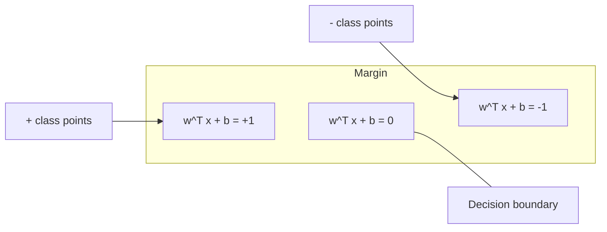
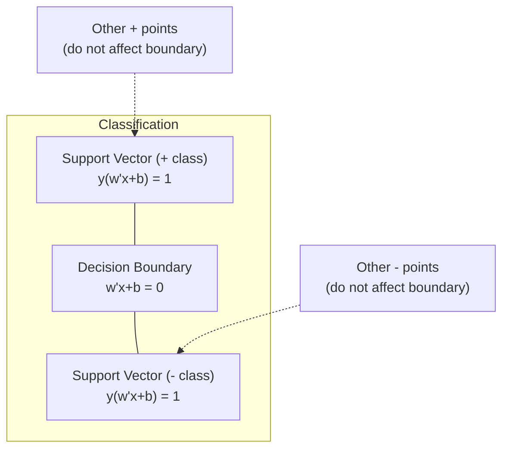
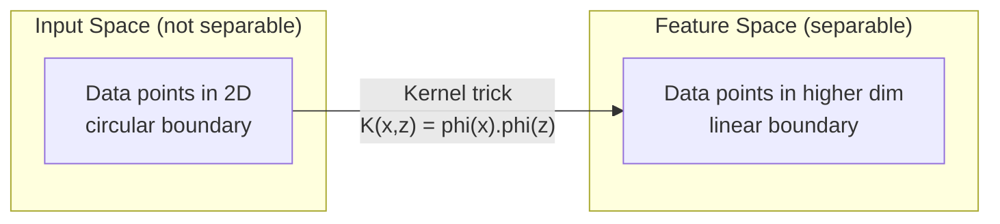

## Learning Objectives

- Implement a linear SVM from scratch using hinge loss and gradient descent on the primal formulation
- Explain the maximum margin principle and identify support vectors from a trained model
- Compare linear, polynomial, and RBF kernels and explain how the kernel trick avoids explicit high-dimensional mapping
- Evaluate the tradeoff controlled by the C parameter between margin width and classification errors

## The Problem

You have two classes of data points and need to draw a line (or hyperplane) separating them. Infinitely many lines could work. Which one should you pick?

The one with the biggest margin. The margin is the distance between the decision boundary and the nearest data points on each side. A wider margin means the classifier is more confident and generalizes better to unseen data.

This intuition leads to Support Vector Machines, one of the most mathematically elegant algorithms in ML. SVMs were the dominant classification method before deep learning and remain the best choice for small datasets, high-dimensional data, and problems where you need a principled, well-understood model with theoretical guarantees.

SVMs connect directly to Phase 1: the optimization is convex (Lesson 18), the margin is measured with norms (Lesson 14), and the kernel trick exploits dot products to handle nonlinear boundaries without ever computing in the high-dimensional space.

## The Concept

### The maximum margin classifier

Given linearly separable data with labels y_i in {-1, +1} and feature vectors x_i, we want a hyperplane w^T x + b = 0 that separates the classes.

The distance from a point x_i to the hyperplane is:

```
distance = |w^T x_i + b| / ||w||
```

For a correctly classified point: y_i * (w^T x_i + b) > 0. The margin is twice the distance from the hyperplane to the nearest point on either side.



The optimization problem:

```
maximize    2 / ||w||     (the margin width)
subject to  y_i * (w^T x_i + b) >= 1  for all i
```

Equivalently (minimizing ||w||^2 is easier to optimize):

```
minimize    (1/2) ||w||^2
subject to  y_i * (w^T x_i + b) >= 1  for all i
```

This is a convex quadratic program. It has a unique global solution. The data points that sit exactly on the margin boundaries (where y_i * (w^T x_i + b) = 1) are the support vectors. They are the only points that determine the decision boundary. Move or remove any non-support-vector point, and the boundary does not change.

```plotly
{"recipe": "svm_margin", "title": "SVM — maximum margin hyperplane and support vectors"}
```

### Support vectors: the critical few



Most training points are irrelevant. Only the support vectors matter. This is why SVMs are memory-efficient at prediction time: you only need to store the support vectors, not the entire training set.

The number of support vectors also gives a bound on generalization error. Fewer support vectors relative to the dataset size means better generalization.

### Soft margin: handling noise with the C parameter

Real data is rarely perfectly separable. Some points may be on the wrong side of the boundary, or inside the margin. The soft margin formulation allows violations by introducing slack variables.

```
minimize    (1/2) ||w||^2 + C * sum(xi_i)
subject to  y_i * (w^T x_i + b) >= 1 - xi_i
            xi_i >= 0  for all i
```

The slack variable xi_i measures how much point i violates the margin. C controls the trade-off:

| C value | Behavior |
|---------|----------|
| Large C | Penalizes violations heavily. Narrow margin, fewer misclassifications. Overfits |
| Small C | Allows more violations. Wide margin, more misclassifications. Underfits |

C is the regularization strength, inverted. Large C = less regularization. Small C = more regularization.

### Hinge loss: the SVM loss function

The soft margin SVM can be rewritten as an unconstrained optimization:

```
minimize    (1/2) ||w||^2 + C * sum(max(0, 1 - y_i * (w^T x_i + b)))
```

The term max(0, 1 - y_i * f(x_i)) is the hinge loss. It is zero when the point is correctly classified and beyond the margin. It is linear when the point is inside the margin or misclassified.

```
Hinge loss for a single point:

loss
  |
  | \
  |  \
  |   \
  |    \
  |     \_______________
  |
  +-----|-----|-------->  y * f(x)
       0     1

Zero loss when y*f(x) >= 1 (correctly classified, outside margin).
Linear penalty when y*f(x) < 1.
```

Compare with logistic loss (logistic regression):

```
Hinge:     max(0, 1 - y*f(x))          Hard cutoff at margin
Logistic:  log(1 + exp(-y*f(x)))        Smooth, never exactly zero
```

Hinge loss produces sparse solutions (only support vectors have nonzero contribution). Logistic loss uses all data points. This makes SVMs more memory-efficient at prediction time.

### Training a linear SVM with gradient descent

You can train a linear SVM using gradient descent on the hinge loss plus L2 regularization, without solving the constrained QP:

```
L(w, b) = (lambda/2) * ||w||^2 + (1/n) * sum(max(0, 1 - y_i * (w^T x_i + b)))

Gradient with respect to w:
  If y_i * (w^T x_i + b) >= 1:  dL/dw = lambda * w
  If y_i * (w^T x_i + b) < 1:   dL/dw = lambda * w - y_i * x_i

Gradient with respect to b:
  If y_i * (w^T x_i + b) >= 1:  dL/db = 0
  If y_i * (w^T x_i + b) < 1:   dL/db = -y_i
```

This is called the primal formulation. It runs in O(n * d) per epoch, where n is the number of samples and d is the number of features. For large, sparse, high-dimensional data (text classification), this is fast.

### The dual formulation and the kernel trick

The Lagrangian dual of the SVM problem (from Phase 1 Lesson 18, KKT conditions) is:

```
maximize    sum(alpha_i) - (1/2) * sum_ij(alpha_i * alpha_j * y_i * y_j * (x_i . x_j))
subject to  0 <= alpha_i <= C
            sum(alpha_i * y_i) = 0
```

The dual only involves dot products x_i . x_j between data points. This is the key insight. Replace every dot product with a kernel function K(x_i, x_j) and the SVM can learn nonlinear boundaries without ever computing the transformation explicitly.

```
Linear kernel:      K(x, z) = x . z
Polynomial kernel:  K(x, z) = (x . z + c)^d
RBF (Gaussian):     K(x, z) = exp(-gamma * ||x - z||^2)
```

The RBF kernel maps data into an infinite-dimensional space. Points that are close in input space have kernel value near 1. Points that are far apart have kernel value near 0. It can learn any smooth decision boundary.



The kernel trick computes the dot product in the high-dimensional space without ever going there. For the polynomial kernel of degree d in D dimensions, the explicit feature space has O(D^d) dimensions. But K(x, z) is computed in O(D) time.

### SVM for regression (SVR)

Support Vector Regression fits a tube of width epsilon around the data. Points inside the tube have zero loss. Points outside the tube are penalized linearly.

```
minimize    (1/2) ||w||^2 + C * sum(xi_i + xi_i*)
subject to  y_i - (w^T x_i + b) <= epsilon + xi_i
            (w^T x_i + b) - y_i <= epsilon + xi_i*
            xi_i, xi_i* >= 0
```

The epsilon parameter controls the tube width. Wider tube = fewer support vectors = smoother fit. Narrower tube = more support vectors = tighter fit.

### Why SVMs lost to deep learning (and when they still win)

SVMs dominated ML from the late 1990s through the early 2010s. Deep learning surpassed them for several reasons:

| Factor | SVMs | Deep learning |
|--------|------|---------------|
| Feature engineering | Requires it | Learns features |
| Scalability | O(n^2) to O(n^3) for kernel | O(n) per epoch with SGD |
| Image/text/audio | Needs handcrafted features | Learns from raw data |
| Large datasets (>100k) | Slow | Scales well |
| GPU acceleration | Limited benefit | Massive speedup |

SVMs still win in these situations:
- Small datasets (hundreds to low thousands of samples)
- High-dimensional sparse data (text with TF-IDF features)
- When you need mathematical guarantees (margin bounds)
- When training time must be minimal (linear SVM is very fast)
- Binary classification with clear margin structure
- Anomaly detection (one-class SVM)

## Build It

### Step 1: Hinge loss and gradient

The foundation. Compute hinge loss for a batch and its gradient.

```python
def hinge_loss(X, y, w, b):
    n = len(X)
    total_loss = 0.0
    for i in range(n):
        margin = y[i] * (dot(w, X[i]) + b)
        total_loss += max(0.0, 1.0 - margin)
    return total_loss / n
```

### Step 2: Linear SVM via gradient descent

Train by minimizing regularized hinge loss. No QP solver needed.

```python
class LinearSVM:
    def __init__(self, lr=0.001, lambda_param=0.01, n_epochs=1000):
        self.lr = lr
        self.lambda_param = lambda_param
        self.n_epochs = n_epochs
        self.w = None
        self.b = 0.0

    def fit(self, X, y):
        n_features = len(X[0])
        self.w = [0.0] * n_features
        self.b = 0.0

        for epoch in range(self.n_epochs):
            for i in range(len(X)):
                margin = y[i] * (dot(self.w, X[i]) + self.b)
                if margin >= 1:
                    self.w = [wj - self.lr * self.lambda_param * wj
                              for wj in self.w]
                else:
                    self.w = [wj - self.lr * (self.lambda_param * wj - y[i] * X[i][j])
                              for j, wj in enumerate(self.w)]
                    self.b -= self.lr * (-y[i])

    def predict(self, X):
        return [1 if dot(self.w, x) + self.b >= 0 else -1 for x in X]
```

### Step 3: Kernel functions

Implement linear, polynomial, and RBF kernels.

```python
def linear_kernel(x, z):
    return dot(x, z)

def polynomial_kernel(x, z, degree=3, c=1.0):
    return (dot(x, z) + c) ** degree

def rbf_kernel(x, z, gamma=0.5):
    diff = [xi - zi for xi, zi in zip(x, z)]
    return math.exp(-gamma * dot(diff, diff))
```

### Step 4: Margin and support vector identification

After training, identify which points are support vectors and compute the margin width.

```python
def find_support_vectors(X, y, w, b, tol=1e-3):
    support_vectors = []
    for i in range(len(X)):
        margin = y[i] * (dot(w, X[i]) + b)
        if abs(margin - 1.0) < tol:
            support_vectors.append(i)
    return support_vectors
```

See `code/svm.py` for the complete implementation with all demos.

## Use It

With scikit-learn:

```python
from sklearn.svm import SVC, LinearSVC, SVR
from sklearn.preprocessing import StandardScaler
from sklearn.pipeline import Pipeline

clf = Pipeline([
    ("scaler", StandardScaler()),
    ("svm", SVC(kernel="rbf", C=1.0, gamma="scale")),
])
clf.fit(X_train, y_train)
print(f"Accuracy: {clf.score(X_test, y_test):.4f}")
print(f"Support vectors: {clf['svm'].n_support_}")
```

Important: always scale your features before training an SVM. SVMs are sensitive to feature magnitudes because the margin depends on ||w||, and unscaled features distort the geometry.

For large datasets, use `LinearSVC` (primal formulation, O(n) per epoch) instead of `SVC` (dual formulation, O(n^2) to O(n^3)):

```python
from sklearn.svm import LinearSVC

clf = Pipeline([
    ("scaler", StandardScaler()),
    ("svm", LinearSVC(C=1.0, max_iter=10000)),
])
```

## Exercises

1. Generate a 2D linearly separable dataset. Train your LinearSVM and identify the support vectors. Verify that the support vectors are the points closest to the decision boundary.

2. Vary C from 0.001 to 1000 on a noisy dataset. Plot the decision boundary for each C value. Observe the transition from wide margin (underfitting) to narrow margin (overfitting).

3. Create a dataset where class boundaries are circular (not linear). Show that a linear SVM fails. Compute the RBF kernel matrix and show that the classes become separable in the kernel-induced feature space.

4. Compare hinge loss vs logistic loss on the same dataset. Train a linear SVM and logistic regression. Count how many training points contribute to each model's decision boundary (support vectors vs all points).

5. Implement SVR (epsilon-insensitive loss). Fit it to y = sin(x) + noise. Plot the epsilon tube around the predictions and highlight the support vectors (points outside the tube).

## Key Terms

| Term | What it actually means |
|------|----------------------|
| Support vectors | The training points closest to the decision boundary. The only points that determine the hyperplane |
| Margin | The distance between the decision boundary and the nearest support vectors. SVMs maximize this |
| Hinge loss | max(0, 1 - y*f(x)). Zero when correctly classified and outside the margin. Linear penalty otherwise |
| C parameter | Trade-off between margin width and classification errors. Large C = narrow margin, small C = wide margin |
| Soft margin | SVM formulation that allows margin violations via slack variables. Handles non-separable data |
| Kernel trick | Computing dot products in a high-dimensional feature space without explicitly mapping to that space |
| Linear kernel | K(x, z) = x . z. Equivalent to standard dot product. For linearly separable data |
| RBF kernel | K(x, z) = exp(-gamma * \|\|x-z\|\|^2). Maps to infinite dimensions. Learns any smooth boundary |
| Polynomial kernel | K(x, z) = (x . z + c)^d. Maps to a feature space of polynomial combinations |
| Dual formulation | Reformulation of the SVM problem that depends only on dot products between data points. Enables kernels |
| SVR | Support Vector Regression. Fits an epsilon-tube around the data. Points inside the tube have zero loss |
| Slack variables | xi_i: measures how much a point violates the margin. Zero for correctly classified points outside margin |
| Maximum margin | The principle of choosing the hyperplane that maximizes the distance to the nearest points of each class |

## Further Reading

- [Vapnik: The Nature of Statistical Learning Theory (1995)](https://link.springer.com/book/10.1007/978-1-4757-3264-1) - the foundational text on SVMs and statistical learning
- [Cortes & Vapnik: Support-vector networks (1995)](https://link.springer.com/article/10.1007/BF00994018) - the original SVM paper
- [Platt: Sequential Minimal Optimization (1998)](https://www.microsoft.com/en-us/research/publication/sequential-minimal-optimization-a-fast-algorithm-for-training-support-vector-machines/) - the SMO algorithm that made SVM training practical
- [scikit-learn SVM documentation](https://scikit-learn.org/stable/modules/svm.html) - practical guide with implementation details
- [LIBSVM: A Library for Support Vector Machines](https://www.csie.ntu.edu.tw/~cjlin/libsvm/) - the C++ library behind most SVM implementations

## Full Code

```python
import math
import random


def dot(a, b):
    return sum(ai * bi for ai, bi in zip(a, b))


def vec_add(a, b):
    return [ai + bi for ai, bi in zip(a, b)]


def vec_sub(a, b):
    return [ai - bi for ai, bi in zip(a, b)]


def vec_scale(a, s):
    return [ai * s for ai in a]


def vec_norm(a):
    return math.sqrt(dot(a, a))


def linear_kernel(x, z):
    return dot(x, z)


def polynomial_kernel(x, z, degree=3, c=1.0):
    return (dot(x, z) + c) ** degree


def rbf_kernel(x, z, gamma=0.5):
    diff = vec_sub(x, z)
    return math.exp(-gamma * dot(diff, diff))


def hinge_loss(X, y, w, b):
    n = len(X)
    total = 0.0
    for i in range(n):
        margin = y[i] * (dot(w, X[i]) + b)
        total += max(0.0, 1.0 - margin)
    return total / n


def svm_objective(X, y, w, b, lambda_param):
    reg = 0.5 * lambda_param * dot(w, w)
    loss = hinge_loss(X, y, w, b)
    return reg + loss


class LinearSVM:
    def __init__(self, lr=0.001, lambda_param=0.01, n_epochs=1000):
        self.lr = lr
        self.lambda_param = lambda_param
        self.n_epochs = n_epochs
        self.w = None
        self.b = 0.0
        self.loss_history = []

    def fit(self, X, y):
        n_features = len(X[0])
        n_samples = len(X)
        self.w = [0.0] * n_features
        self.b = 0.0
        self.loss_history = []

        for epoch in range(self.n_epochs):
            indices = list(range(n_samples))
            random.shuffle(indices)

            for i in indices:
                margin = y[i] * (dot(self.w, X[i]) + self.b)

                if margin >= 1:
                    self.w = [
                        wj - self.lr * self.lambda_param * wj
                        for wj in self.w
                    ]
                else:
                    self.w = [
                        wj - self.lr * (self.lambda_param * wj - y[i] * X[i][j])
                        for j, wj in enumerate(self.w)
                    ]
                    self.b -= self.lr * (-y[i])

            if epoch % 100 == 0 or epoch == self.n_epochs - 1:
                loss = svm_objective(X, y, self.w, self.b, self.lambda_param)
                self.loss_history.append((epoch, loss))

    def predict(self, X):
        return [1 if dot(self.w, x) + self.b >= 0 else -1 for x in X]

    def decision_function(self, X):
        return [dot(self.w, x) + self.b for x in X]

    def margin_width(self):
        w_norm = vec_norm(self.w)
        if w_norm == 0:
            return 0.0
        return 2.0 / w_norm

    def find_support_vectors(self, X, y, tol=0.1):
        svs = []
        for i in range(len(X)):
            margin = y[i] * (dot(self.w, X[i]) + self.b)
            if abs(margin - 1.0) < tol:
                svs.append(i)
        return svs


def accuracy(y_true, y_pred):
    correct = sum(1 for a, b in zip(y_true, y_pred) if a == b)
    return correct / len(y_true)


def generate_linear_data(n_samples=100, margin=1.0, seed=42):
    random.seed(seed)
    X = []
    y = []
    for _ in range(n_samples):
        x1 = random.uniform(-3, 3)
        x2 = random.uniform(-3, 3)
        val = x1 + x2
        if val > margin / 2:
            X.append([x1, x2])
            y.append(1)
        elif val < -margin / 2:
            X.append([x1, x2])
            y.append(-1)
    return X, y


def generate_noisy_data(n_samples=200, noise=0.5, seed=42):
    random.seed(seed)
    X = []
    y = []
    for _ in range(n_samples):
        x1 = random.uniform(-3, 3)
        x2 = random.uniform(-3, 3)
        val = x1 - 0.5 * x2 + random.gauss(0, noise)
        label = 1 if val > 0 else -1
        X.append([x1, x2])
        y.append(label)
    return X, y


def generate_circular_data(n_samples=200, seed=42):
    random.seed(seed)
    X = []
    y = []
    for _ in range(n_samples):
        r = random.uniform(0, 3)
        angle = random.uniform(0, 2 * math.pi)
        x1 = r * math.cos(angle) + random.gauss(0, 0.1)
        x2 = r * math.sin(angle) + random.gauss(0, 0.1)
        label = 1 if r > 1.5 else -1
        X.append([x1, x2])
        y.append(label)
    return X, y


def train_test_split(X, y, test_ratio=0.2, seed=42):
    random.seed(seed)
    n = len(X)
    indices = list(range(n))
    random.shuffle(indices)
    split = int(n * (1 - test_ratio))
    train_idx = indices[:split]
    test_idx = indices[split:]
    return (
        [X[i] for i in train_idx],
        [y[i] for i in train_idx],
        [X[i] for i in test_idx],
        [y[i] for i in test_idx],
    )


def compute_kernel_matrix(X, kernel_fn, **kwargs):
    n = len(X)
    K = [[0.0] * n for _ in range(n)]
    for i in range(n):
        for j in range(i, n):
            val = kernel_fn(X[i], X[j], **kwargs)
            K[i][j] = val
            K[j][i] = val
    return K


def demo_hinge_loss():
    print("=" * 65)
    print("HINGE LOSS: THE SVM LOSS FUNCTION")
    print("=" * 65)
    print()

    margins = [-2.0, -1.0, -0.5, 0.0, 0.5, 1.0, 1.5, 2.0, 3.0]
    print(f"  {'y * f(x)':>10s}  {'Hinge loss':>12s}  {'Logistic loss':>14s}  {'Visual':>20s}")
    print(f"  {'-' * 10}  {'-' * 12}  {'-' * 14}  {'-' * 20}")

    for m in margins:
        h_loss = max(0.0, 1.0 - m)
        l_loss = math.log(1 + math.exp(-m))
        bar_len = int(h_loss * 5)
        bar = "#" * bar_len
        print(f"  {m:>10.1f}  {h_loss:>12.3f}  {l_loss:>14.3f}  {bar}")

    print()
    print("  Hinge loss is exactly zero when y*f(x) >= 1 (outside margin).")
    print("  Logistic loss is never exactly zero. Always uses all data points.")
    print()


def demo_linear_svm():
    print("=" * 65)
    print("LINEAR SVM: MAXIMUM MARGIN CLASSIFIER")
    print("=" * 65)
    print()

    X, y = generate_linear_data(200, margin=1.0, seed=42)
    X_train, y_train, X_test, y_test = train_test_split(X, y)

    print(f"  Dataset: {len(X)} samples, linearly separable")
    print(f"  Train: {len(X_train)}  Test: {len(X_test)}")
    print()

    svm = LinearSVM(lr=0.001, lambda_param=0.01, n_epochs=500)
    svm.fit(X_train, y_train)

    train_pred = svm.predict(X_train)
    test_pred = svm.predict(X_test)
    train_acc = accuracy(y_train, train_pred)
    test_acc = accuracy(y_test, test_pred)

    print(f"  Weights: [{svm.w[0]:.4f}, {svm.w[1]:.4f}]")
    print(f"  Bias: {svm.b:.4f}")
    print(f"  Margin width: {svm.margin_width():.4f}")
    print(f"  Train accuracy: {train_acc:.4f}")
    print(f"  Test accuracy: {test_acc:.4f}")

    svs = svm.find_support_vectors(X_train, y_train, tol=0.3)
    print(f"  Support vectors: {len(svs)} / {len(X_train)} training points")
    print()

    print("  Training loss progression:")
    print(f"  {'Epoch':>8s}  {'Loss':>10s}")
    print(f"  {'-' * 8}  {'-' * 10}")
    for epoch, loss in svm.loss_history:
        print(f"  {epoch:>8d}  {loss:>10.4f}")
    print()


def demo_c_parameter():
    print("=" * 65)
    print("C PARAMETER: REGULARIZATION TRADE-OFF")
    print("=" * 65)
    print()

    X, y = generate_noisy_data(300, noise=0.8, seed=42)
    X_train, y_train, X_test, y_test = train_test_split(X, y)

    print(f"  Dataset: {len(X)} samples with noise (not perfectly separable)")
    print(f"  Train: {len(X_train)}  Test: {len(X_test)}")
    print()

    c_values = [0.001, 0.01, 0.1, 1.0, 10.0, 100.0]
    print(f"  {'C':>8s}  {'lambda':>8s}  {'Train Acc':>10s}  {'Test Acc':>10s}  {'Margin':>8s}  {'SVs':>6s}")
    print(f"  {'-' * 8}  {'-' * 8}  {'-' * 10}  {'-' * 10}  {'-' * 8}  {'-' * 6}")

    for c in c_values:
        lam = 1.0 / (c * len(X_train))
        svm = LinearSVM(lr=0.001, lambda_param=lam, n_epochs=500)
        svm.fit(X_train, y_train)

        train_acc = accuracy(y_train, svm.predict(X_train))
        test_acc = accuracy(y_test, svm.predict(X_test))
        margin = svm.margin_width()
        n_sv = len(svm.find_support_vectors(X_train, y_train, tol=0.3))

        print(f"  {c:>8.3f}  {lam:>8.5f}  {train_acc:>10.4f}  {test_acc:>10.4f}  "
              f"{margin:>8.4f}  {n_sv:>6d}")

    print()
    print("  Small C (large lambda): wide margin, more errors, better generalization.")
    print("  Large C (small lambda): narrow margin, fewer errors, risk of overfitting.")
    print()


def demo_kernel_functions():
    print("=" * 65)
    print("KERNEL FUNCTIONS: SIMILARITY IN DIFFERENT SPACES")
    print("=" * 65)
    print()

    x = [1.0, 0.0]
    points = [
        ("same direction", [2.0, 0.0]),
        ("perpendicular", [0.0, 1.0]),
        ("close", [1.1, 0.1]),
        ("far same dir", [5.0, 0.0]),
        ("opposite", [-1.0, 0.0]),
    ]

    print(f"  Reference point: {x}")
    print()
    print(f"  {'Point':<20s}  {'Linear':>8s}  {'Poly(d=2)':>10s}  {'Poly(d=3)':>10s}  {'RBF(g=0.5)':>10s}")
    print(f"  {'-' * 20}  {'-' * 8}  {'-' * 10}  {'-' * 10}  {'-' * 10}")

    for name, z in points:
        k_lin = linear_kernel(x, z)
        k_p2 = polynomial_kernel(x, z, degree=2)
        k_p3 = polynomial_kernel(x, z, degree=3)
        k_rbf = rbf_kernel(x, z, gamma=0.5)
        print(f"  {name:<20s}  {k_lin:>8.3f}  {k_p2:>10.3f}  {k_p3:>10.3f}  {k_rbf:>10.4f}")

    print()
    print("  Linear kernel: raw dot product. Measures projection.")
    print("  Polynomial kernel: captures feature interactions up to degree d.")
    print("  RBF kernel: locality-based. High for nearby points, near zero for distant.")
    print()


def demo_kernel_matrix():
    print("=" * 65)
    print("KERNEL MATRIX: RBF ON CIRCULAR DATA")
    print("=" * 65)
    print()

    X, y = generate_circular_data(20, seed=42)

    K_linear = compute_kernel_matrix(X, linear_kernel)
    K_rbf = compute_kernel_matrix(X, rbf_kernel, gamma=1.0)

    print(f"  Generated {len(X)} points with circular decision boundary")
    print()

    pos_pos_lin = []
    pos_neg_lin = []
    neg_neg_lin = []
    pos_pos_rbf = []
    pos_neg_rbf = []
    neg_neg_rbf = []

    for i in range(len(X)):
        for j in range(i + 1, len(X)):
            if y[i] == 1 and y[j] == 1:
                pos_pos_lin.append(K_linear[i][j])
                pos_pos_rbf.append(K_rbf[i][j])
            elif y[i] == -1 and y[j] == -1:
                neg_neg_lin.append(K_linear[i][j])
                neg_neg_rbf.append(K_rbf[i][j])
            else:
                pos_neg_lin.append(K_linear[i][j])
                pos_neg_rbf.append(K_rbf[i][j])

    def safe_mean(lst):
        return sum(lst) / len(lst) if lst else 0.0

    print(f"  Average kernel values between classes:")
    print(f"  {'Pair':<15s}  {'Linear':>10s}  {'RBF(g=1)':>10s}")
    print(f"  {'-' * 15}  {'-' * 10}  {'-' * 10}")
    print(f"  {'Same (+/+)':<15s}  {safe_mean(pos_pos_lin):>10.4f}  {safe_mean(pos_pos_rbf):>10.4f}")
    print(f"  {'Same (-/-)':<15s}  {safe_mean(neg_neg_lin):>10.4f}  {safe_mean(neg_neg_rbf):>10.4f}")
    print(f"  {'Different':<15s}  {safe_mean(pos_neg_lin):>10.4f}  {safe_mean(pos_neg_rbf):>10.4f}")
    print()
    print("  Linear kernel: cannot separate circular classes well.")
    print("  RBF kernel: creates separation by measuring local similarity.")
    print()


def demo_linear_vs_nonlinear():
    print("=" * 65)
    print("LINEAR SVM vs NONLINEAR BOUNDARY")
    print("=" * 65)
    print()

    X, y = generate_circular_data(200, seed=42)
    X_train, y_train, X_test, y_test = train_test_split(X, y)

    svm = LinearSVM(lr=0.001, lambda_param=0.01, n_epochs=500)
    svm.fit(X_train, y_train)

    train_acc = accuracy(y_train, svm.predict(X_train))
    test_acc = accuracy(y_test, svm.predict(X_test))

    print(f"  Circular data (not linearly separable)")
    print(f"  Linear SVM: train acc = {train_acc:.4f}, test acc = {test_acc:.4f}")
    print()

    X_train_aug = [
        [x[0], x[1], x[0] ** 2, x[1] ** 2, x[0] * x[1]]
        for x in X_train
    ]
    X_test_aug = [
        [x[0], x[1], x[0] ** 2, x[1] ** 2, x[0] * x[1]]
        for x in X_test
    ]

    svm_aug = LinearSVM(lr=0.0005, lambda_param=0.01, n_epochs=1000)
    svm_aug.fit(X_train_aug, y_train)

    train_acc_aug = accuracy(y_train, svm_aug.predict(X_train_aug))
    test_acc_aug = accuracy(y_test, svm_aug.predict(X_test_aug))

    print(f"  After polynomial feature mapping (x1, x2) -> (x1, x2, x1^2, x2^2, x1*x2):")
    print(f"  Linear SVM on augmented features: train acc = {train_acc_aug:.4f}, "
          f"test acc = {test_acc_aug:.4f}")
    print()
    print("  The kernel trick does this feature mapping implicitly.")
    print("  You compute K(x, z) instead of explicitly constructing the features.")
    print()


def demo_support_vectors():
    print("=" * 65)
    print("SUPPORT VECTORS: THE CRITICAL FEW")
    print("=" * 65)
    print()

    X, y = generate_linear_data(200, margin=1.5, seed=42)
    X_train, y_train, X_test, y_test = train_test_split(X, y)

    svm = LinearSVM(lr=0.001, lambda_param=0.01, n_epochs=1000)
    svm.fit(X_train, y_train)

    margins = []
    for i in range(len(X_train)):
        m = y_train[i] * (dot(svm.w, X_train[i]) + svm.b)
        margins.append((i, m))

    margins.sort(key=lambda x: x[1])

    print(f"  Trained on {len(X_train)} points")
    print(f"  Weights: [{svm.w[0]:.4f}, {svm.w[1]:.4f}], bias: {svm.b:.4f}")
    print()
    print("  Points sorted by margin (y * f(x)):")
    print(f"  {'Index':>6s}  {'y':>4s}  {'Margin':>8s}  {'Role':<20s}")
    print(f"  {'-' * 6}  {'-' * 4}  {'-' * 8}  {'-' * 20}")

    for i, (idx, m) in enumerate(margins[:8]):
        if m < 0:
            role = "MISCLASSIFIED"
        elif m < 1.0:
            role = "inside margin"
        elif m < 1.2:
            role = "SUPPORT VECTOR"
        else:
            role = "safely classified"
        print(f"  {idx:>6d}  {y_train[idx]:>4d}  {m:>8.4f}  {role:<20s}")

    print(f"  ...")
    for i, (idx, m) in enumerate(margins[-3:]):
        role = "safely classified"
        print(f"  {idx:>6d}  {y_train[idx]:>4d}  {m:>8.4f}  {role:<20s}")

    n_sv = sum(1 for _, m in margins if 0.7 < m < 1.3)
    n_safe = sum(1 for _, m in margins if m >= 1.3)
    n_inside = sum(1 for _, m in margins if 0 < m < 0.7)

    print()
    print(f"  Support vectors (margin ~ 1.0): {n_sv}")
    print(f"  Safely classified (margin >> 1): {n_safe}")
    print(f"  Inside margin (0 < margin < 1): {n_inside}")
    print(f"  Only {n_sv} out of {len(X_train)} points define the boundary.")
    print()


def demo_svm_vs_logistic():
    print("=" * 65)
    print("SVM vs LOGISTIC REGRESSION: LOSS COMPARISON")
    print("=" * 65)
    print()

    X, y = generate_noisy_data(200, noise=0.3, seed=42)
    X_train, y_train, X_test, y_test = train_test_split(X, y)

    svm = LinearSVM(lr=0.001, lambda_param=0.01, n_epochs=500)
    svm.fit(X_train, y_train)
    svm_test_acc = accuracy(y_test, svm.predict(X_test))

    w_lr = [0.0, 0.0]
    b_lr = 0.0
    lr_rate = 0.01
    for epoch in range(500):
        for i in range(len(X_train)):
            z = dot(w_lr, X_train[i]) + b_lr
            z = max(-500, min(500, z))
            p = 1.0 / (1.0 + math.exp(-z))
            y_01 = (y_train[i] + 1) / 2
            error = p - y_01
            for j in range(len(w_lr)):
                w_lr[j] -= lr_rate * error * X_train[i][j]
            b_lr -= lr_rate * error

    lr_pred = [1 if dot(w_lr, x) + b_lr >= 0 else -1 for x in X_test]
    lr_test_acc = accuracy(y_test, lr_pred)

    svm_svs = len(svm.find_support_vectors(X_train, y_train, tol=0.5))

    print(f"  SVM test accuracy:              {svm_test_acc:.4f}")
    print(f"  Logistic regression test acc:   {lr_test_acc:.4f}")
    print()
    print(f"  SVM support vectors:            {svm_svs} / {len(X_train)}")
    print(f"  Logistic regression:            ALL {len(X_train)} points used")
    print()
    print("  SVM: sparse model, only support vectors matter at prediction time.")
    print("  Logistic: dense model, all training points contribute.")
    print()


def demo_margin_effect():
    print("=" * 65)
    print("MARGIN WIDTH AND GENERALIZATION")
    print("=" * 65)
    print()

    margins = [0.5, 1.0, 2.0, 3.0]
    print(f"  {'Data margin':>12s}  {'SVM margin':>12s}  {'Train Acc':>10s}  {'Test Acc':>10s}")
    print(f"  {'-' * 12}  {'-' * 12}  {'-' * 10}  {'-' * 10}")

    for data_margin in margins:
        X, y = generate_linear_data(200, margin=data_margin, seed=42)
        X_train, y_train, X_test, y_test = train_test_split(X, y)

        svm = LinearSVM(lr=0.001, lambda_param=0.01, n_epochs=500)
        svm.fit(X_train, y_train)

        train_acc = accuracy(y_train, svm.predict(X_train))
        test_acc = accuracy(y_test, svm.predict(X_test))

        print(f"  {data_margin:>12.1f}  {svm.margin_width():>12.4f}  "
              f"{train_acc:>10.4f}  {test_acc:>10.4f}")

    print()
    print("  Wider data separation = wider learned margin = better generalization.")
    print()


def print_summary():
    print()
    print("=" * 65)
    print("SUMMARY")
    print("=" * 65)
    print()
    print("  1. SVMs find the maximum margin hyperplane between classes.")
    print("  2. Only support vectors determine the boundary.")
    print("  3. Hinge loss produces sparse models (zero loss outside margin).")
    print("  4. The C parameter trades off margin width vs classification errors.")
    print("  5. The kernel trick enables nonlinear boundaries via dot products.")
    print("  6. RBF kernel maps to infinite dimensions using local similarity.")
    print("  7. Linear SVMs train in O(n*d) per epoch using gradient descent.")
    print("  8. SVMs still win on small datasets and high-dimensional sparse data.")
    print()


if __name__ == "__main__":
    demo_hinge_loss()
    demo_linear_svm()
    demo_c_parameter()
    demo_kernel_functions()
    demo_kernel_matrix()
    demo_linear_vs_nonlinear()
    demo_support_vectors()
    demo_svm_vs_logistic()
    demo_margin_effect()
    print_summary()
```
