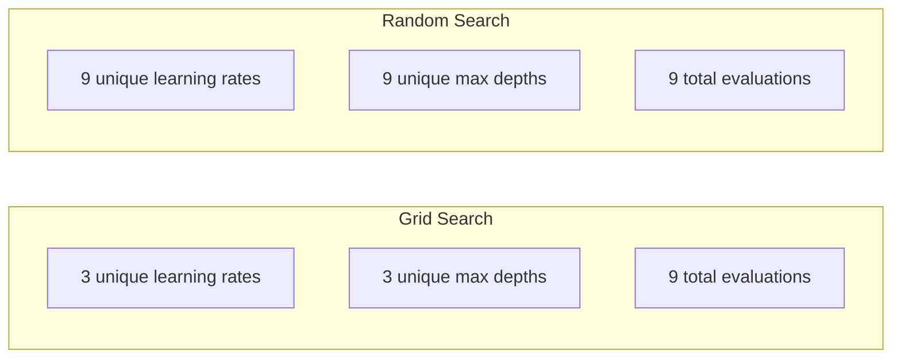
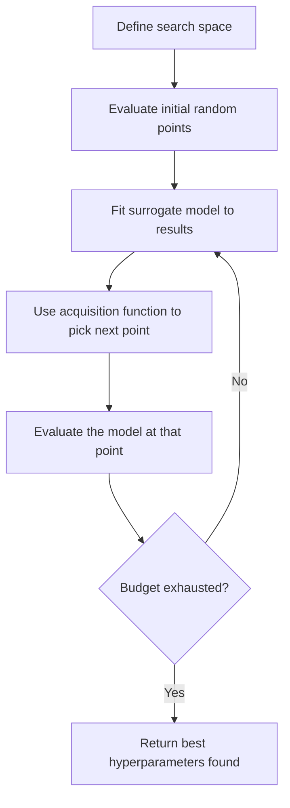
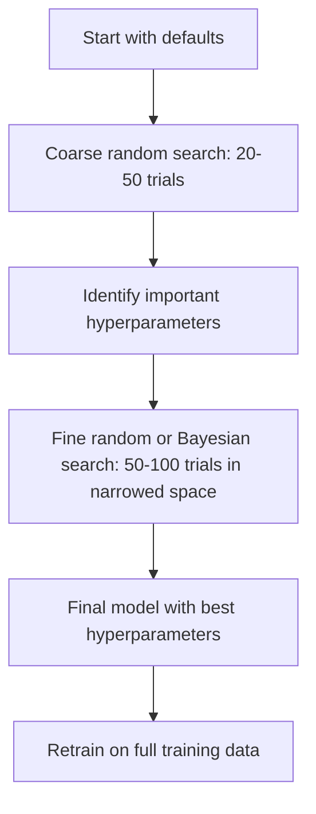
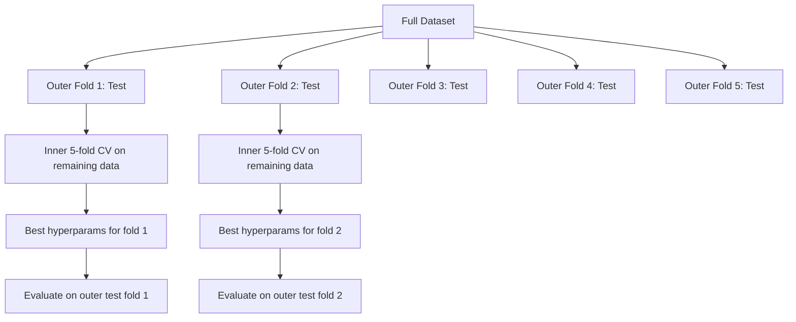

# Hyperparameter Tuning

> Hyperparameters are the knobs you turn before training starts. Turning them well is the difference between a mediocre model and a great one.

## Learning Objectives

- Implement grid search, random search, and Bayesian optimization from scratch and compare their sample efficiency
- Explain why random search outperforms grid search when most hyperparameters have low effective dimensionality
- Build a Bayesian optimization loop using a surrogate model and acquisition function to guide the search
- Design a hyperparameter tuning strategy that avoids overfitting the validation set through proper cross-validation

## The Problem

Your gradient boosting model has a learning rate, number of trees, max depth, min samples per leaf, subsample ratio, and column sample ratio. That is six hyperparameters. If each has 5 reasonable values, the grid has 5^6 = 15,625 combinations. Training each takes 10 seconds. That is 43 hours of compute to try them all.

Grid search is the obvious approach and the worst one at scale. Random search does better with less compute. Bayesian optimization does even better by learning from past evaluations. Knowing which strategy to use, and which hyperparameters actually matter, saves days of wasted GPU time.

## The Concept

### Parameters vs Hyperparameters

Parameters are learned during training (weights, biases, split thresholds). Hyperparameters are set before training starts and control how learning happens.

| Hyperparameter | What it controls | Typical range |
|---------------|-----------------|---------------|
| Learning rate | Step size per update | 0.001 to 1.0 |
| Number of trees/epochs | How long to train | 10 to 10,000 |
| Max depth | Model complexity | 1 to 30 |
| Regularization (lambda) | Overfitting prevention | 0.0001 to 100 |
| Batch size | Gradient estimation noise | 16 to 512 |
| Dropout rate | Fraction of neurons dropped | 0.0 to 0.5 |

### Grid Search

Grid search evaluates every combination of specified values. It is exhaustive and easy to understand, but scales exponentially with the number of hyperparameters.

```
Grid for 2 hyperparameters:

  learning_rate: [0.01, 0.1, 1.0]
  max_depth:     [3, 5, 7]

  Evaluations: 3 x 3 = 9 combinations

  (0.01, 3)  (0.01, 5)  (0.01, 7)
  (0.1,  3)  (0.1,  5)  (0.1,  7)
  (1.0,  3)  (1.0,  5)  (1.0,  7)
```

Grid search has a fundamental flaw: if one hyperparameter matters and the other does not, most evaluations are wasted. You get only 3 unique values of the important parameter from 9 evaluations.

### Random Search

Random search samples hyperparameters from distributions instead of a grid. With the same budget of 9 evaluations, you get 9 unique values of each hyperparameter.



Why random beats grid (Bergstra & Bengio, 2012):

- Most hyperparameters have low effective dimensionality. Only 1-2 of 6 hyperparameters usually matter for a given problem.
- Grid search wastes evaluations on unimportant dimensions.
- Random search covers the important dimensions more densely for the same budget.
- At 60 random trials, you have a 95% chance of finding a point within 5% of the optimum (if one exists in the search space).

### Bayesian Optimization

Random search ignores results. It does not learn that high learning rates cause divergence or that depth 3 consistently outperforms depth 10. Bayesian optimization uses past evaluations to decide where to search next.



The two key components:

**Surrogate model:** A cheap-to-evaluate model (usually a Gaussian process) that approximates the expensive objective function. It gives both a prediction and an uncertainty estimate at any point in the search space.

**Acquisition function:** Decides where to evaluate next by balancing exploitation (search near known good points) and exploration (search where uncertainty is high). Common choices:

- **Expected Improvement (EI):** How much improvement over the current best do we expect at this point?
- **Upper Confidence Bound (UCB):** Prediction plus a multiple of uncertainty. Higher UCB means either promising or unexplored.
- **Probability of Improvement (PI):** What is the probability this point beats the current best?

Bayesian optimization typically finds better hyperparameters than random search with 2-5x fewer evaluations. The overhead of fitting the surrogate model is negligible compared to training the actual model.

### Early Stopping

Not every training run needs to finish. If a configuration is clearly bad after 10 epochs, stop it and move on. This is early stopping in the context of hyperparameter search.

Strategies:
- **Patience-based:** Stop if validation loss has not improved for N consecutive epochs
- **Median pruning:** Stop if the trial's intermediate result is worse than the median of completed trials at the same step
- **Hyperband:** Allocate small budgets to many configurations, then progressively increase budget for the best ones

Hyperband is particularly effective. It starts 81 configurations with 1 epoch each, keeps the top third, gives them 3 epochs, keeps the top third, and so on. This finds good configurations 10-50x faster than evaluating all configs for the full budget.

### Learning Rate Schedulers

The learning rate is almost always the most important hyperparameter. Rather than keeping it fixed, schedulers adjust it during training.

| Scheduler | Formula | When to use |
|-----------|---------|-------------|
| Step decay | Multiply by 0.1 every N epochs | Classic CNN training |
| Cosine annealing | lr * 0.5 * (1 + cos(pi * t / T)) | Modern default |
| Warmup + decay | Linear increase then cosine decay | Transformers |
| One-cycle | Increase then decrease over one cycle | Fast convergence |
| Reduce on plateau | Reduce by factor when metric stalls | Safe default |

### Hyperparameter Importance

Not all hyperparameters matter equally. Research on random forests (Probst et al., 2019) and gradient boosting shows consistent patterns:

**High importance:**
- Learning rate (always tune first)
- Number of estimators / epochs (use early stopping instead of tuning)
- Regularization strength

**Medium importance:**
- Max depth / number of layers
- Min samples per leaf / weight decay
- Subsample ratio

**Low importance:**
- Max features (for random forests)
- Specific activation function choice
- Batch size (within reasonable range)

Tune the important ones first, leave the rest at defaults.

### Practical Strategy



The concrete workflow:

1. **Start with library defaults.** They are chosen by experienced practitioners and are often 80% of the way there.
2. **Coarse random search.** Wide ranges, 20-50 trials. Use early stopping to kill bad runs fast.
3. **Analyze results.** Which hyperparameters correlate with performance? Narrow the search space.
4. **Fine search.** Bayesian optimization or focused random search in the narrowed space. 50-100 trials.
5. **Retrain on all training data** with the best hyperparameters found.

### Cross-Validation Integration

Tuning hyperparameters on a single validation split is risky. The best hyperparameters might overfit to the specific validation fold. Nested cross-validation solves this by using two loops:

- **Outer loop** (evaluation): splits data into train+val and test. Reports unbiased performance.
- **Inner loop** (tuning): splits train+val into train and val. Finds best hyperparameters.



Each outer fold finds its own best hyperparameters independently. The outer scores are an unbiased estimate of generalization performance.

```plotly
{"recipe": "validation_curve", "title": "Validation Curve — find the sweet spot: too little regularization overfits, too much underfits"}
```

With sklearn:

```python
from sklearn.model_selection import cross_val_score, GridSearchCV
from sklearn.ensemble import GradientBoostingRegressor

inner_cv = GridSearchCV(
    GradientBoostingRegressor(),
    param_grid={
        "learning_rate": [0.01, 0.05, 0.1],
        "max_depth": [2, 3, 5],
        "n_estimators": [50, 100, 200],
    },
    cv=5,
    scoring="neg_mean_squared_error",
)

outer_scores = cross_val_score(
    inner_cv, X, y, cv=5, scoring="neg_mean_squared_error"
)

print(f"Nested CV MSE: {-outer_scores.mean():.4f} +/- {outer_scores.std():.4f}")
```

This is expensive (5 outer folds x 5 inner folds x 27 grid points = 675 model fits), but it gives you a trustworthy performance estimate. Use it when reporting final results in papers or when the stake of the decision is high.

### Practical Tips

**Start with the learning rate.** It is always the most important hyperparameter for gradient-based methods. A bad learning rate makes everything else irrelevant. Fix other hyperparameters at defaults and sweep learning rate first.

**Use log-uniform distributions for learning rate and regularization.** The difference between 0.001 and 0.01 matters as much as the difference between 0.1 and 1.0. Searching linearly wastes budget on the large end.

**Use early stopping instead of tuning n_estimators.** For boosting and neural networks, set n_estimators or epochs high and let early stopping decide when to stop. This removes one hyperparameter from the search.

**Budget allocation.** Spend 60% of your tuning budget on the top 2 most important hyperparameters. Spend the remaining 40% on everything else. The top 2 account for most of the performance variation.

**Scale matters.** Never search batch size on a log scale (16, 32, 64 are fine). Always search learning rate on a log scale. Match the search distribution to how the hyperparameter affects the model.

| Model Type | Top Hyperparameters | Recommended Search | Budget |
|-----------|--------------------|--------------------|--------|
| Random Forest | n_estimators, max_depth, min_samples_leaf | Random search, 50 trials | Low (fast training) |
| Gradient Boosting | learning_rate, n_estimators, max_depth | Bayesian, 100 trials + early stopping | Medium |
| Neural Network | learning_rate, weight_decay, batch_size | Bayesian or random, 100+ trials | High (slow training) |
| SVM | C, gamma (RBF kernel) | Grid on log scale, 25-50 trials | Low (2 params) |
| Lasso/Ridge | alpha | 1D search on log scale, 20 trials | Very low |
| XGBoost | learning_rate, max_depth, subsample, colsample | Bayesian, 100-200 trials + early stopping | Medium |

**When in doubt:** random search with 2x the number of hyperparameters as trials (e.g., 6 hyperparameters = 12+ trials minimum). You will be surprised how often random search with 50 trials beats carefully designed grid search.

## Build It

### Step 1: Grid Search from Scratch

```python
import numpy as np
import itertools
import time


def make_data(n_samples=400, n_features=8, seed=42):
    rng = np.random.RandomState(seed)
    X = rng.randn(n_samples, n_features)
    y = (
        2.0 * X[:, 0]
        + np.sin(3 * X[:, 1])
        - 0.5 * X[:, 2] ** 2
        + 0.3 * X[:, 3] * X[:, 4]
        + rng.normal(0, 0.3, n_samples)
    )
    split = int(n_samples * 0.6)
    val_split = int(n_samples * 0.8)
    return (
        X[:split], y[:split],
        X[split:val_split], y[split:val_split],
        X[val_split:], y[val_split:],
    )


class SimpleTree:
    def __init__(self, max_depth=3, min_samples_split=5):
        self.max_depth = max_depth
        self.min_samples_split = min_samples_split
        self.root = None

    def fit(self, X, y):
        self.root = self._build(X, y, 0)

    def _build(self, X, y, depth):
        if depth >= self.max_depth or len(y) < self.min_samples_split:
            return {"value": np.mean(y)}

        best_gain = -1
        best_f, best_t = 0, 0
        var_total = np.var(y) * len(y)

        n_features = X.shape[1]
        for f in range(n_features):
            thresholds = np.percentile(X[:, f], np.linspace(10, 90, 10))
            for t in thresholds:
                left = y[X[:, f] <= t]
                right = y[X[:, f] > t]
                if len(left) < 2 or len(right) < 2:
                    continue
                gain = var_total - np.var(left) * len(left) - np.var(right) * len(right)
                if gain > best_gain:
                    best_gain = gain
                    best_f, best_t = f, t

        if best_gain <= 0:
            return {"value": np.mean(y)}

        mask = X[:, best_f] <= best_t
        return {
            "feature": best_f,
            "threshold": best_t,
            "left": self._build(X[mask], y[mask], depth + 1),
            "right": self._build(X[~mask], y[~mask], depth + 1),
        }

    def predict(self, X):
        return np.array([self._predict_one(x, self.root) for x in X])

    def _predict_one(self, x, node):
        if "value" in node:
            return node["value"]
        if x[node["feature"]] <= node["threshold"]:
            return self._predict_one(x, node["left"])
        return self._predict_one(x, node["right"])


class GBMForTuning:
    def __init__(self, n_estimators=50, learning_rate=0.1, max_depth=3,
                 min_samples_split=5, subsample=1.0):
        self.n_estimators = n_estimators
        self.learning_rate = learning_rate
        self.max_depth = max_depth
        self.min_samples_split = min_samples_split
        self.subsample = subsample
        self.trees = []
        self.init_pred = None

    def fit(self, X, y):
        rng = np.random.RandomState(42)
        self.init_pred = np.mean(y)
        pred = np.full(len(y), self.init_pred)

        for _ in range(self.n_estimators):
            residuals = y - pred

            if self.subsample < 1.0:
                n_sub = max(1, int(len(y) * self.subsample))
                idx = rng.choice(len(y), n_sub, replace=False)
                X_sub, r_sub = X[idx], residuals[idx]
            else:
                X_sub, r_sub = X, residuals

            tree = SimpleTree(
                max_depth=self.max_depth,
                min_samples_split=self.min_samples_split,
            )
            tree.fit(X_sub, r_sub)
            pred += self.learning_rate * tree.predict(X)
            self.trees.append(tree)

    def predict(self, X):
        pred = np.full(X.shape[0], self.init_pred)
        for tree in self.trees:
            pred += self.learning_rate * tree.predict(X)
        return pred


def neg_mse(model, X, y):
    pred = model.predict(X)
    return -np.mean((pred - y) ** 2)


def grid_search(param_grid, X_train, y_train, X_val, y_val):
    keys = list(param_grid.keys())
    values = list(param_grid.values())
    best_score = -float("inf")
    best_params = None
    history = []

    for combo in itertools.product(*values):
        params = dict(zip(keys, combo))
        model = GBMForTuning(**params)
        model.fit(X_train, y_train)
        score = neg_mse(model, X_val, y_val)
        history.append((params.copy(), score))

        if score > best_score:
            best_score = score
            best_params = params.copy()

    return best_params, best_score, history
```

### Step 2: Random Search from Scratch

```python
def sample_param(spec, rng):
    if isinstance(spec, list):
        return rng.choice(spec)
    name, low, high = spec[0], spec[1], spec[2]
    if name == "int":
        return rng.randint(low, high + 1)
    if name == "float":
        return rng.uniform(low, high)
    if name == "log_float":
        return np.exp(rng.uniform(np.log(low), np.log(high)))
    return low


def random_search(param_distributions, X_train, y_train, X_val, y_val,
                  n_iter=50, seed=42):
    rng = np.random.RandomState(seed)
    best_score = -float("inf")
    best_params = None
    history = []

    for _ in range(n_iter):
        params = {k: sample_param(v, rng) for k, v in param_distributions.items()}
        int_params = {}
        for k, v in params.items():
            if k in ("n_estimators", "max_depth", "min_samples_split"):
                int_params[k] = int(v)
            else:
                int_params[k] = v

        model = GBMForTuning(**int_params)
        model.fit(X_train, y_train)
        score = neg_mse(model, X_val, y_val)
        history.append((int_params.copy(), score))

        if score > best_score:
            best_score = score
            best_params = int_params.copy()

    return best_params, best_score, history
```

### Step 3: Bayesian Optimization (Simplified)

The core idea: fit a Gaussian process to observed (hyperparameter, score) pairs, then use an acquisition function to decide where to look next.

```python
class SimpleBayesianOptimizer:
    def __init__(self, param_space, n_initial=10, seed=42):
        self.param_space = param_space
        self.n_initial = n_initial
        self.rng = np.random.RandomState(seed)
        self.X_observed = []
        self.y_observed = []
        self.param_names = list(param_space.keys())

    def _sample_random(self):
        return {k: sample_param(v, self.rng) for k, v in self.param_space.items()}

    def _params_to_vec(self, params):
        vec = []
        for k in self.param_names:
            v = params[k]
            spec = self.param_space[k]
            if isinstance(spec, list):
                vec.append(spec.index(v) / max(1, len(spec) - 1))
            elif spec[0] == "log_float":
                vec.append(
                    (np.log(v) - np.log(spec[1])) / (np.log(spec[2]) - np.log(spec[1]))
                )
            else:
                vec.append((v - spec[1]) / max(1e-10, spec[2] - spec[1]))
        return np.array(vec)

    def _rbf_kernel(self, X1, X2, length_scale=0.3):
        dists = np.sum((X1[:, None, :] - X2[None, :, :]) ** 2, axis=2)
        return np.exp(-0.5 * dists / length_scale ** 2)

    def _predict(self, X_new):
        if len(self.X_observed) == 0:
            return np.zeros(len(X_new)), np.ones(len(X_new))

        X_obs = np.array(self.X_observed)
        y_obs = np.array(self.y_observed)
        y_mean = y_obs.mean()
        y_centered = y_obs - y_mean

        K = self._rbf_kernel(X_obs, X_obs) + 1e-4 * np.eye(len(X_obs))
        K_star = self._rbf_kernel(X_new, X_obs)

        try:
            L = np.linalg.cholesky(K)
            alpha = np.linalg.solve(L.T, np.linalg.solve(L, y_centered))
            mu = K_star @ alpha + y_mean
            v = np.linalg.solve(L, K_star.T)
            var = 1.0 - np.sum(v ** 2, axis=0)
            var = np.maximum(var, 1e-6)
        except np.linalg.LinAlgError:
            K_inv = np.linalg.pinv(K)
            mu = K_star @ K_inv @ y_centered + y_mean
            var = np.ones(len(X_new)) * 0.1

        return mu, var

    def _expected_improvement(self, mu, var, best_y):
        sigma = np.sqrt(var)
        z = (mu - best_y) / (sigma + 1e-10)
        ei = sigma * (z * self._norm_cdf(z) + self._norm_pdf(z))
        return ei

    @staticmethod
    def _norm_cdf(x):
        return 0.5 * (1 + np.vectorize(lambda v: np.tanh(v * 0.7978845608))(x))

    @staticmethod
    def _norm_pdf(x):
        return np.exp(-0.5 * x ** 2) / np.sqrt(2 * np.pi)

    def suggest(self):
        if len(self.X_observed) < self.n_initial:
            return self._sample_random()

        n_candidates = 500
        candidates = [self._sample_random() for _ in range(n_candidates)]
        X_cand = np.array([self._params_to_vec(c) for c in candidates])

        mu, var = self._predict(X_cand)
        best_y = max(self.y_observed)
        ei = self._expected_improvement(mu, var, best_y)

        best_idx = np.argmax(ei)
        return candidates[best_idx]

    def observe(self, params, score):
        self.X_observed.append(self._params_to_vec(params))
        self.y_observed.append(score)

    def optimize(self, objective, n_iter=50):
        best_score = -float("inf")
        best_params = None
        history = []

        for i in range(n_iter):
            params = self.suggest()
            score = objective(params)
            self.observe(params, score)
            history.append((params.copy(), score))

            if score > best_score:
                best_score = score
                best_params = params.copy()

        return best_params, best_score, history
```

### Step 4: Compare All Methods

```python
def convergence_curve(history):
    best_so_far = -float("inf")
    curve = []
    for _, score in history:
        best_so_far = max(best_so_far, score)
        curve.append(best_so_far)
    return curve


def demo_grid_search():
    print("=" * 60)
    print("GRID SEARCH")
    print("=" * 60)

    X_tr, y_tr, X_val, y_val, X_te, y_te = make_data()

    param_grid = {
        "n_estimators": [20, 50, 100],
        "learning_rate": [0.01, 0.05, 0.1, 0.3],
        "max_depth": [2, 3, 5],
    }

    start = time.time()
    best_params, best_score, history = grid_search(param_grid, X_tr, y_tr, X_val, y_val)
    elapsed = time.time() - start

    total_combos = 1
    for v in param_grid.values():
        total_combos *= len(v)

    print(f"  Total combinations: {total_combos}")
    print(f"  Best params: {best_params}")
    print(f"  Best val neg_mse: {best_score:.4f} (MSE = {-best_score:.4f})")
    print(f"  Time: {elapsed:.1f}s")

    model = GBMForTuning(**best_params)
    model.fit(X_tr, y_tr)
    test_mse = -neg_mse(model, X_te, y_te)
    print(f"  Test MSE: {test_mse:.4f}")
    print()


def demo_random_search():
    print("=" * 60)
    print("RANDOM SEARCH")
    print("=" * 60)

    X_tr, y_tr, X_val, y_val, X_te, y_te = make_data()

    param_distributions = {
        "n_estimators": ("int", 10, 200),
        "learning_rate": ("log_float", 0.005, 0.5),
        "max_depth": ("int", 2, 8),
        "min_samples_split": ("int", 2, 20),
        "subsample": ("float", 0.5, 1.0),
    }

    budgets = [10, 25, 50, 100]

    for n_iter in budgets:
        start = time.time()
        best_params, best_score, history = random_search(
            param_distributions, X_tr, y_tr, X_val, y_val, n_iter=n_iter
        )
        elapsed = time.time() - start
        print(f"  n_iter={n_iter:>3d}  best_mse={-best_score:.4f}  time={elapsed:.1f}s")

    print()

    best_params, best_score, _ = random_search(
        param_distributions, X_tr, y_tr, X_val, y_val, n_iter=100
    )
    print(f"  Best params (100 trials):")
    for k, v in best_params.items():
        if isinstance(v, float):
            print(f"    {k}: {v:.4f}")
        else:
            print(f"    {k}: {v}")

    model = GBMForTuning(**best_params)
    model.fit(X_tr, y_tr)
    test_mse = -neg_mse(model, X_te, y_te)
    print(f"  Test MSE: {test_mse:.4f}")
    print()


def demo_bayesian():
    print("=" * 60)
    print("BAYESIAN OPTIMIZATION")
    print("=" * 60)

    X_tr, y_tr, X_val, y_val, X_te, y_te = make_data()

    param_space = {
        "n_estimators": ("int", 10, 200),
        "learning_rate": ("log_float", 0.005, 0.5),
        "max_depth": ("int", 2, 8),
        "min_samples_split": ("int", 2, 20),
        "subsample": ("float", 0.5, 1.0),
    }

    def objective(params):
        int_params = {}
        for k, v in params.items():
            if k in ("n_estimators", "max_depth", "min_samples_split"):
                int_params[k] = int(v)
            else:
                int_params[k] = v
        model = GBMForTuning(**int_params)
        model.fit(X_tr, y_tr)
        return neg_mse(model, X_val, y_val)

    optimizer = SimpleBayesianOptimizer(param_space, n_initial=10, seed=42)
    best_params, best_score, history = optimizer.optimize(objective, n_iter=50)

    print(f"  Best params (50 trials):")
    for k, v in best_params.items():
        if isinstance(v, float):
            print(f"    {k}: {v:.4f}")
        else:
            print(f"    {k}: {v}")
    print(f"  Best val MSE: {-best_score:.4f}")

    int_params = {}
    for k, v in best_params.items():
        if k in ("n_estimators", "max_depth", "min_samples_split"):
            int_params[k] = int(v)
        else:
            int_params[k] = v
    model = GBMForTuning(**int_params)
    model.fit(X_tr, y_tr)
    test_mse = -neg_mse(model, X_te, y_te)
    print(f"  Test MSE: {test_mse:.4f}")
    print()


def demo_comparison():
    print("=" * 60)
    print("HEAD-TO-HEAD: GRID vs RANDOM vs BAYESIAN")
    print("=" * 60)

    X_tr, y_tr, X_val, y_val, X_te, y_te = make_data()

    param_grid = {
        "n_estimators": [20, 50, 100],
        "learning_rate": [0.01, 0.05, 0.1, 0.3],
        "max_depth": [2, 3, 5],
    }

    _, grid_score, grid_history = grid_search(param_grid, X_tr, y_tr, X_val, y_val)
    n_grid = len(grid_history)

    param_dist = {
        "n_estimators": ("int", 10, 200),
        "learning_rate": ("log_float", 0.005, 0.5),
        "max_depth": ("int", 2, 8),
    }

    _, rand_score, rand_history = random_search(
        param_dist, X_tr, y_tr, X_val, y_val, n_iter=n_grid
    )

    param_space = {
        "n_estimators": ("int", 10, 200),
        "learning_rate": ("log_float", 0.005, 0.5),
        "max_depth": ("int", 2, 8),
    }

    def objective(params):
        int_params = {k: int(v) if k in ("n_estimators", "max_depth") else v
                      for k, v in params.items()}
        model = GBMForTuning(**int_params)
        model.fit(X_tr, y_tr)
        return neg_mse(model, X_val, y_val)

    optimizer = SimpleBayesianOptimizer(param_space, n_initial=10, seed=42)
    _, bayes_score, bayes_history = optimizer.optimize(objective, n_iter=n_grid)

    print(f"  Budget: {n_grid} evaluations each")
    print(f"  Grid search   best MSE: {-grid_score:.4f}")
    print(f"  Random search best MSE: {-rand_score:.4f}")
    print(f"  Bayesian opt  best MSE: {-bayes_score:.4f}")
    print()

    grid_curve = convergence_curve(grid_history)
    rand_curve = convergence_curve(rand_history)
    bayes_curve = convergence_curve(bayes_history)

    checkpoints = [5, 10, 20, n_grid - 1]
    print(f"  {'Eval':>6}  {'Grid MSE':>10}  {'Random MSE':>10}  {'Bayes MSE':>10}")
    print(f"  {'-'*6}  {'-'*10}  {'-'*10}  {'-'*10}")
    for cp in checkpoints:
        if cp < len(grid_curve):
            print(
                f"  {cp+1:>6d}  {-grid_curve[cp]:>10.4f}  "
                f"{-rand_curve[cp]:>10.4f}  {-bayes_curve[cp]:>10.4f}"
            )

    print()
    print("Random search explores the full continuous space (better coverage).")
    print("Bayesian optimization learns from past results (better convergence).")
    print("Grid search is only competitive with few hyperparameters.")
    print()


if __name__ == "__main__":
    demo_grid_search()
    demo_random_search()
    demo_bayesian()
    demo_comparison()
    print("All tuning demos complete.")
```

## Use It

### Optuna in Practice

Optuna is the recommended library for serious hyperparameter tuning. It supports pruning, distributed search, and visualization out of the box.

```python
import optuna

def objective(trial):
    lr = trial.suggest_float("learning_rate", 1e-4, 1e-1, log=True)
    n_est = trial.suggest_int("n_estimators", 50, 500)
    max_depth = trial.suggest_int("max_depth", 2, 10)

    model = GradientBoostingRegressor(
        learning_rate=lr,
        n_estimators=n_est,
        max_depth=max_depth,
    )
    model.fit(X_train, y_train)
    return mean_squared_error(y_val, model.predict(X_val))

study = optuna.create_study(direction="minimize")
study.optimize(objective, n_trials=100)

print(f"Best params: {study.best_params}")
print(f"Best MSE: {study.best_value:.4f}")
```

Key Optuna features:
- `suggest_float(..., log=True)` for parameters best searched on log scale (learning rate, regularization)
- `suggest_int` for integer parameters
- `suggest_categorical` for discrete choices
- Built-in MedianPruner for early stopping of bad trials
- `study.trials_dataframe()` for analysis

### Optuna with Pruning

Pruning stops unpromising trials early, saving massive compute. Here is the pattern:

```python
import optuna
from sklearn.model_selection import cross_val_score

def objective(trial):
    params = {
        "learning_rate": trial.suggest_float("lr", 1e-4, 0.5, log=True),
        "max_depth": trial.suggest_int("max_depth", 2, 10),
        "n_estimators": trial.suggest_int("n_estimators", 50, 500),
        "subsample": trial.suggest_float("subsample", 0.5, 1.0),
    }

    model = GradientBoostingRegressor(**params)
    scores = cross_val_score(model, X_train, y_train, cv=3,
                             scoring="neg_mean_squared_error")
    mean_score = -scores.mean()

    trial.report(mean_score, step=0)
    if trial.should_prune():
        raise optuna.TrialPruned()

    return mean_score

pruner = optuna.pruners.MedianPruner(n_startup_trials=10, n_warmup_steps=5)
study = optuna.create_study(direction="minimize", pruner=pruner)
study.optimize(objective, n_trials=200)
```

The `MedianPruner` stops a trial if its intermediate value is worse than the median of all completed trials at the same step. Pruning requires calling `trial.report()` to report intermediate metrics and `trial.should_prune()` to check whether the trial should be stopped. The `n_startup_trials=10` ensures at least 10 trials complete fully before pruning kicks in. This typically saves 40-60% of total compute.

### sklearn's Built-in Tuners

For quick experiments, sklearn provides `GridSearchCV`, `RandomizedSearchCV`, and `HalvingRandomSearchCV`:

```python
from sklearn.model_selection import RandomizedSearchCV
from scipy.stats import loguniform, randint

param_dist = {
    "learning_rate": loguniform(1e-4, 0.5),
    "max_depth": randint(2, 10),
    "n_estimators": randint(50, 500),
}

search = RandomizedSearchCV(
    GradientBoostingRegressor(),
    param_dist,
    n_iter=100,
    cv=5,
    scoring="neg_mean_squared_error",
    random_state=42,
    n_jobs=-1,
)
search.fit(X_train, y_train)
print(f"Best params: {search.best_params_}")
print(f"Best CV MSE: {-search.best_score_:.4f}")
```

Use `loguniform` from scipy for learning rate and regularization. Use `randint` for integer hyperparameters. The `n_jobs=-1` flag parallelizes across all CPU cores.

### Common Mistakes in Hyperparameter Tuning

**Data leakage through preprocessing.** If you fit a scaler on the full dataset before cross-validation, information from the validation fold leaks into training. Always put preprocessing inside a `Pipeline` so it is fit only on the training fold.

**Overfitting to the validation set.** Running thousands of trials effectively trains on the validation set. Use nested cross-validation for final performance estimates, or hold out a separate test set that you never touch during tuning.

**Searching too narrow a range.** If your best value is at the boundary of your search space, you have not searched widely enough. The optimal value might be outside your range. Always check if the best parameters are at the edges.

**Ignoring interaction effects.** Learning rate and number of estimators interact strongly in boosting. A low learning rate needs more estimators. Tuning them independently gives worse results than tuning them together.

**Not using early stopping for iterative models.** For gradient boosting and neural networks, set n_estimators or epochs to a high value and use early stopping. This is strictly better than tuning the number of iterations as a hyperparameter.

## Exercises

1. Run grid search and random search with the same total budget (e.g., 50 evaluations). Compare the best scores found. Run the experiment 10 times with different seeds. How often does random search win?

2. Implement Hyperband from scratch. Start with 81 configurations, each trained for 1 epoch. Keep the top 1/3 at each round and triple their budget. Compare total compute (sum of all epochs across all configs) to running 81 configs for the full budget.

3. Add a learning rate scheduler (cosine annealing) to the gradient boosting implementation from Lesson 11. Does it help compared to a fixed learning rate?

4. Use Optuna to tune a RandomForestClassifier on a real dataset (e.g., sklearn's breast cancer dataset). Use `optuna.visualization.plot_param_importances(study)` to see which hyperparameters matter most. Does it match the importance ranking from this lesson?

5. Implement a simple acquisition function (Expected Improvement) and demonstrate exploration vs exploitation. Plot the surrogate model's mean and uncertainty, and show where EI chooses to evaluate next.

## Key Terms

| Term | What people say | What it actually means |
|------|----------------|----------------------|
| Hyperparameter | "A setting you choose" | A value set before training that controls the learning process, not learned from data |
| Grid search | "Try every combination" | Exhaustive search over a specified parameter grid. Exponential cost. |
| Random search | "Just sample randomly" | Sample hyperparameters from distributions. Covers important dimensions better than grid search. |
| Bayesian optimization | "Smart search" | Uses a surrogate model of the objective to decide where to evaluate next, balancing exploration and exploitation |
| Surrogate model | "A cheap approximation" | A model (usually Gaussian process) that approximates the expensive objective function from observed evaluations |
| Acquisition function | "Where to look next" | Scores candidate points by balancing expected improvement with uncertainty. EI and UCB are common choices. |
| Early stopping | "Stop wasting time" | Terminate training early when validation performance stops improving |
| Hyperband | "Tournament bracket for configs" | Adaptive resource allocation: start many configs with small budgets, keep the best and increase their budgets |
| Learning rate scheduler | "Change lr during training" | A function that adjusts the learning rate over the course of training for better convergence |

## Further Reading

- [Bergstra & Bengio: Random Search for Hyper-Parameter Optimization (2012)](https://jmlr.org/papers/v13/bergstra12a.html) -- the paper that showed random beats grid
- [Snoek et al., Practical Bayesian Optimization of Machine Learning Algorithms (2012)](https://arxiv.org/abs/1206.2944) -- Bayesian optimization for ML
- [Li et al., Hyperband: A Novel Bandit-Based Approach (2018)](https://jmlr.org/papers/v18/16-558.html) -- the Hyperband paper
- [Optuna: A Next-generation Hyperparameter Optimization Framework](https://arxiv.org/abs/1907.10902) -- the Optuna paper
- [Probst et al., Tunability: Importance of Hyperparameters (2019)](https://jmlr.org/papers/v20/18-444.html) -- which hyperparameters matter
