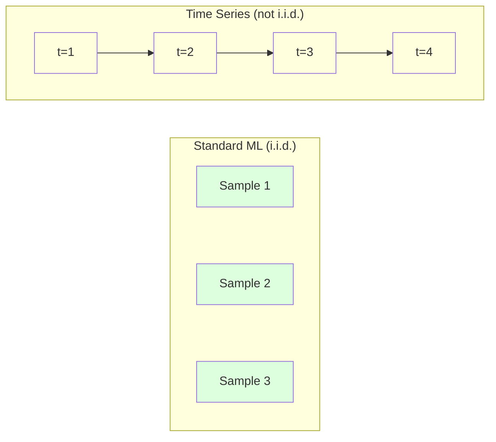
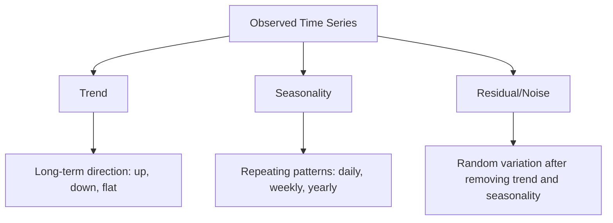
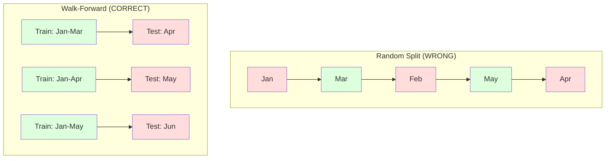

# Time Series Fundamentals

> Past performance does predict future results -- if you check for stationarity first.

## Learning Objectives

- Decompose a time series into trend, seasonality, and residual components and test for stationarity
- Implement lag features and rolling statistics to convert a time series into a supervised learning problem
- Build a walk-forward validation framework that prevents future data from leaking into training
- Explain why random train/test splits are invalid for time series and demonstrate the performance gap versus proper temporal splits

## The Problem

You have data ordered by time. Daily sales, hourly temperature, per-minute CPU usage, weekly stock prices. You want to predict the next value, the next week, the next quarter.

You reach for your standard ML toolkit: random train/test split, cross-validation, feature matrix in, prediction out. Every step is wrong.

Time series breaks the assumptions that standard ML relies on. Samples are not independent -- today's temperature depends on yesterday's. Random splits leak future information into the past. Features that look great in backtest fail in production because they rely on patterns that shift over time.

A model that gets 95% accuracy with random cross-validation might get 55% with proper time-based evaluation. The difference is not a technicality. It is the difference between a model that works on paper and one that works in production.

This lesson covers the fundamentals: what makes time data different, how to evaluate models honestly, and how to turn a time series into features that standard ML models can consume.

## The Concept

### What Makes Time Series Different

Standard ML assumes i.i.d. -- independent and identically distributed. Each sample is drawn from the same distribution, independently of other samples. Time series violates both:

- **Not independent.** Today's stock price depends on yesterday's. This week's sales correlate with last week's.
- **Not identically distributed.** The distribution shifts over time. Sales in December look different from sales in March.

These violations are not minor. They change how you build features, how you evaluate models, and which algorithms work.



In standard ML, samples are interchangeable. Shuffling them changes nothing. In time series, order is everything. Shuffling destroys the signal.

### Components of a Time Series

Every time series is a combination of:



- **Trend**: The long-term direction. Revenue growing 10% per year. Global temperature rising.
- **Seasonality**: Repeating patterns at fixed intervals. Retail sales spike in December. Air conditioning usage peaks in July.
- **Residual**: Whatever is left after removing trend and seasonality. If the residual looks like white noise, the decomposition captured the signal.

### Stationarity

A time series is stationary if its statistical properties (mean, variance, autocorrelation) do not change over time. Most forecasting methods assume stationarity.

**Why it matters:** A non-stationary series has a mean that drifts. A model trained on data from January has learned a different mean than what February will show. It will be systematically wrong.

**How to check:** Compute rolling mean and rolling standard deviation over windows. If they drift, the series is non-stationary.

**How to fix:** Differencing. Instead of modeling the raw values, model the change between consecutive values:

```
diff[t] = value[t] - value[t-1]
```

If one round of differencing does not make the series stationary, apply it again (second-order differencing). Most real-world series need at most two rounds.

**Example:**

Original series: [100, 102, 106, 112, 120]
First difference:  [2, 4, 6, 8] (still trending upward)
Second difference:  [2, 2, 2] (constant -- stationary)

The original series had a quadratic trend. First differencing turned it into a linear trend. Second differencing made it flat. In practice, you rarely need more than two rounds.

**Formal test:** The Augmented Dickey-Fuller (ADF) test is the standard statistical test for stationarity. The null hypothesis is "the series is non-stationary." A p-value below 0.05 means you can reject the null and conclude stationarity. We do not implement ADF from scratch (it requires asymptotic distribution tables), but the rolling statistics approach in our code gives a practical visual check.

### Autocorrelation

Autocorrelation measures how much a value at time t correlates with the value at time t-k (k steps in the past). The autocorrelation function (ACF) plots this correlation for each lag k.

**ACF tells you:**
- How far back the series remembers. If ACF drops to zero after lag 5, values more than 5 steps ago are irrelevant.
- Whether seasonality exists. If ACF spikes at lag 12 (monthly data), there is yearly seasonality.
- How many lag features to create. Use lags up to where ACF becomes negligible.

```plotly
{"recipe": "acf_plot", "title": "Autocorrelation Function (ACF) — bars outside the CI bands indicate significant lag dependencies"}
```

**PACF (Partial Autocorrelation Function)** removes indirect correlations. If today correlates with 3 days ago only because both correlate with yesterday, PACF at lag 3 will be zero while ACF at lag 3 will not.

### Lag Features: Turning Time Series into Supervised Learning

Standard ML models need a feature matrix X and a target y. Time series gives you a single column of values. The bridge is lag features.

Take the series [10, 12, 14, 13, 15] and create lag-1 and lag-2 features:

| lag_2 | lag_1 | target |
|-------|-------|--------|
| 10    | 12    | 14     |
| 12    | 14    | 13     |
| 14    | 13    | 15     |

Now you have a standard regression problem. Any ML model (linear regression, random forest, gradient boosting) can predict the target from the lags.

Additional features you can engineer:
- **Rolling statistics:** mean, std, min, max over the last k values
- **Calendar features:** day of week, month, is_holiday, is_weekend
- **Differenced values:** change from previous step
- **Expanding statistics:** cumulative mean, cumulative sum
- **Ratio features:** current value / rolling mean (how far from recent average)
- **Interaction features:** lag_1 * day_of_week (weekday effects on momentum)

**How many lags?** Use the autocorrelation function. If ACF is significant up to lag 10, use at least 10 lags. If there is weekly seasonality, include lag 7 (and possibly 14). More lags give the model more history but also more features to fit, increasing the risk of overfitting.

**The target alignment trap.** When creating lag features, the target must be the value at time t, and all features must use values at time t-1 or earlier. If you accidentally include the value at time t as a feature, you have a perfect predictor -- and a completely useless model. This is the most common bug in time series feature engineering.

### Walk-Forward Validation

This is the most important concept in this lesson. Standard k-fold cross-validation randomly assigns samples to train and test. For time series, this leaks future information.



Walk-forward validation:
1. Train on data up to time t
2. Predict at time t+1 (or t+1 to t+k for multi-step)
3. Slide the window forward
4. Repeat

Each test fold only contains data that comes after all training data. No future leakage. This gives you an honest estimate of how the model will perform when deployed.

**Expanding window** uses all historical data for training (window grows). **Sliding window** uses a fixed-size training window (window slides). Use expanding when you believe older data is still relevant. Use sliding when the world changes and old data hurts.

### ARIMA Intuition

ARIMA is the classical time series model. It has three components:

- **AR (Autoregressive):** Predict from past values. AR(p) uses the last p values.
- **I (Integrated):** Differencing to achieve stationarity. I(d) applies d rounds of differencing.
- **MA (Moving Average):** Predict from past forecast errors. MA(q) uses the last q errors.

ARIMA(p, d, q) combines all three. You choose p, d, q based on ACF/PACF analysis or automated search (auto-ARIMA).

We will not implement ARIMA from scratch -- it requires numerical optimization that is beyond the scope of this lesson. The key insight is understanding what each component does so you can interpret ARIMA results and know when to use it.

### When to Use What

| Approach | Best For | Handles Seasonality | Handles External Features |
|----------|---------|-------------------|------------------------|
| Lag features + ML | Tabular with many external features | With calendar features | Yes |
| ARIMA | Single univariate series, short-term | SARIMA variant | No (ARIMAX for limited) |
| Exponential smoothing | Simple trend + seasonality | Yes (Holt-Winters) | No |
| Prophet | Business forecasting, holidays | Yes (Fourier terms) | Limited |
| Neural networks (LSTM, Transformer) | Long sequences, many series | Learned | Yes |

For most practical problems, lag features + gradient boosting is the strongest starting point. It handles external features naturally, does not require stationarity, and is easy to debug.

### Forecasting Horizons and Strategies

Single-step forecasting predicts one time step ahead. Multi-step forecasting predicts multiple steps. There are three strategies:

**Recursive (iterated):** Predict one step ahead, use the prediction as input for the next step. Simple but errors accumulate -- each prediction uses the previous prediction, so mistakes compound.

**Direct:** Train a separate model for each horizon. Model-1 predicts t+1, Model-5 predicts t+5. No error accumulation, but each model has fewer training samples and they do not share information.

**Multi-output:** Train one model that outputs all horizons simultaneously. Shares information across horizons but requires a model that supports multiple outputs (or a custom loss function).

For most practical problems, start with recursive for short horizons (1-5 steps) and direct for longer horizons.

### Common Mistakes in Time Series

| Mistake | Why it happens | How to fix |
|---------|---------------|-----------|
| Random train/test split | Habit from standard ML | Use walk-forward or temporal split |
| Using future features | Feature at time t included by mistake | Audit every feature for temporal alignment |
| Overfitting to seasonality | Model memorizes calendar patterns | Hold out a full seasonal cycle in the test set |
| Ignoring scale changes | Revenue doubles but patterns stay | Model percentage change instead of absolute |
| Too many lag features | "More history is better" | Use ACF to determine relevant lags |
| Not differencing | "The model will figure it out" | Tree models handle trends; linear models need stationarity |

## Build It

The following code implements the core building blocks from scratch.

### Full Implementation

```python
import numpy as np


def make_synthetic_series(n=500, seed=42):
    rng = np.random.RandomState(seed)
    t = np.arange(n, dtype=float)

    trend = 0.05 * t
    seasonality = 10 * np.sin(2 * np.pi * t / 30)
    noise = rng.normal(0, 2, n)
    series = 50 + trend + seasonality + noise

    return series


def make_seasonal_series(n=365, period=7, seed=42):
    rng = np.random.RandomState(seed)
    t = np.arange(n, dtype=float)

    trend = 0.02 * t
    weekly = 5 * np.sin(2 * np.pi * t / period)
    monthly = 3 * np.sin(2 * np.pi * t / 30)
    noise = rng.normal(0, 1.5, n)
    series = 100 + trend + weekly + monthly + noise

    return series


def difference(series, order=1):
    result = series.copy()
    for _ in range(order):
        result = result[1:] - result[:-1]
    return result


def check_stationarity(series, window=50):
    n = len(series)
    rolling_mean = np.zeros(n)
    rolling_std = np.zeros(n)

    for i in range(n):
        start = max(0, i - window + 1)
        segment = series[start:i + 1]
        rolling_mean[i] = segment.mean()
        rolling_std[i] = segment.std() if len(segment) > 1 else 0.0

    first_half_mean = series[:n // 2].mean()
    second_half_mean = series[n // 2:].mean()
    first_half_var = series[:n // 2].var()
    second_half_var = series[n // 2:].var()

    mean_shift = abs(first_half_mean - second_half_mean)
    var_ratio = max(first_half_var, second_half_var) / max(min(first_half_var, second_half_var), 1e-10)

    is_stationary = mean_shift < 0.5 * series.std() and var_ratio < 2.0

    return rolling_mean, rolling_std, is_stationary


def autocorrelation(series, max_lag=20):
    n = len(series)
    mean = series.mean()
    var = series.var()
    acf = np.zeros(max_lag + 1)

    for k in range(max_lag + 1):
        if k >= n:
            break
        cov = np.mean((series[:n - k] - mean) * (series[k:] - mean)) if k < n else 0
        acf[k] = cov / var if var > 0 else 0.0

    return acf


def make_lag_features(series, n_lags):
    n = len(series)
    X = np.full((n, n_lags), np.nan)

    for lag in range(1, n_lags + 1):
        X[lag:, lag - 1] = series[:-lag]

    valid_mask = ~np.isnan(X).any(axis=1)
    X_valid = X[valid_mask]
    y_valid = series[valid_mask]

    return X_valid, y_valid


def walk_forward_split(n_samples, n_splits=5, min_train=50):
    if n_samples <= min_train:
        return

    step = max(1, (n_samples - min_train) // n_splits)

    for i in range(n_splits):
        train_end = min_train + i * step
        test_start = train_end
        test_end = min(train_end + step, n_samples)

        if test_start >= n_samples:
            break

        yield slice(0, train_end), slice(test_start, test_end)


class SimpleAR:
    def __init__(self, n_lags=5):
        self.n_lags = n_lags
        self.weights = None
        self.bias = None

    def fit(self, X, y):
        X_b = np.column_stack([np.ones(len(X)), X])
        theta = np.linalg.lstsq(X_b, y, rcond=None)[0]
        self.bias = theta[0]
        self.weights = theta[1:]
        return self

    def predict(self, X):
        return X @ self.weights + self.bias

    def fit_series(self, series):
        X, y = make_lag_features(series, self.n_lags)
        return self.fit(X, y)

    def forecast(self, last_values, n_steps):
        if len(last_values) < self.n_lags:
            raise ValueError(
                f"Need at least {self.n_lags} history points, got {len(last_values)}"
            )
        history = list(last_values[-self.n_lags:])
        predictions = []

        for _ in range(n_steps):
            features = np.array(history[-self.n_lags:][::-1]).reshape(1, -1)
            pred = self.predict(features)[0]
            predictions.append(pred)
            history.append(pred)

        return np.array(predictions)


def mse(y_true, y_pred):
    return np.mean((y_true - y_pred) ** 2)


def mae(y_true, y_pred):
    return np.mean(np.abs(y_true - y_pred))


def mape(y_true, y_pred):
    mask = y_true != 0
    return np.mean(np.abs((y_true[mask] - y_pred[mask]) / y_true[mask])) * 100


def print_separator(title):
    print(f"\n{'=' * 60}")
    print(f"  {title}")
    print(f"{'=' * 60}\n")


def demo_stationarity():
    print_separator("STATIONARITY CHECK")

    series = make_synthetic_series(n=300, seed=42)
    _, _, is_stat = check_stationarity(series)
    print(f"Original series (trend + seasonality):")
    print(f"  Mean: {series.mean():.2f}, Std: {series.std():.2f}")
    print(f"  Stationary: {is_stat}")

    diff1 = difference(series, order=1)
    _, _, is_stat1 = check_stationarity(diff1)
    print(f"\nAfter first differencing:")
    print(f"  Mean: {diff1.mean():.4f}, Std: {diff1.std():.2f}")
    print(f"  Stationary: {is_stat1}")


def demo_autocorrelation():
    print_separator("AUTOCORRELATION ANALYSIS")

    series = make_seasonal_series(n=365, period=7, seed=42)
    diff_series = difference(series, order=1)
    acf = autocorrelation(diff_series, max_lag=30)

    print("ACF of differenced series (first 15 lags):")
    print(f"{'Lag':>5} {'ACF':>8} {'Significance':>14}")
    print(f"{'-' * 28}")
    threshold = 1.96 / np.sqrt(len(diff_series))
    for k in range(15):
        sig = "***" if abs(acf[k]) > threshold else ""
        bar = "#" * int(abs(acf[k]) * 30)
        print(f"{k:>5} {acf[k]:>8.4f} {sig:>4} {bar}")

    print(f"\nSignificance threshold (95%): +/-{threshold:.4f}")
    print(f"Lags 7 and 14 should show spikes (weekly seasonality)")


def demo_lag_features():
    print_separator("LAG FEATURES AND AR MODEL")

    series = make_synthetic_series(n=400, seed=42)
    n_lags = 10

    X, y = make_lag_features(series, n_lags)
    print(f"Series length: {len(series)}")
    print(f"Feature matrix: {X.shape} (samples x lag features)")
    print(f"Target vector: {y.shape}")

    print(f"\nFirst 3 samples:")
    for i in range(3):
        lags_str = ", ".join(f"{v:.1f}" for v in X[i, :5])
        print(f"  Lags: [{lags_str}, ...] -> Target: {y[i]:.1f}")

    ar = SimpleAR(n_lags=n_lags)
    ar.fit(X, y)

    print(f"\nAR({n_lags}) weights:")
    for i, w in enumerate(ar.weights):
        print(f"  Lag {i+1}: {w:+.4f}")
    print(f"  Bias:  {ar.bias:+.4f}")


def demo_walk_forward():
    print_separator("WALK-FORWARD VALIDATION")

    series = make_synthetic_series(n=400, seed=42)
    n_lags = 10
    X, y = make_lag_features(series, n_lags)

    n_splits = 5
    fold_scores = []

    print(f"Walk-forward with {n_splits} splits:")
    print(f"{'Fold':>6} {'Train':>10} {'Test':>10} {'MSE':>10} {'MAE':>10}")
    print(f"{'-' * 48}")

    for fold, (train_sl, test_sl) in enumerate(walk_forward_split(len(X), n_splits=n_splits, min_train=100)):
        X_train, y_train = X[train_sl], y[train_sl]
        X_test, y_test = X[test_sl], y[test_sl]

        ar = SimpleAR(n_lags=n_lags)
        ar.fit(X_train, y_train)
        y_pred = ar.predict(X_test)

        fold_mse = mse(y_test, y_pred)
        fold_mae = mae(y_test, y_pred)
        fold_scores.append(fold_mse)

        print(f"{fold+1:>6} {X_train.shape[0]:>10} {X_test.shape[0]:>10} {fold_mse:>10.4f} {fold_mae:>10.4f}")

    print(f"\nMean MSE: {np.mean(fold_scores):.4f}")
    print(f"Std MSE:  {np.std(fold_scores):.4f}")


def demo_random_vs_walk_forward():
    print_separator("RANDOM SPLIT vs WALK-FORWARD")

    series = make_synthetic_series(n=500, seed=42)
    n_lags = 10
    X, y = make_lag_features(series, n_lags)

    rng = np.random.RandomState(42)
    idx = rng.permutation(len(X))
    split = int(len(X) * 0.8)
    train_idx, test_idx = idx[:split], idx[split:]

    ar_random = SimpleAR(n_lags=n_lags)
    ar_random.fit(X[train_idx], y[train_idx])
    random_mse = mse(y[test_idx], ar_random.predict(X[test_idx]))

    wf_scores = []
    for train_sl, test_sl in walk_forward_split(len(X), n_splits=5, min_train=100):
        ar_wf = SimpleAR(n_lags=n_lags)
        ar_wf.fit(X[train_sl], y[train_sl])
        y_pred = ar_wf.predict(X[test_sl])
        wf_scores.append(mse(y[test_sl], y_pred))

    wf_mse = np.mean(wf_scores)

    print(f"Random 80/20 split MSE:  {random_mse:.4f}")
    print(f"Walk-forward mean MSE:   {wf_mse:.4f}")
    print(f"Ratio (random/wf):       {random_mse / wf_mse:.4f}")
    print()
    if random_mse < wf_mse:
        print("Random split gives lower MSE -- this is the optimistic bias from future leakage.")
        print("The walk-forward score is the honest estimate of production performance.")
    else:
        print("Walk-forward gives similar or lower MSE -- the series may be stationary enough")
        print("that future leakage is not a major factor here.")


def demo_lag_comparison():
    print_separator("LAG COUNT COMPARISON")

    series = make_seasonal_series(n=365, period=7, seed=42)

    print(f"{'n_lags':>8} {'Mean MSE':>12} {'Mean MAE':>12}")
    print(f"{'-' * 34}")

    for n_lags in [1, 3, 5, 7, 10, 14, 21, 30]:
        X, y = make_lag_features(series, n_lags)

        scores_mse = []
        scores_mae = []

        for train_sl, test_sl in walk_forward_split(len(X), n_splits=5, min_train=max(60, n_lags + 20)):
            ar = SimpleAR(n_lags=n_lags)
            ar.fit(X[train_sl], y[train_sl])
            y_pred = ar.predict(X[test_sl])
            scores_mse.append(mse(y[test_sl], y_pred))
            scores_mae.append(mae(y[test_sl], y_pred))

        if scores_mse:
            print(f"{n_lags:>8} {np.mean(scores_mse):>12.4f} {np.mean(scores_mae):>12.4f}")


def demo_forecasting():
    print_separator("MULTI-STEP FORECASTING")

    series = make_synthetic_series(n=300, seed=42)
    train_series = series[:250]
    true_future = series[250:270]

    n_lags = 10
    ar = SimpleAR(n_lags=n_lags)
    X, y = make_lag_features(train_series, n_lags)
    ar.fit(X, y)

    forecast = ar.forecast(train_series, n_steps=20)

    print(f"Training on {len(train_series)} points, forecasting {len(true_future)} steps ahead")
    print()
    print(f"{'Step':>6} {'True':>10} {'Predicted':>10} {'Error':>10}")
    print(f"{'-' * 38}")

    for i in range(len(true_future)):
        error = true_future[i] - forecast[i]
        print(f"{i+1:>6} {true_future[i]:>10.2f} {forecast[i]:>10.2f} {error:>+10.2f}")

    print(f"\nForecast MSE:  {mse(true_future, forecast):.4f}")
    print(f"Forecast MAE:  {mae(true_future, forecast):.4f}")
    print(f"Forecast MAPE: {mape(true_future, forecast):.2f}%")


if __name__ == "__main__":
    demo_stationarity()
    demo_autocorrelation()
    demo_lag_features()
    demo_walk_forward()
    demo_random_vs_walk_forward()
    demo_lag_comparison()
    demo_forecasting()
```

### Lag Feature Creator

```python
def make_lag_features(series, n_lags):
    n = len(series)
    X = np.full((n, n_lags), np.nan)
    for lag in range(1, n_lags + 1):
        X[lag:, lag - 1] = series[:-lag]
    valid = ~np.isnan(X).any(axis=1)
    return X[valid], series[valid]
```

This converts a 1D series into a feature matrix where each row has the last `n_lags` values as features, and the current value as the target.

### Walk-Forward Cross-Validation

```python
def walk_forward_split(n_samples, n_splits=5, min_train=50):
    assert min_train < n_samples, "min_train must be less than n_samples"
    step = max(1, (n_samples - min_train) // n_splits)
    for i in range(n_splits):
        train_end = min_train + i * step
        test_end = min(train_end + step, n_samples)
        if train_end >= n_samples:
            break
        yield slice(0, train_end), slice(train_end, test_end)
```

Each split ensures training data comes strictly before test data. The training window expands with each fold.

### Simple Autoregressive Model

A pure AR model is just linear regression on lag features:

```python
class SimpleAR:
    def __init__(self, n_lags=5):
        self.n_lags = n_lags
        self.weights = None
        self.bias = None

    def fit(self, series):
        X, y = make_lag_features(series, self.n_lags)
        # Solve via normal equations
        X_b = np.column_stack([np.ones(len(X)), X])
        theta = np.linalg.lstsq(X_b, y, rcond=None)[0]
        self.bias = theta[0]
        self.weights = theta[1:]
        return self
```

This is conceptually identical to linear regression from Lesson 02, but applied to time-lagged versions of the same variable.

### Stationarity Check

The code computes rolling statistics to visually and numerically assess stationarity:

```python
def check_stationarity(series, window=50):
    rolling_mean = np.array([
        series[max(0, i - window):i].mean()
        for i in range(1, len(series) + 1)
    ])
    rolling_std = np.array([
        series[max(0, i - window):i].std()
        for i in range(1, len(series) + 1)
    ])
    return rolling_mean, rolling_std
```

If the rolling mean drifts or the rolling std changes, the series is non-stationary. Apply differencing and check again.

The code also checks stationarity by comparing the first half and second half of the series. If the means differ by more than half a standard deviation or the variance ratio exceeds 2x, the series is flagged as non-stationary.

### Autocorrelation

```python
def autocorrelation(series, max_lag=20):
    n = len(series)
    mean = series.mean()
    var = series.var()
    acf = np.zeros(max_lag + 1)
    for k in range(max_lag + 1):
        cov = np.mean((series[:n-k] - mean) * (series[k:] - mean))
        acf[k] = cov / var if var > 0 else 0
    return acf
```

## Use It

With sklearn, you use lag features directly with any regressor:

```python
from sklearn.linear_model import Ridge
from sklearn.ensemble import GradientBoostingRegressor

X, y = make_lag_features(series, n_lags=10)

for train_idx, test_idx in walk_forward_split(len(X)):
    model = Ridge(alpha=1.0)
    model.fit(X[train_idx], y[train_idx])
    predictions = model.predict(X[test_idx])
```

For ARIMA, use statsmodels:

```python
from statsmodels.tsa.arima.model import ARIMA

model = ARIMA(train_series, order=(5, 1, 2))
fitted = model.fit()
forecast = fitted.forecast(steps=30)
```

The code demonstrates both approaches and compares them using walk-forward validation.

### sklearn TimeSeriesSplit

sklearn provides `TimeSeriesSplit` which implements walk-forward validation:

```python
from sklearn.model_selection import TimeSeriesSplit

tscv = TimeSeriesSplit(n_splits=5)
for train_index, test_index in tscv.split(X):
    X_train, X_test = X[train_index], X[test_index]
    y_train, y_test = y[train_index], y[test_index]
    model.fit(X_train, y_train)
    score = model.score(X_test, y_test)
```

This is equivalent to our from-scratch `walk_forward_split` but integrated into sklearn's cross-validation framework. You can use it with `cross_val_score`:

```python
from sklearn.model_selection import cross_val_score

scores = cross_val_score(model, X, y, cv=TimeSeriesSplit(n_splits=5))
print(f"Mean score: {scores.mean():.4f} +/- {scores.std():.4f}")
```

### Evaluation Metrics

Time series forecasting uses regression metrics, but with time-aware context:

- **MAE (Mean Absolute Error):** Average of |y_true - y_pred|. Easy to interpret in original units. "On average, predictions are off by 3.2 degrees."
- **RMSE (Root Mean Squared Error):** Square root of mean squared error. Penalizes large errors more than MAE. Use when big errors are worse than many small errors.
- **MAPE (Mean Absolute Percentage Error):** Average of |error / true_value| * 100. Scale-independent, useful for comparing across different series. But undefined when true values are zero.
- **Naive baseline comparison:** Always compare against simple baselines. The seasonal naive baseline predicts the value from one period ago (yesterday, last week). If your model cannot beat naive, something is wrong.

### Rolling Features

The code demonstrates adding rolling statistics (mean, std, min, max over windows of 7 and 14 days) to lag features. These give the model information about recent trends and volatility that lag features alone do not capture.

For example, if the rolling mean is rising, it suggests an upward trend. If the rolling std is increasing, it suggests growing volatility. These are the kinds of patterns that tree-based models can learn from but linear models cannot.

### Baselines You Must Beat

Before building any model, establish baselines:

1. **Last value (persistence).** Predict that tomorrow will be the same as today. For many series, this is surprisingly hard to beat.
2. **Seasonal naive.** Predict that today will be the same as the same day last week (or last year). If your model cannot beat this, it has not learned any useful pattern beyond seasonality.
3. **Moving average.** Predict the average of the last k values. Smooths noise but cannot capture sudden changes.

If your fancy ML model loses to the seasonal naive baseline, you have a bug. Most commonly: future leakage in features, wrong evaluation method, or the series is truly random and unpredictable.

### Practical Tips

1. **Start with plotting.** Before any modeling, plot the raw series. Look for trends, seasonality, outliers, structural breaks (sudden changes in behavior). A 30-second visual inspection often tells you more than an hour of automated analysis.

2. **Difference first, model second.** If the series has a clear trend, difference it before creating lag features. Tree-based models can handle trends, but linear models cannot, and differencing never hurts.

3. **Hold out at least one full seasonal cycle.** If you have weekly seasonality, your test set needs at least one full week. If monthly, at least one full month. Otherwise you cannot evaluate whether the model captured the seasonal pattern.

4. **Monitor in production.** Time series models degrade over time as the world changes. Track prediction errors on a rolling basis. When errors start increasing, retrain the model on recent data.

5. **Beware of regime changes.** A model trained on pre-pandemic data will not predict post-pandemic behavior. Include indicators of known regime changes as features, or use a sliding window that forgets old data.

6. **Log-transform skewed series.** Revenue, prices, and counts are often right-skewed. Taking the log stabilizes variance and makes multiplicative patterns additive, which linear models can handle. Forecast in log space, then exponentiate to get back to original units.

## Exercises

1. **Stationarity experiment.** Generate a series with a linear trend. Check stationarity with rolling statistics. Apply first differencing. Check again. How many rounds of differencing does it take for a quadratic trend?

2. **Lag selection.** Compute ACF on a seasonal series (period=7). Which lags have the highest autocorrelation? Create lag features using only those lags (not consecutive lags). Does accuracy improve compared to using lags 1 through 7?

3. **Walk-forward vs random split.** Train a Ridge regression on lag features. Evaluate with random 80/20 split and with walk-forward validation. How much does the random split overestimate performance?

4. **Feature engineering.** Add rolling mean (window=7), rolling std (window=7), and day-of-week features to the lag features. Compare accuracy with and without these extras using walk-forward validation.

5. **Multi-step forecasting.** Modify the AR model to predict 5 steps ahead instead of 1. Compare two strategies: (a) predict one step, use the prediction as input for the next step (recursive), and (b) train separate models for each horizon (direct). Which is more accurate?

## Key Terms

| Term | What people say | What it actually means |
|------|----------------|----------------------|
| Stationarity | "The stats don't change over time" | A series whose mean, variance, and autocorrelation structure are constant over time |
| Differencing | "Subtract consecutive values" | Computing y[t] - y[t-1] to remove trends and achieve stationarity |
| Autocorrelation (ACF) | "How a series correlates with itself" | The correlation between a time series and a lagged copy of itself, as a function of the lag |
| Partial autocorrelation (PACF) | "Direct correlation only" | Autocorrelation at lag k after removing the effect of all shorter lags |
| Lag features | "Past values as inputs" | Using y[t-1], y[t-2], ..., y[t-k] as features to predict y[t] |
| Walk-forward validation | "Time-respecting cross-validation" | Evaluation where training data always precedes test data chronologically |
| ARIMA | "The classic time series model" | AutoRegressive Integrated Moving Average: combines past values (AR), differencing (I), and past errors (MA) |
| Seasonality | "Repeating calendar patterns" | Regular, predictable cycles in a time series tied to calendar periods (daily, weekly, yearly) |
| Trend | "The long-term direction" | A persistent increase or decrease in the series level over time |
| Expanding window | "Use all history" | Walk-forward validation where the training set grows with each fold |
| Sliding window | "Fixed-size history" | Walk-forward validation where the training set is a fixed-length window that slides forward |

## Further Reading

- [Hyndman and Athanasopoulos, Forecasting: Principles and Practice (3rd ed.)](https://otexts.com/fpp3/) -- the best free textbook on time series forecasting
- [scikit-learn Time Series Split](https://scikit-learn.org/stable/modules/generated/sklearn.model_selection.TimeSeriesSplit.html) -- sklearn's walk-forward splitter
- [statsmodels ARIMA docs](https://www.statsmodels.org/stable/generated/statsmodels.tsa.arima.model.ARIMA.html) -- ARIMA implementation with diagnostics
- [Makridakis et al., The M5 Competition (2022)](https://www.sciencedirect.com/science/article/pii/S0169207021001874) -- large-scale forecasting competition showing ML methods vs statistical methods
