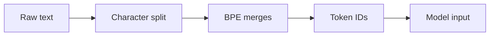

# 3.1 Tokenization

LLMs don't read text the way humans do. They don't see characters. They don't see words. They see **tokens** — integer IDs that represent chunks of text. Understanding tokenization is foundational to understanding why LLMs behave the way they do, and why your costs look the way they do.

## What Is a Token?

A token is the atomic unit of text that a language model processes. In most modern tokenizers using **Byte-Pair Encoding (BPE)**, a token is roughly:

- ~4 characters of English text, or
- ~¾ of an English word

So "tokenization" doesn't become one token — it gets split:

```
"tokenization" → ["token", "ization"]
```

Here's a concrete example of what actually happens when text hits the model:

```
Input:  "Hello, world!"
Tokens: ["Hello", ",", " world", "!"]
IDs:    [9906,    11,  1917,     0]
```

Those integers — `[9906, 11, 1917, 0]` — are what the model actually receives. The mapping from string to integer is defined by the tokenizer's **vocabulary**, typically 50,000–150,000 entries.

## Byte-Pair Encoding (BPE)

BPE is the dominant tokenization algorithm for modern LLMs (GPT, Llama, Mistral, etc.). It works by:

1. Starting with individual bytes or characters as the initial vocabulary
2. Repeatedly merging the most frequently co-occurring pair
3. Stopping when the vocabulary reaches the target size

The result is a vocabulary where common words are single tokens (`" the"` = 1 token) and rare or invented words get split into subword pieces (`"Kognitivität"` = several tokens).



## Language Efficiency Differences

Here's where tokenization has real cost and performance implications: **different languages tokenize very differently**.

| Language | Text | Tokens | Tokens/char |
|---|---|---|---|
| English | "The quick brown fox" | 5 | 0.26 |
| French | "Le renard brun rapide" | 6 | 0.27 |
| Spanish | "El rápido zorro marrón" | 7 | 0.30 |
| Chinese | "快速的棕色狐狸" | 9–14 | 1.3–2.0 |
| Japanese | "素早い茶色のキツネ" | 12–18 | 1.3–2.0 |
| Arabic | "الثعلب البني السريع" | 8–12 | 0.5–0.7 |

English text is the most token-efficient because BPE vocabularies are trained predominantly on English. A Chinese prompt that conveys the same information as an English prompt can cost **2–3× more tokens**.

This matters directly for:

- **Cost** — APIs charge per token. Same information, triple the bill.
- **Context limits** — a 128K context window fits less non-English content than English content.
- **Latency** — more input tokens = longer prefill phase = slower TTFT.

## Token Counting with tiktoken

Before sending a request, you can count tokens precisely using OpenAI's `tiktoken` library:

```python
import tiktoken

enc = tiktoken.encoding_for_model("gpt-4o")

text = "Hello, world! This is a tokenization example."
tokens = enc.encode(text)

print(f"Token IDs: {tokens}")
print(f"Token count: {len(tokens)}")
print(f"Tokens: {[enc.decode([t]) for t in tokens]}")
```

```
Token IDs: [9906, 11, 1917, 0, 1115, 374, 264, 47058, 2065, 3187, 13]
Token count: 11
Tokens: ['Hello', ',', ' world', '!', ' This', ' is', ' a', ' token', 'ization', ' example', '.']
```

> **Note:** `tiktoken` works for OpenAI models. For Llama/Mistral models, use HuggingFace's `tokenizers` library with the model's tokenizer config.

```python
from transformers import AutoTokenizer

tokenizer = AutoTokenizer.from_pretrained("meta-llama/Meta-Llama-3-8B")
tokens = tokenizer.encode("Hello, world!")
print(f"Token count: {len(tokens)}")
```

## The Subword Insight: Why Spelling Is Hard for LLMs

This is one of the most important consequences of tokenization that engineers often overlook.

LLMs operate on token patterns, not characters or words. When you ask a model to count the letters in "strawberry," it doesn't see `s-t-r-a-w-b-e-r-r-y`. It sees something like `["st", "raw", "berry"]` — three tokens. The character-level structure is invisible.

This is why LLMs historically struggle with:

```
Q: How many 'r's are in "strawberry"?
A: 2  ← wrong, there are 3
```

The model never "sees" individual characters unless the tokenizer happens to split them that way. Similarly:

- **Anagrams** — models can't reliably rearrange characters
- **Pig latin** — requires manipulating first characters
- **Reversing strings** — requires character-level access the model doesn't have natively
- **Counting vowels** — same problem

Some newer models handle these better through instruction tuning and chain-of-thought training, but the underlying limitation is tokenization.

## Practical Guidance

| Use case | What to do |
|---|---|
| Estimating API cost | Count tokens with tiktoken before sending |
| Multilingual apps | Budget 2–3× more tokens for non-English content |
| Structured output | Use shorter field names to reduce prompt tokens |
| Debugging unexpected behavior | Inspect the actual token split — the model might be seeing something unexpected |
| Character manipulation tasks | Don't rely on LLMs for precise character-level operations without explicit reasoning steps |

## Summary

- Tokens are integer IDs representing text chunks — roughly 4 characters or ¾ of an English word
- BPE builds a vocabulary by merging frequent character pairs; common words = 1 token, rare words = many tokens
- Token counts drive cost, context limits, and latency — count them before sending
- Different languages tokenize at different efficiencies; English is most compact
- LLMs operate on token patterns, not characters — this is why spelling and character manipulation is genuinely hard for them
