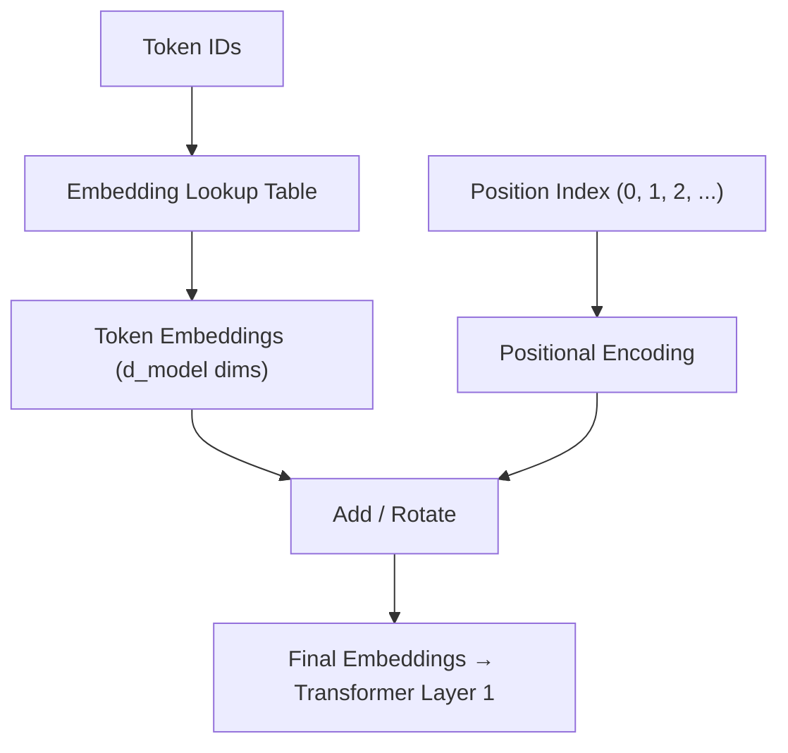

# 3.2 Prompt Encoding

Tokenization gives you integers. But integers can't go directly into a Transformer — math doesn't know what `9906` means semantically. The next step is **encoding**: converting those token IDs into dense vectors that carry meaning. This is where the model starts doing real work.

## The Full Encoding Pipeline

```
"Hello, world!"
       ↓  tokenization
[9906, 11, 1917, 0]
       ↓  embedding lookup
[[0.12, -0.43, 0.91, ...],   ← vector for "Hello"
 [0.03,  0.67, -0.22, ...],  ← vector for ","
 [-0.55, 0.14,  0.88, ...],  ← vector for " world"
 [0.77, -0.31,  0.05, ...]]  ← vector for "!"
       ↓  + positional encoding
[final embeddings for Transformer layer 1]
```

Every token ID is looked up in an **embedding table** — a learned matrix of shape `[vocab_size × d_model]`. For GPT-4 class models, `d_model` is likely 4096–12288 dimensions. For smaller models like Llama-3-8B, it's 4096.

## Embeddings: Vectors That Carry Meaning

An embedding is a dense vector of floating-point numbers. The key property: **semantic similarity is geometric proximity**.

After training on billions of tokens, the embedding space develops meaningful structure:

```
"king"   → [0.71, 0.43, -0.12, ...]
"queen"  → [0.68, 0.41, -0.10, ...]   ← close to "king"
"banana" → [-0.33, 0.89, 0.54, ...]   ← far from "king"
```

The classic demonstration:

```
embedding("king") - embedding("man") + embedding("woman") ≈ embedding("queen")
```

This isn't magic — it's a consequence of training. Words that appear in similar contexts end up with similar vectors.

### Embedding Dimensions Across Models

| Model | d_model | Vocab size | Embedding table size |
|---|---|---|---|
| GPT-2 small | 768 | 50,257 | ~150 MB |
| Llama-3-8B | 4,096 | 128,256 | ~1 GB |
| Llama-3-70B | 8,192 | 128,256 | ~2 GB |
| GPT-4 (estimated) | ~12,288 | ~100,000 | ~2.4 GB |

The embedding table is a significant chunk of total model size — and it's also what gets loaded into GPU memory before any inference starts.

## Positional Encodings: Telling the Model Where Things Are

Here's a subtle but critical problem: **Transformers have no inherent sense of order**.

The attention mechanism (`QKᵀ / √d_k`) treats every token as potentially relevant to every other token, regardless of position. If you shuffle the input tokens, the attention matrix doesn't know the order changed — unless you explicitly inject position information.

Positional encodings solve this by adding position-dependent signals to each token embedding before it enters the first Transformer layer.

```
final_embedding[i] = token_embedding[i] + positional_encoding[i]
```

### Two Main Approaches

**1. Learned Positional Encodings (GPT-style)**

A second lookup table — `[max_seq_len × d_model]` — where each position gets a learned vector. During training, the model learns what "being at position 5" vs "position 500" means contextually.

```
Pros: simple, effective within training sequence length
Cons: can't generalize beyond max training length
```

**2. RoPE (Rotary Position Embedding)**

Used by Llama, Mistral, Falcon, and most modern open models. Instead of adding a position vector, RoPE **rotates** the query and key vectors by an angle proportional to the token's position before computing attention.

The rotation is applied in pairs of dimensions:

```
q[2i], q[2i+1] are rotated by angle θᵢ × position
```

Where `θᵢ = 1 / 10000^(2i/d)` — a fixed frequency schedule.

```
Pros:
  - Generalizes to longer sequences than training length
  - Relative position awareness (token A is 5 positions before token B)
  - No extra parameters
  
Cons:
  - More complex implementation
  - Still degrades beyond ~2–4× training length without further techniques
```

### RoPE Length Extrapolation

RoPE enables techniques like **YaRN** and **LongRoPE** that extend context windows without full retraining. This is how Llama models originally trained on 4K contexts were adapted to 128K context windows.



## What Enters the First Transformer Layer

After encoding, you have a matrix of shape `[seq_len × d_model]`. Every row is a token's embedding augmented with its position information. This matrix is what the first Transformer layer actually operates on.

From this point forward, the model's job is to progressively refine these representations through layers of attention and feed-forward operations — building up a contextual understanding of every token in relation to every other.

## Practical Implications

**Embedding tables consume memory**

The embedding table must be loaded into GPU memory. For a 128K vocabulary at d_model=4096 in fp16, that's ~1 GB — and this is separate from the attention weights.

**Tokenizer and model must match**

A token ID means nothing without the right embedding table. You can't mix tokenizers between models. Llama-3's token `5` is not the same as GPT-4's token `5`.

**Embedding similarity is useful for debugging**

If a model behaves oddly for a particular word, check how it tokenizes and whether the resulting tokens have reasonable embeddings. A rare technical term might tokenize into strange subword pieces whose embeddings don't capture the intended meaning.

## Summary

- Token IDs are converted to dense vectors via an embedding lookup table
- Embedding vectors carry semantic meaning — similar concepts are geometrically close
- Transformers need explicit position information; positional encodings inject this
- Learned positional encodings (GPT-style) work well within training length but don't extrapolate
- RoPE (used by Llama, Mistral) encodes position as rotation, enabling better length generalization
- The final embeddings — token + position — are the actual input to the Transformer's first layer
