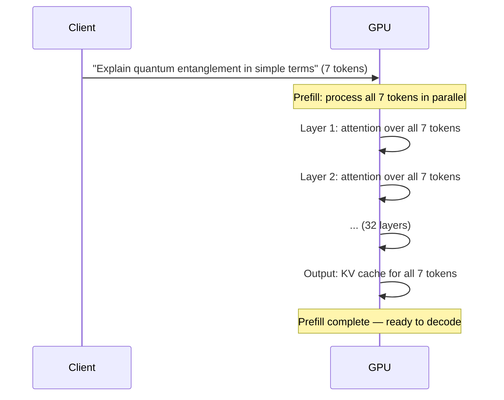

# 3.3 The Prefill Phase

LLM inference has two very different phases: **prefill** and **decode**. They run on different bottlenecks, scale differently with input size, and have different optimization strategies. This section covers the first: prefill.

## What Is Prefill?

When you send a prompt to a model, the first thing that happens is the model processes your **entire input in one shot**. Every token in your prompt — system message, examples, user message, all of it — is computed simultaneously on the GPU.

This is the **prefill phase**.




*Fig: The thing you keep is not the first output token — it is keys and values for all prompt positions, at every layer and head. Compute-bound. Cost scales with prompt length, so TTFT on 128K can be tens of seconds.*

The key word is **parallel**: all tokens are processed in the same forward pass. This is fundamentally different from the decode phase, where tokens are generated one at a time.

## What Prefill Produces: The KV Cache

The primary output of the prefill phase isn't the first token — it's the **KV (key-value) cache**.

During attention at each layer, every token generates three vectors: Query (Q), Key (K), and Value (V). The K and V vectors for all input tokens are stored in the KV cache. The Q vector is used only during the forward pass and discarded.

```
For each layer (e.g., 32 layers):
  For each attention head (e.g., 32 heads):
    Store K and V vectors for every input token
```

This cache is what makes subsequent generation fast. When the model generates the next token, it attends over the **cached** K/V pairs from the prompt — no recomputation needed.

Without the KV cache, every decode step would need to reprocess the entire prompt from scratch. For a 1000-token prompt, that would be 1000× more computation per generated token. The cache turns an O(n²) problem back into O(n).

## Prefill Cost Scales With Prompt Length

Prefill is **compute-bound** — it's doing real matrix multiplications over all prompt tokens. The cost scales roughly linearly with prompt length:

| Prompt length | Relative prefill cost | Example TTFT |
|---|---|---|
| 1,000 tokens | 1× | ~100 ms |
| 10,000 tokens | ~10× | ~1,000 ms |
| 100,000 tokens | ~100× | ~10,000 ms |
| 128,000 tokens | ~128× | ~13,000 ms |

> These are illustrative numbers. Actual TTFT depends on hardware, batch size, and model architecture.

This is why **time-to-first-token (TTFT)** degrades with long prompts. The user waits for the entire prompt to be processed before seeing a single output character.

## Prompt Caching: Skip the Prefill

If you're repeatedly sending the same system prompt — a common pattern in production — you're paying the prefill cost over and over for identical content.

Anthropic and OpenAI both offer **prompt caching**: the provider caches the KV state for a common prompt prefix. On cache hits, the prefill is skipped entirely.

### Anthropic's Prompt Caching

```python
import anthropic

client = anthropic.Anthropic()

response = client.messages.create(
    model="claude-opus-4-5",
    max_tokens=1024,
    system=[
        {
            "type": "text",
            "text": "You are an expert software engineer...",
        },
        {
            "type": "text",
            "text": "<very long system prompt: 2000 tokens of context>",
            "cache_control": {"type": "ephemeral"},  # ← mark this for caching
        }
    ],
    messages=[{"role": "user", "content": "Review this code: ..."}]
)

# First request: cache miss, normal cost
# Subsequent requests: cache hit — 90% cost reduction on cached tokens
```

The economics are significant:

| | Cache miss | Cache hit |
|---|---|---|
| Input token cost (Claude) | ~$3 / MTok | ~$0.30 / MTok |
| Latency savings | — | Up to 85% TTFT reduction |

### Caching Requirements

- **Minimum length**: Anthropic requires ≥1024 tokens in the cached prefix; OpenAI requires ≥1024 tokens
- **Exact prefix match**: the cached content must be identical, byte-for-byte
- **Cache lifetime**: typically 5 minutes (Anthropic ephemeral) to several hours; provider-dependent

### Design Implication: Structure Your Prompts for Caching

```
✓ Good (stable content first):
[System prompt — 2000 tokens, always identical]
[Few-shot examples — 1000 tokens, always identical]
[User message — varies per request]

✗ Bad (variable content first):
[User ID and timestamp — changes every request]
[System prompt]
[User message]
```

Put everything that doesn't change at the **top** of your prompt. Put user-specific, request-specific content at the bottom. This maximizes cache hit rate.


*Fig: Providers skip prefill when the leading tokens match a recent cache, byte-for-byte. Put the 2,000-token system prompt first. Put the user id and timestamp last, or you get a miss every call.*

## Multi-Turn Conversations and Prefill

In a multi-turn conversation, you're typically sending the entire conversation history with each request (most APIs are stateless). This means:

- Turn 1: prefill 500 tokens
- Turn 2: prefill 1,000 tokens (turn 1 + turn 2)
- Turn 3: prefill 1,500 tokens
- Turn N: prefill N×500 tokens

The cost of a long conversation grows quadratically unless you use prompt caching. With caching, each new turn only pays for the incremental tokens.

## Prefill Parallelism

Prefill can be parallelized across multiple GPUs — a technique called **prefill disaggregation** or **chunked prefill**:

- Split the prompt into chunks
- Run each chunk on a separate GPU or in a separate time slice
- Merge the KV caches

This reduces TTFT at the cost of communication overhead. Used in production at large inference providers (Deepmind, Google, etc.) for very long contexts.

## Summary

- Prefill processes the entire input prompt in a single parallel GPU pass
- It produces the KV cache — stored key/value vectors for all input tokens
- The KV cache is what makes fast autoregressive generation possible
- Prefill cost is compute-bound and scales linearly with prompt length
- Long prompts cause high TTFT; 128K token prompts can take 10+ seconds to prefill
- Prompt caching (Anthropic/OpenAI) skips re-prefilling identical prefixes, saving 90% cost and up to 85% latency
- Design your prompts with stable content first to maximize cache hit rates
