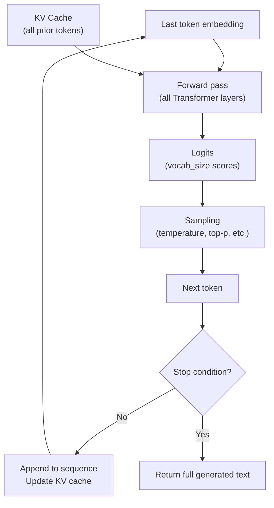

# 3.4 The Decode Phase

Once prefill is complete and the KV cache is populated, the model enters the **decode phase**: the part where it actually generates your output. This is serial, incremental, and fundamentally different from prefill in every important way.

## One Token at a Time

The decode phase generates tokens sequentially. You cannot generate token N+1 until you have token N, because the model's next prediction is conditioned on everything that came before — including the tokens it just generated.

Each decode step follows the same four operations:

```
Step 1: Look up embedding for last generated token
         (or the last prompt token for the very first decode step)

Step 2: Run a full forward pass through all Transformer layers
         — Q from the current token only (1 vector)
         — K and V from ALL previous tokens (via KV cache)

Step 3: The final layer outputs logits
         — a vector of length ~vocab_size (50K–150K floats)
         — raw scores for every possible next token

Step 4: Sample the next token from the logit distribution
         → append to generated sequence
         → check stop condition (EOS token? max_tokens reached?)
         → if not done, go back to Step 1
```




*Fig: You cannot emit token n+1 before token n exists. Stop on EOS, max_tokens, or a stop string. Always set max_tokens.*

## Why Decode Is Memory-Bandwidth Bound

This surprises most people when they first hear it: during decode, the GPU is **not** compute-bound. It's **memory-bandwidth bound**.

Here's why: at each decode step, you're running a forward pass for a single token (batch size = 1, sequence position = 1 new token). The computation required is tiny compared to the amount of data you need to read from GPU memory:

- **Model weights**: ~14 GB for a 7B fp16 model — must be read from HBM every step
- **KV cache**: grows with output length, must be read for attention every step

The GPU's arithmetic units sit mostly idle, waiting for memory transfers to complete.

```
A100 80GB specs:
  Peak compute: 312 TFLOP/s (bf16)
  Memory bandwidth: 2,000 GB/s

For a 7B model decode step:
  ~14 GB of weights to read
  Time to read weights: 14 GB / 2000 GB/s = 7 ms
  Time to actually compute: <1 ms worth of FLOPs
  → bottleneck is memory, not compute
```


*Fig: An A100's ALUs sit idle. Quantization and batching help decode more than "a faster core." int4 is one-quarter the bytes. A bigger batch shares the read.*

This has important consequences:

1. **Faster GPUs ≠ faster decode** unless they also have more memory bandwidth
2. **Smaller models can be faster** — not just because of fewer FLOPs, but because fewer bytes to read
3. **Quantization helps decode speed** — int4 weights = ¼ the bytes to read per step
4. **Batching helps** — multiple sequences share the weight reads, amortizing bandwidth cost

## Decode Latency Scaling

Decode latency scales with two things:

| Factor | Effect |
|---|---|
| Output length (tokens) | Linear — each new token requires one full decode step |
| Model size | Linear — larger model = more weights to read each step |
| GPU memory bandwidth | Inverse — more bandwidth = faster decode |
| Batch size | Sub-linear — larger batches amortize weight reads |
| KV cache size | Minor — grows with context length, adds small overhead per step |

The practical implication: generating 1000 tokens takes roughly 10× longer than generating 100 tokens. There's no shortcut (without speculative decoding — see Chapter 6).

## The KV Cache During Decode

At every decode step, the new token's K and V vectors are computed and **appended to the KV cache**. The cache grows by one row per layer per step.

```
After prefill (prompt = 100 tokens):
  KV cache: [100 × layers × heads × head_dim]

After 50 decode steps:
  KV cache: [150 × layers × heads × head_dim]

After 1000 decode steps:
  KV cache: [1100 × layers × heads × head_dim]
```


*Fig: After a 100-token prefill you hold 100 rows. A thousand generated tokens later you hold 1,100. Ballpark: about 1 MB per 1K tokens for 7B fp16, about 8 MB per 1K for 70B.*

For a 7B model at fp16, the KV cache uses roughly 1 MB per 1K tokens. For a 70B model, ~8 MB per 1K tokens. Long outputs on large models create real memory pressure.

## Stop Conditions

The decode loop ends when any of these is true:

1. **EOS token generated** — the model generates the special end-of-sequence token (e.g., `<|endoftext|>`)
2. **`max_tokens` reached** — the hard limit you set in the API call
3. **Stop sequences matched** — custom strings you specify (e.g., `"\nHuman:"`, `"</answer>"`)

If the model never generates an EOS token (e.g., it's in the middle of a long generation), `max_tokens` is your safety net. Always set it appropriately — an unbounded generation can run for minutes and cost significantly.

## A Concrete Example

```python
import openai

client = openai.OpenAI()

response = client.chat.completions.create(
    model="gpt-4o",
    messages=[{"role": "user", "content": "Count from 1 to 5."}],
    max_tokens=50,
)

# What happened internally:
# Prefill:  process "Count from 1 to 5." (8 tokens) → build KV cache
# Decode 1: generate "1"
# Decode 2: generate ","
# Decode 3: generate " 2"
# Decode 4: generate ","
# Decode 5: generate " 3"
# ...
# Decode N: generate EOS → stop

print(response.choices[0].message.content)
# "1, 2, 3, 4, 5."
print(f"Tokens generated: {response.usage.completion_tokens}")
```

## Summary

- The decode phase generates tokens one at a time — token N must exist before generating token N+1
- Each step: embed last token → forward pass (Q from new token, KV from cache) → logits → sample
- Decode is **memory-bandwidth bound**, not compute bound — the GPU waits on weight reads
- Decode latency scales linearly with output length and model size
- The KV cache grows by one row per layer per decode step
- Stop conditions: EOS token, max_tokens limit, or custom stop sequences
- Always set `max_tokens` — unbounded generation is expensive and slow
