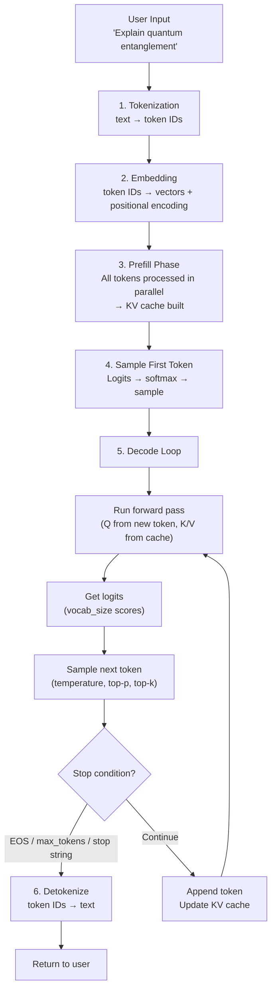

# 3.7 Token Generation Lifecycle

The previous sections covered each stage of inference in isolation. Now let's tie them together into a complete picture — from user input to final response — and identify exactly where the bottlenecks live.

## The Complete Lifecycle



## Step-by-Step Breakdown

### Step 1: Tokenization

```
Input:  "Explain quantum entanglement in simple terms."
Output: [849, 94137, 100455, 304, 4382, 3878, 13]
Time:   < 1 ms (pure CPU, dictionary lookup)
```

Tokenization runs on CPU and is so fast it's rarely a bottleneck — unless you're tokenizing millions of documents.

### Step 2: Embedding

Token IDs are looked up in the embedding table and positional encodings are added. This also runs fast — it's a matrix row lookup, not matrix multiplication.

```
[849, 94137, 100455, ...] 
    → [[0.12, -0.43, 0.91, ...],   ← 4096-dim vector per token
       [0.33,  0.71, -0.15, ...],
       ...]
Time: < 1 ms on GPU
```

### Step 3: Prefill

All token embeddings pass through every Transformer layer in parallel. This is a large batched matrix multiplication — **compute-bound**.

```
Input:  [seq_len × d_model] matrix
Layers: 32 × (attention + FFN)
Output: KV cache stored in GPU HBM
        + embedding for last position (used to produce first logits)

Cost:   O(seq_len × d_model²) per layer
        Scales linearly with prompt length
```

### Steps 4–5: First Token and Decode Loop

The first token is sampled from the last position's logits after prefill. Then the decode loop runs:

```
For each decode step:
  Read last token embedding          (~microseconds)
  Read model weights from HBM        (the main bottleneck — GBs of data)
  Compute Q for current token        (1 vector × 32 layers)
  Compute attention with KV cache    (attend over all prior tokens)
  Compute FFN output                 
  Project to logits                  
  Apply temperature/top-p/top-k      
  Sample token                       (argmax or random draw)
  Append to KV cache                 
  Check stop condition               

Total per step: 5–50ms depending on model size and hardware
```

### Step 6: Detokenization

```
[849, 94137, 100455, ..., 47823, 1] 
    → "Quantum entanglement is a phenomenon where..."
Time: < 1 ms (reverse vocabulary lookup)
```

## Bottleneck Analysis

This is the most important table for anyone optimizing inference:

| Phase | Bound by | Scales with | Optimization lever |
|---|---|---|---|
| Tokenization | CPU speed | Input length | Rarely needed |
| Embedding | Memory bandwidth | — | Rarely needed |
| Prefill | **Compute (FLOP/s)** | Prompt length² / layers | Chunked prefill, prompt caching |
| Decode (per step) | **Memory bandwidth** | Model size / GPU BW | Quantization, GQA, speculative decoding |
| Decode (total) | Steps × per-step | Output length | Early stopping, streaming |

The core insight: **prefill and decode have different bottlenecks**. Throwing more compute at a memory-bandwidth-bound decode phase doesn't help. Throwing more memory bandwidth at a compute-bound prefill phase doesn't help either.

## The Context Window Cost Explosion

Consider how costs scale when you fill up a context window:

```
128K context window, all used for input:

Prefill cost:
  128K tokens × relative cost ≈ 128× the cost of a 1K prompt
  TTFT: potentially 10–30 seconds on a single A100

KV cache memory:
  128K tokens × 1 MB/1K (7B model) = 128 MB per request
  On a 40GB GPU: you can only run ~200 such requests simultaneously

Decode:
  Same cost per token regardless of context length
  (slight increase from longer KV cache attention)
```

This is why context window management matters beyond just the API cost. Long contexts are expensive to prefill and memory-intensive to serve.

## Latency Budget Breakdown

For a typical API call with a 1,000-token prompt and 500-token response on a well-optimized inference stack:

```
Tokenization:         ~1 ms
Network (client→server): ~10–50 ms
Prefill (1K tokens):  ~100–300 ms  ← TTFT includes this
First token sample:   ~5 ms
Decode (500 tokens):  ~2,500 ms (at ~5 ms/token for 7B)
Network (streaming):  continuous
Detokenization:       ~1 ms

Total perceived:
  TTFT: ~200–500 ms (user sees first token here)
  Total: ~3,000–4,000 ms
```

## Understanding Metrics

Two metrics matter for different stakeholders:

**TTFT (Time to First Token)**: primarily governed by prefill. Optimize by:
- Shorter prompts
- Prompt caching
- Prefill disaggregation
- Prioritizing the request in the scheduler

**Tokens per second (decode throughput)**: primarily governed by memory bandwidth. Optimize by:
- Quantization (fewer bytes per weight)
- Larger batches (amortize weight reads)
- Speculative decoding (multiple tokens per step)
- Models with GQA (smaller KV cache)

## Summary Diagram

```
Timeline (not to scale):

|-- Network req -->|-- Prefill -------->|<-- Decode token by token --------->|-- Network resp --|

                   ^                    ^                                     ^
                   |                    |                                     |
              compute-bound        First token                          Memory-BW bound
              scales w/ prompt     reaches client                       scales w/ output len
```

## Summary

- The full lifecycle: tokenize → embed → prefill → decode loop → detokenize
- Tokenization and detokenization are CPU-fast and rarely a bottleneck
- Prefill is **compute-bound**: parallelizable, scales linearly with prompt length
- Decode is **memory-bandwidth-bound**: serial, scales with output length and model size
- TTFT is dominated by prefill; total latency is dominated by decode
- Filling the context window is expensive: 128K tokens = 128× prefill cost vs 1K tokens
- Prompt caching eliminates repeated prefill costs for stable system prompts
