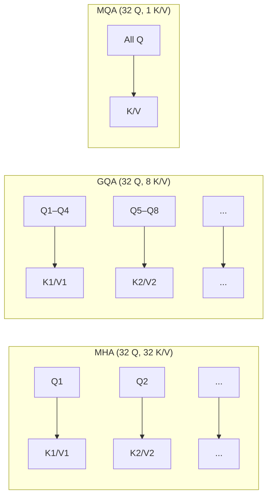

# 4.2 Attention and the KV Cache

The KV cache exists to serve one specific operation: attention. To understand the cache deeply, you need to understand what attention is computing and why K and V are the right things to cache.

## The Attention Formula

Standard scaled dot-product attention:

```
Attention(Q, K, V) = softmax( QKᵀ / √d_k ) × V
```

Where:
- **Q** (Query) — what the current token is looking for
- **K** (Key) — what each past token "is" or "contains"
- **V** (Value) — what each past token contributes if attended to
- **d_k** — the key/query dimension (used for scaling to prevent vanishing gradients)

The output is a weighted sum of all V vectors, where the weights come from how well the current Q matches each K.

## During Prefill: Compute Everything in Parallel

During prefill, all prompt tokens are processed simultaneously. For a prompt of length `n`:

```python
# Shapes:
# Q: [batch, heads, seq_len, head_dim]  — one query per token
# K: [batch, heads, seq_len, head_dim]  — one key per token
# V: [batch, heads, seq_len, head_dim]  — one value per token

scores = torch.matmul(Q, K.transpose(-2, -1)) / math.sqrt(head_dim)
# scores: [batch, heads, seq_len, seq_len]

# Apply causal mask (upper triangle = -inf, enforces left-to-right)
scores = scores.masked_fill(causal_mask, float('-inf'))

weights = F.softmax(scores, dim=-1)
output  = torch.matmul(weights, V)
# output: [batch, heads, seq_len, head_dim]
```

All K and V vectors computed here are saved into the KV cache.

## During Decode: One Query, Cached Keys and Values

At each decode step, only **one new token** is being processed. The query is a single vector:

```python
# During decode step t:
# Q: [batch, heads, 1, head_dim]        ← just the new token
# K: [batch, heads, t+1, head_dim]      ← all past keys (from cache) + new key
# V: [batch, heads, t+1, head_dim]      ← all past values (from cache) + new value

# The new token's key and value are appended to the cache:
K_cache = torch.cat([K_cache, K_new], dim=2)
V_cache = torch.cat([V_cache, V_new], dim=2)

scores = torch.matmul(Q, K_cache.transpose(-2, -1)) / math.sqrt(head_dim)
weights = F.softmax(scores, dim=-1)
output  = torch.matmul(weights, V_cache)
```

Notice: Q is 1 row. K_cache and V_cache are growing matrices. This is why the cache must be in fast GPU memory — it's accessed at every single decode step.

## Why Only K and V Are Cached (Not Q)

The query Q for each decode step depends on the current token's hidden state, which depends on the previous step's output. You can't precompute it. K and V, however, are computed from each token's own position and the model weights — they're fixed once computed and never need updating.

Caching Q would be useless. Caching K and V eliminates all the redundant computation.

## Multi-Head Attention: Parallel Perspectives

In practice, attention is computed across `num_heads` parallel heads, each with its own Q, K, V projection matrices. Each head learns to attend to different aspects of the input (syntax, semantics, position, etc.):

```
head_1 output = Attention(Q·W_Q1, K·W_K1, V·W_V1)
head_2 output = Attention(Q·W_Q2, K·W_K2, V·W_V2)
...
head_h output = Attention(Q·W_Qh, K·W_Kh, V·W_Vh)

final = concat(head_1, ..., head_h) · W_O
```

Each head has its own slice of the KV cache. This is why the total KV cache size scales with `num_heads`.

## Multi-Query Attention (MQA): Shrink the Cache

In standard Multi-Head Attention (MHA), each of the `h` heads has its own K and V projection weights. MQA changes this: **all query heads share a single K and V**.

```
MHA: Q has h heads, K has h heads, V has h heads → KV cache = full size
MQA: Q has h heads, K has 1 head,  V has 1 head  → KV cache = 1/h the size
```

The KV cache shrinks by `num_heads` times (e.g., 32× for a 32-head model), with minimal quality degradation. Trade-off: slightly less expressive attention. Used by: GPT-J, Falcon, some versions of PaLM.

## Grouped-Query Attention (GQA): The Sweet Spot

GQA is a compromise between MHA and MQA. Query heads are divided into groups; each group shares a single K and V:

```
With 32 query heads and 8 KV heads (group size = 4):
  Query heads 0–3   share  KV head 0
  Query heads 4–7   share  KV head 1
  ...
  Query heads 28–31 share  KV head 7
```

KV cache size is reduced by `num_query_heads / num_kv_heads` (e.g., 32/8 = 4× reduction).



### GQA in Modern Models

| Model | Query heads | KV heads | Reduction vs MHA |
|---|---|---|---|
| Llama-2-7B | 32 | 32 | 1× (MHA) |
| Llama-3-8B | 32 | 8 | 4× |
| Llama-3-70B | 64 | 8 | 8× |
| Mistral-7B | 32 | 8 | 4× |
| Gemma-7B | 16 | 16 | 1× (MHA) |

Llama 3 uses GQA throughout — one of the main reasons it can serve longer contexts with less GPU memory than Llama 2.

## Practical Impact on Serving

The choice of attention variant directly determines how many concurrent requests you can serve:

```
7B model weights: ~14 GB (fp16)
Available GPU memory (A100 40GB): ~26 GB

MHA KV cache per 1K tokens:  ~0.5 MB × 4 (full heads) = ~2 MB
GQA KV cache per 1K tokens:  ~0.5 MB                   = ~0.5 MB

With 10K token context:
  MHA: 20 MB per request → serve ~1,300 concurrent sequences
  GQA: 5 MB per request  → serve ~5,200 concurrent sequences
```

GQA's 4× KV cache reduction translates to 4× more concurrent users at the same GPU memory — a significant operational advantage.

## Summary

- Attention formula: `softmax(QKᵀ / √d_k) × V` — outputs a weighted sum of V, weighted by Q-K similarity
- During decode, Q is one vector (current token); K and V come from the full cached history
- K and V are cached because they're fixed per token; Q must be recomputed at each step
- Multi-Head Attention (MHA): full K/V per head — highest quality, largest cache
- Multi-Query Attention (MQA): single shared K/V — smallest cache, slight quality drop
- Grouped-Query Attention (GQA): K/V shared within groups — the modern standard (Llama 3, Mistral)
- GQA reduces KV cache by 4–8×, enabling more concurrent requests per GPU
