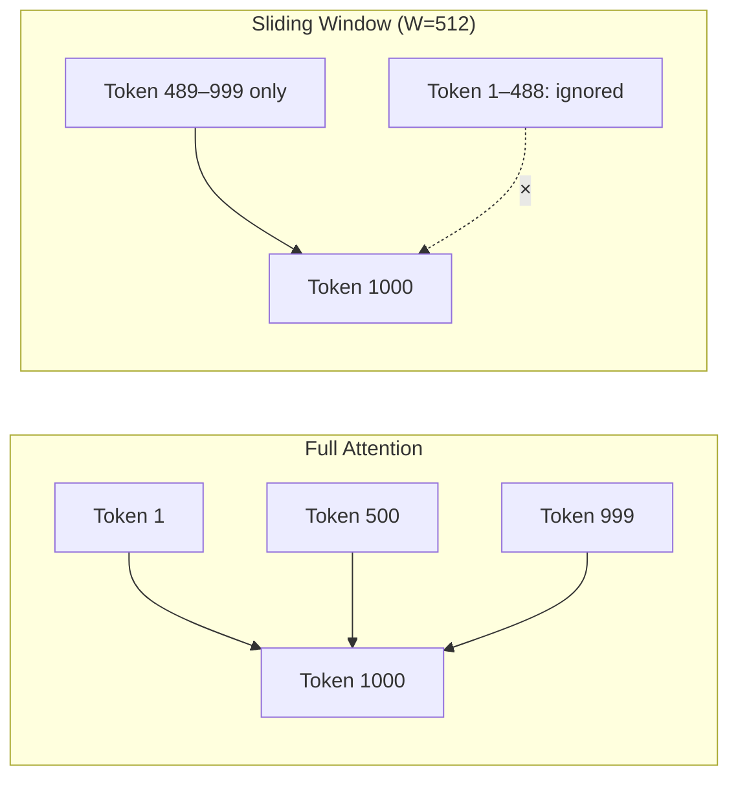

# 4.6 Sliding Window Attention

Standard attention is beautiful but expensive: every token attends to every previous token. That's O(n²) memory and compute with context length. For long documents and extended conversations, this becomes the primary scaling challenge. Sliding window attention offers a practical alternative.

## The Quadratic Scaling Problem

In full (global) attention with a context of n tokens:

```
Attention matrix size: n × n
Memory: O(n²)
Compute: O(n²)

At n = 4,096:   ~16M entries
At n = 32,768:  ~1B entries
At n = 131,072: ~17B entries  ← 131K context, full attention is enormous
```

Not only does the attention matrix itself grow quadratically, but so does the KV cache memory required to maintain it. A 128K context window in full attention mode on a 7B model requires tens of gigabytes just for the cache.

## Sliding Window: Local Attention

Sliding window attention restricts each token to attending only to the **W most recent tokens** (its "window"), where W is a fixed hyperparameter:

```
Full attention (W = n):
  Token 1000 attends to: tokens 1, 2, 3, ..., 999, 1000

Sliding window (W = 512):
  Token 1000 attends to: tokens 489, 490, ..., 999, 1000
  Tokens 1–488 are ignored
```

This reduces the KV cache from O(n) to O(W) — regardless of total sequence length.



## KV Cache Impact

With sliding window attention:

```
KV cache size = W × layers × heads × head_dim × 2 × bytes
             = constant regardless of total sequence length
```

For Mistral-7B with W=4096 and GQA (8 KV heads):

```
KV cache = 4096 × 32 × 8 × 128 × 2 × 2 bytes = 536 MB (fixed ceiling)
```

Compare to full attention on a 100K context:
```
KV cache = 100,000 × 32 × 8 × 128 × 2 × 2 bytes = 13 GB
```

Sliding window caps memory usage and makes the system predictable to operate.

## Mistral's Architecture: Sliding Window + Global Layers

Mistral-7B uses sliding window attention with W=4096 for most layers, but also includes a few "global" attention layers that attend to the full context. This hybrid approach:

- Maintains O(1) KV cache memory growth (local layers dominate)
- Preserves some long-range context via global layers
- Achieves ~90% of full-attention quality on most benchmarks

The global layers act as bottlenecks that aggregate information from the full context and propagate it forward into subsequent local layers.

```
Mistral-7B layer structure (simplified):
  Layer 0:  sliding window (W=4096)
  Layer 1:  sliding window (W=4096)
  Layer 2:  sliding window (W=4096)
  ...
  Layer 7:  global attention (attends to full context)  ← periodically inserted
  Layer 8:  sliding window
  ...
```

## Information Propagation in Sliding Windows

A common concern: does information from distant tokens get lost entirely?

Not exactly. Information propagates through the layers. Token A at position 0 directly influences token B at position 4000 (beyond the window), but indirectly:

```
Layer 0: Token A influences tokens in its window (positions 0–4096)
Layer 1: Those tokens influence their windows
Layer 2: Those tokens influence further tokens
...
After k layers: information from A has propagated k×W positions
```

For a 32-layer model with W=4096: information can theoretically travel 32 × 4096 = 131K positions. This is why sliding window attention works better in practice than the simple analysis suggests.

## Grouped Sliding Window: Combining with GQA

Mistral combines sliding window with Grouped-Query Attention (GQA), achieving multiplicative memory savings:

```
Sliding window alone:         W × layers × num_heads × head_dim
With GQA (8 KV heads):        W × layers × 8         × head_dim
                                    ↑ 4× reduction from MHA
```

## When Sliding Window Hurts

Sliding window is not universally beneficial. It hurts when:

1. **Long-range dependencies are critical**: legal documents with cross-references, multi-document synthesis, long code files where a function calls something defined 5000 tokens earlier.

2. **Needle-in-a-haystack tasks**: the "needle" (the answer) is 10K tokens before the relevant question — sliding window will miss it.

3. **Retrieval-augmented generation**: if retrieved documents are placed far from the question in the prompt, local attention may not bridge the gap.

## When Sliding Window Helps

Ideal for:

1. **Conversations**: recent turns matter most, older turns are summarized or less critical
2. **Streaming document processing**: process very long documents that wouldn't fit in full-attention context
3. **Code generation**: nearby code context is most relevant; very distant definitions matter less
4. **Fixed-size operational windows**: log analysis, time-series interpretation, rolling context

## Configuring Sliding Window in Practice

In HuggingFace Transformers, sliding window is part of the model config:

```python
from transformers import AutoModelForCausalLM, AutoConfig

config = AutoConfig.from_pretrained("mistralai/Mistral-7B-v0.1")
print(config.sliding_window)  # 4096

# For vLLM, it's handled automatically based on the model config:
from vllm import LLM
llm = LLM(model="mistralai/Mistral-7B-v0.1")
# sliding_window=4096 is read from config and applied to the attention kernel
```

## Comparison: Full vs Sliding Window Attention

| Property | Full Attention | Sliding Window |
|---|---|---|
| KV cache memory | O(n) — grows with context | O(W) — fixed ceiling |
| Compute per layer | O(n²) | O(n × W) |
| Long-range recall | Perfect | Approximate (via layer propagation) |
| Context limit | Hardware-bound | Can exceed in theory |
| Quality on long docs | Better | Slightly worse |
| Quality on short contexts | Identical | Identical |
| Memory predictability | Variable | Fixed ceiling |

## Summary

- Full attention is O(n²) in memory and compute — impractical for very long contexts
- Sliding window attention limits each token to attending to the last W tokens, making KV cache O(W) regardless of sequence length
- Mistral-7B uses W=4096 with periodic global attention layers for long-range bridging
- Information still propagates through layers, so distant context is not fully lost
- Ideal for conversations, streaming text, and tasks with strong local dependencies
- Avoid for tasks requiring precise recall of content far back in the context


*Fig: Full attention keeps a cache that grows with the document. A window of W keeps a cache that grows until W and then stops. Information can still travel further than W, one layer at a time.*

Mistral 7B is the public model that made this the default people copy: window 4096, and a few layers that still look at the whole prefix so a fact from the start of the prompt is not stranded (Jiang et al., 2023).

<figure class="paper-shot">

<figcaption>Jiang, Sablayrolles, Mensch, Bamford, Chaplot, de las Casas, Bressand, Lengyel, Lample, Saulnier, Lavaud, Lachaux, Stock, Le Scao, Lavril, Wang, Lacroix &amp; El Sayed (2023), <em>Mistral 7B</em>. <a href="https://arxiv.org/abs/2310.06825">arXiv:2310.06825</a>.</figcaption>
</figure>

<figure class="paper-shot">

<figcaption>First figure of the same paper. <a href="https://ar5iv.labs.arxiv.org/html/2310.06825">HTML version</a>.</figcaption>
</figure>
