# 5.2 Continuous Batching

Continuous batching is the single most impactful optimization in modern LLM serving. It's what allows vLLM to achieve 24× higher throughput than naive serving, and it's why essentially every production inference framework today implements it. The idea is elegant: don't batch at the request level — batch at the **decode step** level.

## The Core Problem with Request-Level Batching

In any form of static or dynamic request-level batching, you have this fundamental problem:

```
Batch = {Request A (1000 tokens output), Request B (20 tokens output)}

Decode step 1:   [A: token 1] [B: token 1]   — both active, batch full
Decode step 2:   [A: token 2] [B: token 2]   — both active
...
Decode step 20:  [A: token 20] [B: token 20] — both active
Decode step 21:  [A: token 21] [_________]   — B FINISHED, but we still run A alone!
...
Decode step 1000:[A: token 1000] [_______]   — A finishes

From step 21 to 1000: GPU is running at half capacity (one slot wasted)
```

The batch started at size 2 but functionally dropped to size 1 after just 20 steps. The GPU ran at 50% utilization for 98% of the generation time.

## Continuous Batching: Immediate Slot Reuse

Continuous batching (also called **iteration-level batching**) fixes this by reusing slots the moment a sequence finishes:

```
Step 20: [A: token 20] [B: token 20]
         B hits EOS → B is DONE

Step 21: [A: token 21] [C: ← NEW REQUEST INSERTED HERE]
         Slot freed by B is immediately filled by a waiting request C

Step 22: [A: token 22] [C: token 2]
...
```

There are no gaps. The batch composition changes at every decode step, but the batch **size** stays constant.

```mermaid
gantt
    title Request Execution Timeline
    dateFormat X
    axisFormat %s

    section Static Batching
    Request A (long)    :a1, 0, 100
    Request B (short)   :b1, 0, 20
    Request C (waiting) :c1, 100, 120
    Request D (waiting) :d1, 100, 115

    section Continuous Batching
    Request A (long)    :a2, 0, 100
    Request B (short)   :b2, 0, 20
    Request C (starts immediately after B) :c2, 20, 40
    Request D (starts when C finishes) :d2, 40, 55
```



## Why This Works: The Decode Step Is Fungible

The key insight enabling continuous batching: **a decode step for sequence A and a decode step for sequence C are identical operations**. Both involve:

1. Look up one token's embedding
2. Run the full model with KV cache
3. Sample a token

Batching different sequences together in the same forward pass is mathematically valid — each sequence's attention is computed independently (with its own KV cache). There's no interaction between sequences in the same batch.

This fungibility is what makes iteration-level batching possible. You're not mixing incompatible operations — you're just running more of the same operation in one GPU kernel call.

## Implementation: The Iteration Loop

Conceptually, the continuous batching engine runs like this:

```python
def continuous_batch_server(model, request_queue, max_batch_size=32):
    active_sequences = []   # currently generating sequences
    
    while True:
        # 1. Fill empty slots from the queue
        while len(active_sequences) < max_batch_size and not request_queue.empty():
            new_request = request_queue.get()
            # Run prefill for this new request
            new_request.kv_cache = model.prefill(new_request.prompt_tokens)
            active_sequences.append(new_request)
        
        if not active_sequences:
            time.sleep(0.001)  # idle wait
            continue
        
        # 2. Run ONE decode step for ALL active sequences
        batch_outputs = model.decode_step(active_sequences)
        
        # 3. Process results, remove completed sequences
        for seq, output_token in zip(active_sequences, batch_outputs):
            seq.generated_tokens.append(output_token)
            
            if output_token == EOS or len(seq.generated_tokens) >= seq.max_tokens:
                seq.complete()          # notify the waiting client
                active_sequences.remove(seq)   # free the slot
        
        # 4. Loop immediately — don't wait for a full batch
        # New sequences from step 1 will fill freed slots
```

This loop runs thousands of times per second. Each iteration is one decode step for all active sequences.

## The Prefill Integration Challenge

One complication: prefill takes multiple steps (the entire prompt at once), while decode is one step per token. When a new request is added to the batch, its prefill must be run somehow.

Two approaches:

**Chunked prefill** (vLLM v2, SGLang): break the prefill into chunks that fit into the decode iteration budget, interleaving prefill with decode:

```
Iteration 1: Decode tokens for [A, B, C] + Prefill chunk 1 of D
Iteration 2: Decode tokens for [A, B, C] + Prefill chunk 2 of D
Iteration 3: Decode tokens for [A, B, C, D]  ← D now joins decode
```

**Prefill-first** (original vLLM): run the full prefill before joining the decode batch, accepting a brief increase in batch size:

```
Pause between iterations:
  Run full prefill for D
  D joins the next decode iteration
```

Both approaches achieve full continuous batching behavior. Chunked prefill is preferred for latency-sensitive workloads (avoids the prefill spike).

## Throughput Numbers

From the original vLLM paper and subsequent benchmarks:

| Serving approach | Throughput (tokens/s) | Notes |
|---|---|---|
| Naive (no batching) | ~100 | One request at a time |
| Static batching | ~500–1,000 | Wait for batch, run together |
| Dynamic batching | ~1,000–2,000 | Start sooner, variable batch |
| Continuous batching (vLLM) | ~2,400+ | Up to 24× naive baseline |

The exact numbers vary widely by model size, hardware, and workload, but the relative ordering is consistent: continuous batching is significantly better than all other approaches for online serving.

## GPU Utilization Impact

```
Static batching:
  During batch: ~40% GPU utilization (attention is memory-bound, not compute-bound)
  Between batches: ~0%
  Average: ~25–35%

Continuous batching:
  Always processing: ~60–80% GPU utilization
  No between-batch gaps
  Average: ~60–80%
```

The improvement comes from two sources:
1. No idle time between batches
2. Larger effective batch sizes (slots are continuously reused)

## vLLM Configuration

```python
from vllm import LLM, SamplingParams

# vLLM implements continuous batching by default
llm = LLM(
    model="meta-llama/Meta-Llama-3-8B-Instruct",
    max_num_seqs=256,              # max batch size
    max_num_batched_tokens=16384,  # max tokens per iteration
    enable_chunked_prefill=True,   # interleave prefill with decode
)

sampling_params = SamplingParams(temperature=0.7, max_tokens=256)

# Submit requests asynchronously
outputs = llm.generate(prompts, sampling_params)
```

## Summary

- Continuous batching operates at the decode step level, not the request level
- When a sequence finishes, its slot is immediately filled by a new waiting request — no gaps
- Decode steps are fungible: running A's step 5 and C's step 1 in the same forward pass is mathematically valid
- GPU utilization jumps from ~30–40% (static batching) to ~70–80%+ (continuous batching)
- vLLM reports 24× throughput improvement over naive serving
- Chunked prefill integrates new requests into the active batch without stalling the decode loop
- Continuous batching is the default in all modern inference servers (vLLM, TGI, TensorRT-LLM)
