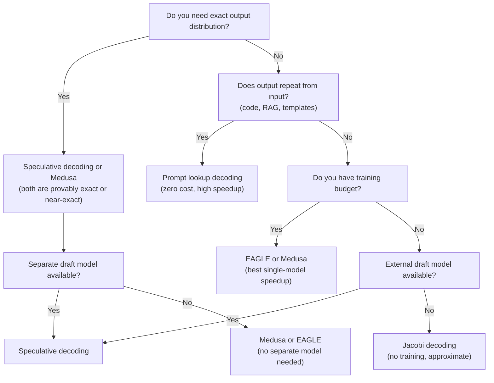

# 6.7 Tradeoffs in Faster Generation

Chapters 6.1–6.6 covered multiple strategies for faster generation. This chapter synthesizes them into a decision framework: given your constraints and requirements, which approach should you choose?

## The Decision Table

| Strategy | Speedup | Quality | Complexity | Memory overhead | Training | Best when |
|---|---|---|---|---|---|---|
| Standard autoregressive | 1× | Exact | Low | None | None | Baseline, simplest case |
| Speculative decoding (external draft) | 2–4× | Exact | Medium | +10–15% | None | High-volume user-facing, long outputs |
| Medusa (extra heads) | 2–3× | ~Exact | Medium | +5–15% | Yes (heads) | Single model, memory-constrained |
| EAGLE / EAGLE-2 | 3–5× | ~Exact | Medium | Small | Yes | Best single-model speedup |
| Prompt lookup decoding | 2–5× | Exact | Low | None | None | Repetitive output (code, RAG) |
| Jacobi decoding | 2–4× | Approximate | Low | None | None | Batch, quality-flexible |
| Parallel decoding (experimental) | 3–8× | Approximate | High | Variable | Sometimes | Research, quality-flexible batch |

## Decision Flow



## Per-Use-Case Recommendations

### Interactive Chat (user-facing API)

**Requirements**: low TTFT, good TPOT, exact distribution, streaming

**Recommendation**: speculative decoding with a small draft model

```bash
# vLLM: target Llama-3-70B, draft Llama-3-8B
python -m vllm.entrypoints.openai.api_server \
    --model meta-llama/Meta-Llama-3-70B-Instruct \
    --speculative-model meta-llama/Meta-Llama-3-8B-Instruct \
    --num-speculative-tokens 5 \
    --tensor-parallel-size 4
```

Expected: 2–3× TPOT improvement, streaming works naturally.

### Code Completion (IDE integration)

**Requirements**: very low TTFT, exact distribution, repetitive output likely

**Recommendation**: prompt lookup decoding first, then speculative if needed

```python
# HuggingFace: prompt lookup for code
output = model.generate(
    input_ids,
    prompt_lookup_num_tokens=5,
    max_new_tokens=128,
    temperature=0.2,   # low temp for code
)
```

Prompt lookup is especially effective for code because variable names and API calls repeat frequently.

### Batch Document Processing

**Requirements**: maximize throughput, latency not critical, quality flexible

**Recommendation**: larger batch size + standard decoding (simpler) or Jacobi

```python
# Large batch, no speculation (simplest, highest throughput)
outputs = model.generate(
    batch_input_ids,      # batch of 64+ sequences
    max_new_tokens=512,
    temperature=0.0,
)
```

For batch jobs, maximizing batch size is usually more impactful than adding speculative decoding complexity.

### Single-GPU Edge Deployment

**Requirements**: minimize memory, decent speed, limited hardware

**Recommendation**: quantized model (int4) + prompt lookup

```python
from transformers import AutoModelForCausalLM, BitsAndBytesConfig

model = AutoModelForCausalLM.from_pretrained(
    "meta-llama/Meta-Llama-3-8B-Instruct",
    quantization_config=BitsAndBytesConfig(load_in_4bit=True),  # 4× memory reduction
)

output = model.generate(
    input_ids,
    prompt_lookup_num_tokens=5,  # free speedup for typical edge tasks
    max_new_tokens=256,
)
```

On a single consumer GPU (RTX 4090), a quantized 7B model with prompt lookup can achieve ~200–400 tokens/second.

### Latency-Critical Agents

**Requirements**: minimize TTFT for tool call detection, exact distribution

**Recommendation**: speculative decoding + chunked prefill + streaming

```python
# vLLM with chunked prefill reduces TTFT variability
python -m vllm.entrypoints.openai.api_server \
    --enable-chunked-prefill \
    --speculative-model small-model \
    --num-speculative-tokens 4
```

Streaming is essential here — start processing output as soon as the first tokens arrive, even before the model has finished generating.

## The Memory Budget Question

Before choosing a strategy, check if you can fit both models:

```python
# Quick memory check
import torch

def estimate_model_memory_gb(param_count_B, dtype=torch.bfloat16):
    bytes_per_param = 2 if dtype == torch.bfloat16 else 4
    return param_count_B * 1e9 * bytes_per_param / 1e9

target = estimate_model_memory_gb(70)   # 70B model
draft  = estimate_model_memory_gb(8)    # 8B draft
kv_cache_overhead = 8  # GB, approximate

total_needed = target + draft + kv_cache_overhead
available_gpu = torch.cuda.get_device_properties(0).total_memory / 1e9

print(f"Needed: {total_needed:.0f} GB, Available: {available_gpu:.0f} GB")
if total_needed > available_gpu:
    print("Consider: quantization, smaller draft, or Medusa instead")
```

If the two-model setup doesn't fit, fall back to Medusa/EAGLE (single model) or prompt lookup (zero overhead).

## The "Just Use Speculative Decoding" Default

For most production use cases with dedicated GPU infrastructure, the recommendation is straightforward:

**Default choice**: speculative decoding with a 10× smaller draft from the same model family.

It's:
- Provably zero quality loss
- 2–4× speedup
- Widely supported (vLLM, HuggingFace)
- No training required
- Operationally simple once configured

Only deviate from this when:
- You don't have memory for two models → use Medusa/EAGLE
- Output is highly repetitive → try prompt lookup first (it might be better)
- You need 5–8× speedup and can tolerate approximate distribution → consider parallel decoding
- Batch size is already large → speculative decoding helps less at large batches

## Summary

- **Standard autoregressive**: simplest, use as baseline and for small/fast models
- **Speculative decoding**: default choice for production — zero quality loss, 2–4× speedup
- **Prompt lookup**: best free speedup for repetitive tasks (code, RAG) — try before adding complexity
- **Medusa / EAGLE**: best when you can't afford a second model; requires fine-tuning
- **Jacobi / parallel decoding**: for quality-flexible batch workloads where maximum speed matters
- Rule of thumb: try prompt lookup → try speculative decoding → consider Medusa if memory-constrained → consider parallel decoding for quality-flexible batch jobs
