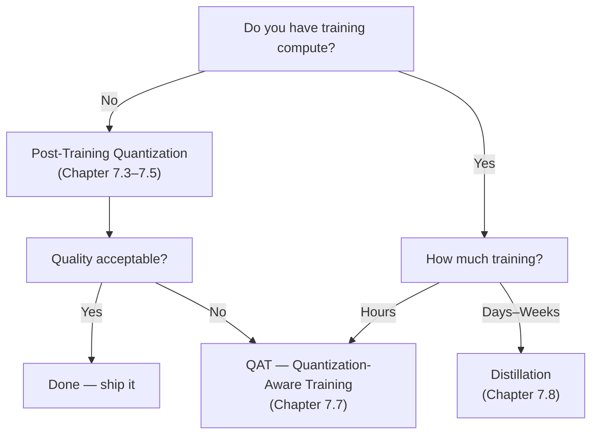

# 7.1 Why Compress Models

A 70B parameter model at float16 precision occupies 140 GB. No single consumer GPU can hold that. Even a high-end A100 80GB can't. Running Llama-3-70B requires at least two A100s just to load the weights. Compression changes this equation dramatically — and even when hardware isn't the constraint, compression still reduces cost, increases speed, and enables new deployment scenarios.

## The Size Problem

Weight size by model and precision:

| Model | fp32 | fp16 / bf16 | int8 | int4 |
|---|---|---|---|---|
| Llama-3-8B | 32 GB | 16 GB | 8 GB | 4 GB |
| Llama-3-70B | 280 GB | 140 GB | 70 GB | 35 GB |
| GPT-3 (175B) | 700 GB | 350 GB | 175 GB | 87.5 GB |
| Llama-3.1-405B | 1,620 GB | 810 GB | 405 GB | 202 GB |

At fp16, the 70B model requires 2× A100 80GB just to load. At int4, it fits on a single A100 80GB with room for KV cache.

## What Compression Enables

### 1. Local Deployment

```
No compression: Llama-3-70B needs 2× A100 ($15,000+ hardware)
With int4: fits on 1× A100 80GB ($10,000)
With int4: fits on 2× RTX 4090 ($3,000)
With int4: fits on some Mac Pro / high-end workstation setups
```

Int4 quantization is the primary reason open-weight LLMs are practically deployable on consumer hardware.

### 2. Reduced API Costs at Scale

When you're running your own inference infrastructure:
- Smaller model → fewer GPUs → lower cloud cost
- A quantized 7B model that performs like an unquantized 7B model but uses half the GPU memory = twice the throughput = half the serving cost per token

### 3. Faster Inference

Decode is memory-bandwidth bound. Smaller weights = fewer bytes to read per decode step = faster generation:

```
fp16 7B model on A100:
  Bytes per decode step: ~14 GB
  A100 bandwidth: 2,000 GB/s
  Minimum decode time: 14/2000 = 7ms → ~143 tokens/second

int4 7B model on A100:
  Bytes per decode step: ~3.5 GB
  Minimum decode time: 3.5/2000 = 1.75ms → ~570 tokens/second
  
Speedup: ~4× (in theory; actual speedup is 2–3× due to dequantization overhead)
```

### 4. Edge and On-Device Deployment

On-device AI (phones, laptops, embedded systems) has strict memory limits:

- iPhone 15 Pro: 8 GB unified memory
- High-end laptop: 16–32 GB RAM (slow vs HBM)
- Edge devices (Raspberry Pi, Jetson): 4–16 GB

An int4 quantized 1B–3B model can run meaningfully on these devices. An fp16 model cannot.

## The Three Pillars of Compression

### Quantization

Reduce numerical precision of weights (and sometimes activations):

```
fp16: 65,504 possible values in [-65504, 65504]
int8: 256 possible values in [-128, 127]
int4: 16 possible values in [-8, 7]
```

Quantization is the most practical compression method: no retraining needed for post-training quantization (PTQ), well-supported tooling, predictable quality tradeoffs. Covered in Chapters 7.2–7.7.

### Pruning

Remove individual weights (unstructured pruning) or entire neurons/heads (structured pruning) that contribute little to the output:

```
Unstructured pruning: set low-magnitude weights to 0 → sparse weight matrix
Structured pruning: remove entire attention heads → smaller but dense model
```

Pruning is complex in practice:
- Sparse matrices require special hardware support for speedup (most GPUs don't accelerate sparse operations well)
- Structured pruning requires retraining to recover quality
- The "lottery ticket hypothesis" — finding which subnetwork to keep — is not straightforward

For most practitioners: **quantization is easier and more reliable than pruning**.

### Distillation

Train a small student model to mimic a large teacher model:

```
Teacher: Llama-3-70B generates rich probability distributions
Student: Llama-3-8B trained to match teacher's distributions (not just hard labels)

Loss = cross_entropy(student_logits, labels) + α × KL(student_logits, teacher_logits)
```

Distillation produces smaller models that punch above their parameter count — the student learns "soft knowledge" that's richer than just supervised training on correct answers.

Examples:
- **DistilBERT**: 66M parameters, 97% of BERT-large quality
- **Phi-3-mini (3.8B)**: trained on GPT-4 distilled data, competitive with 7B models
- **GPT-4o mini**: implicit distillation from GPT-4o

Distillation is expensive (requires access to the teacher during training) but produces the best quality-per-parameter models.

## Choosing Your Compression Strategy



| Situation | Recommended approach |
|---|---|
| Model must fit on hardware | int4 PTQ (GPTQ or AWQ) |
| Serving cost too high | int8 PTQ or int4 |
| Maximum quality at smaller size | Distillation |
| Strict quality, need compression | QAT |
| Edge deployment | int4 + distillation for smallest models |

## What Compression Does NOT Do

Compression does not:
- **Improve the model's knowledge**: a quantized Llama-3-8B knows the same things as the original — it just takes less memory
- **Make a small model think like a large model**: int4 quantization of a 7B model is still a 7B model
- **Automatically maintain fine-tune quality**: if you fine-tuned a model, you'll need to re-apply quantization after fine-tuning

## Summary

- A 70B fp16 model needs 140 GB — beyond any single GPU; int4 brings it to 35 GB (fits on one A100 80GB)
- Compression enables: local deployment, reduced cloud cost, faster inference (memory-bandwidth bound), edge/on-device AI
- Three pillars: quantization (easiest, most practical), pruning (complex, hardware-dependent), distillation (expensive but best quality-per-parameter)
- For most practitioners: start with int8 PTQ, move to int4 if hardware requires, consider distillation only if you have training budget and strict quality needs
