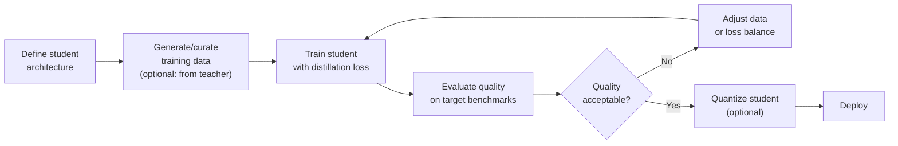

# 7.8 Distillation

Knowledge distillation trains a smaller "student" model to mimic a larger "teacher" model. Unlike quantization — which compresses an existing model — distillation produces a genuinely smaller model that has learned to approximate the teacher's behavior. The result is a model that punches well above its parameter weight class.

## Why Distillation Produces Better Small Models

Standard supervised training teaches a model from hard labels: "the correct answer to this question is A." Distillation teaches from the teacher's **full probability distribution**: "the teacher thinks A is 70% likely, B is 20% likely, C is 8% likely, D is 2% likely."

This soft distribution carries far more information than the hard label:

```
Hard label training signal:
  "The answer is A"
  Information: 1 bit (which of 4 choices is correct)

Soft distribution training signal:
  "A: 70%, B: 20%, C: 8%, D: 2%"
  Information: much richer — the model learns that B is a reasonable
               alternative, C is worth considering, D is nearly impossible
```

The soft labels encode the teacher's understanding of concept relationships, ambiguity, and near-misses. The student learns from this richer signal, fitting the teacher's "dark knowledge" — all the probability mass the teacher assigns to wrong answers.

## The Distillation Loss

Standard distillation uses a combination of:

1. **Hard loss**: cross-entropy with the ground-truth labels
2. **Soft loss**: KL divergence from the teacher's distributions

```python
import torch
import torch.nn.functional as F

def distillation_loss(
    student_logits,     # student model output logits
    teacher_logits,     # teacher model output logits
    labels,             # ground truth token IDs
    temperature=2.0,    # soften distributions
    alpha=0.5,          # balance between hard and soft loss
):
    # Soft loss: KL divergence between student and teacher distributions
    # Temperature > 1 softens both distributions, amplifying soft knowledge
    student_soft = F.log_softmax(student_logits / temperature, dim=-1)
    teacher_soft = F.softmax(teacher_logits / temperature, dim=-1)
    soft_loss = F.kl_div(student_soft, teacher_soft, reduction="batchmean")
    soft_loss *= temperature ** 2  # compensate for temperature scaling

    # Hard loss: standard cross-entropy
    hard_loss = F.cross_entropy(student_logits, labels)
    
    return alpha * soft_loss + (1 - alpha) * hard_loss
```

The temperature parameter controls how "soft" the distributions are:
- **T=1**: use distributions as-is
- **T=2–5**: soften distributions (reduce entropy differences), amplifying information in lower-probability tokens

## Sequence-Level vs Token-Level Distillation

**Token-level distillation** (standard): at each position, minimize KL divergence between student and teacher's next-token distribution. This is the approach in the formula above.

**Sequence-level distillation**: generate complete sequences from the teacher, then train the student to replicate those sequences. This is what most modern open-model distillation does in practice:

```python
# Sequence-level distillation (implicit, via generated data)

# Step 1: Generate training data with the teacher
teacher_outputs = []
for prompt in training_prompts:
    response = teacher_model.generate(prompt, temperature=0.7)
    teacher_outputs.append((prompt, response))

# Step 2: Train the student on teacher-generated data
# (standard supervised fine-tuning, not classical KL distillation)
student_model.fine_tune(teacher_outputs)
```

This is technically **data distillation** or **teacher-generated training data** rather than classical distillation, but the result is similar: the student learns from the teacher's outputs.

## Real-World Distillation Examples

### DistilBERT (Sanh et al., 2019)

```
Teacher: BERT-base (110M parameters)
Student: DistilBERT (66M parameters, 40% smaller)

Training: 90 hours on 8 V100 GPUs
Results:
  GLUE score: 97% of BERT-base
  Inference speed: 60% faster
  Memory: 40% less

Loss = hard_loss + soft_loss + cosine_embedding_loss
(matching hidden states in addition to output distributions)
```

### Phi-3 (Microsoft, 2024)

Phi-3-mini (3.8B) was trained on heavily curated "textbook quality" data, much of it generated by GPT-4:

```
Teacher data source: GPT-4 generated explanations, code, reasoning traces
Student: Phi-3-mini (3.8B parameters trained from scratch)

Results:
  MMLU: 68.8% (better than many 7B models)
  HumanEval: 60.9% (competitive with models 2× larger)
```

### Llama-3.2 (Meta, 2024)

Llama-3.2's 1B and 3B models were distilled from Llama-3.1-8B:

```python
# Accessing Llama-3.2 distilled models
from transformers import AutoModelForCausalLM

# 1B — fast edge deployment
model_1b = AutoModelForCausalLM.from_pretrained(
    "meta-llama/Llama-3.2-1B-Instruct",
    torch_dtype=torch.bfloat16,
)

# 3B — better quality, still small
model_3b = AutoModelForCausalLM.from_pretrained(
    "meta-llama/Llama-3.2-3B-Instruct",
    torch_dtype=torch.bfloat16,
)
```

Llama-3.2-3B outperforms older 7B models (Llama-2-7B) on most benchmarks, demonstrating the power of distillation.

## The Distillation Pipeline

End-to-end distillation for a production model:



## Compute Requirements

Distillation is expensive. It requires:

1. **Teacher inference** (to generate soft labels or training data): running a large model over your training dataset
2. **Student training**: standard LLM pre-training or fine-tuning

Rough estimates for training a distilled model:

| Student size | Teacher size | Training data | GPU time |
|---|---|---|---|
| 1B | 8B | 100B tokens | ~200 A100-hours |
| 7B | 70B | 1T tokens | ~5,000 A100-hours |
| 13B | 70B | 1T tokens | ~10,000 A100-hours |

These are rough orders of magnitude. Actual requirements vary significantly.

## Distillation vs Quantization

| Aspect | Distillation | Quantization (PTQ) |
|---|---|---|
| Compute required | High (training) | Low (hours) |
| Model size reduction | 2–10× | 2–4× |
| Quality at same size | Better | Depends on method |
| Flexibility | Fixed after training | Apply to any model |
| Deployment | New model | Modified weights |
| Use case | Smallest possible model | Fit existing model to hardware |

Distillation and quantization are complementary — you can quantize a distilled model. A distilled 3B model quantized to int4 is a very small, fast, high-quality model.

## Summary

- Distillation trains a small student to mimic a large teacher's **output distributions**, not just hard labels
- Soft labels carry more information: they encode the teacher's uncertainty and concept relationships
- Distillation loss = KL divergence (soft) + cross-entropy (hard), balanced by hyperparameter α
- Modern "implicit distillation": train on teacher-generated data (simpler than explicit KL matching)
- Phi-3-mini (3.8B), DistilBERT, Llama-3.2-1B/3B are prominent real-world examples
- Distilled models outperform same-size models trained from scratch or quantized larger models
- Expensive: requires teacher inference + student training; days-to-weeks of GPU time
- Combine with quantization for maximum compression (distill first, quantize second)
