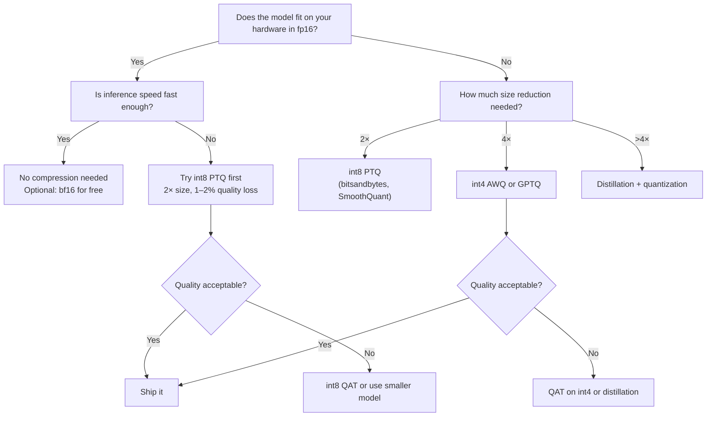

# 7.9 Quality Tradeoffs

You've now seen all the major compression techniques. This chapter synthesizes them into a decision-making framework: given your quality requirements, hardware constraints, and engineering resources, which approach is right for your situation?

## The Compression Quality Tradeoff Table

| Method | Size reduction | Typical quality loss | Compute required | Recommendation |
|---|---|---|---|---|
| **fp16 → bf16** | 0× (same size) | Near zero (rounding only) | None | Always safe — use bf16 over fp16 on modern hardware |
| **fp16 → fp8** | 2× | <0.5% | None (format conversion) | Default for H100 deployments |
| **fp16 → int8 (PTQ)** | 2× | 1–2% | Minutes | Default starting point for memory reduction |
| **fp16 → int4 (naive PTQ)** | 4× | 5–15% | Minutes | Not recommended — use GPTQ or AWQ instead |
| **fp16 → int4 (GPTQ)** | 4× | 2–5% | Hours (CPU) | When hardware requires int4 |
| **fp16 → int4 (AWQ)** | 4× | 1–4% | 5–30 min | Preferred over GPTQ for new deployments |
| **QAT (fine-tuned)** | 2–4× (int4/int8) | <1% | 100–1000 GPU-hours | When PTQ quality is unacceptable |
| **Distillation** | 2–10× | Variable | Days–weeks | When hardware severely constrains model size |

## Decision Tree



## Quality Impact by Model Size

A critical insight: larger models tolerate quantization better than smaller ones.

```
7B model at int4:
  MMLU: ~94–96% of fp16    ← noticeable drop
  GSM8K: ~82–90%           ← significant drop

70B model at int4:
  MMLU: ~96–98% of fp16    ← minor drop
  GSM8K: ~90–95%           ← moderate drop

The 70B int4 model outperforms the 7B fp16 model on most tasks.
```

This means: **quantizing to fit a larger model often beats using a smaller model in full precision**.

```
Decision: "I have one A100 80GB. Should I run Llama-3-70B int4 (35 GB) or Llama-3-8B fp16 (16 GB)?"

Answer: Llama-3-70B int4 — it will significantly outperform Llama-3-8B fp16 on almost every benchmark.
```

## Benchmark Deep Dive

Running the same benchmarks across quantization levels for Llama-3-8B:

| Benchmark | fp16 | int8 PTQ | int4 AWQ | int4 GPTQ |
|---|---|---|---|---|
| MMLU (5-shot) | 66.6% | 65.8% | 65.1% | 64.7% |
| HumanEval (code) | 62.2% | 61.1% | 59.7% | 59.1% |
| GSM8K (math) | 79.6% | 77.4% | 73.8% | 72.3% |
| ARC-Challenge | 78.0% | 77.5% | 76.8% | 76.4% |
| TruthfulQA | 44.7% | 44.2% | 43.6% | 43.1% |

> Note: Specific numbers vary by implementation and calibration data. These are illustrative.

Math (GSM8K) shows the largest drops. Code (HumanEval) is moderately sensitive. General knowledge (MMLU) is most resilient.

## Task-Specific Recommendations

**For coding assistants**:
```
Recommended: int4 AWQ or int8 PTQ
Avoid: aggressive int2 quantization
Rationale: code generation needs syntactic precision; int8 or good int4 is sufficient
```

**For mathematical reasoning**:
```
Recommended: int8 or fp16 if possible
Avoid: int4 on small models (7B or less)
Rationale: math is most sensitive to quantization; use larger quantized model if needed
```

**For general chat and Q&A**:
```
Recommended: int4 AWQ — quality loss is imperceptible to users
Rationale: casual conversations don't require the last 2% of MMLU score
```

**For structured output (JSON extraction)**:
```
Recommended: int8 or int4 + temperature=0
Avoid: int2 or aggressive quantization
Rationale: JSON validity is all-or-nothing; small quality drops can cause parse failures
```

## The Speedup Reality

Theoretical vs measured speedup from quantization:

| Format change | Theoretical speedup | Measured speedup (batch=1) | Measured (batch=32) |
|---|---|---|---|
| fp16 → int8 | 2× | 1.4–1.6× | 1.2–1.4× |
| fp16 → int4 | 4× | 2.0–2.8× | 1.6–2.0× |

Real speedup is lower than theoretical because:
1. Dequantization overhead (int4 must be converted to fp16 before arithmetic)
2. Other bottlenecks exist (attention, memory transfers for KV cache, etc.)
3. Kernel efficiency varies by hardware and implementation

At large batch sizes, quantization helps less — the GPU is more compute-bound, and compute savings matter more than memory-bandwidth savings.

## Combining Techniques

For maximum compression without training:

```python
# Step 1: Distill (if available/feasible)
# → Use a smaller distilled base model (e.g., Phi-3-mini instead of Llama-3-8B)

# Step 2: Apply AWQ int4 quantization
from awq import AutoAWQForCausalLM
model = AutoAWQForCausalLM.from_pretrained("microsoft/Phi-3-mini-4k-instruct")
model.quantize(tokenizer, quant_config={"w_bit": 4, "q_group_size": 128})

# Step 3: Quantize KV cache too
python -m vllm.entrypoints.openai.api_server \
    --model ./phi-3-mini-awq \
    --quantization awq \
    --kv-cache-dtype fp8   ← also quantize KV cache
```

Combined result: a distilled, int4-quantized model with fp8 KV cache uses ~4–6× less memory than the original fp16 model.

## Quick Reference: "What Should I Do?"

```
I want to save memory quickly, minimal quality loss:
  → int8 bitsandbytes (load_in_8bit=True) or fp8 (H100)

I need 4× memory reduction with good quality:
  → AWQ int4 (preferred) or GPTQ int4

I need 4× memory reduction, quality is critical:
  → QAT fine-tuning after AWQ

I need to run a model much larger than my hardware normally allows:
  → int4 quantization — a 4× compressed model is better than a 4× smaller model

I'm deploying on a phone or edge device:
  → Distilled model (Phi-3, Llama-3.2-1B) + GGUF Q4_K_M

I need the absolute fastest inference on H100:
  → SmoothQuant int8 (W8A8) via TensorRT-LLM
```

## Summary

- **Rule 1**: int8 PTQ is almost always safe — 1–2% quality loss, 2× memory reduction
- **Rule 2**: for int4, use AWQ (preferred) or GPTQ — never naive per-tensor int4
- **Rule 3**: larger models tolerate quantization better — a 70B int4 model beats a 7B fp16 model
- **Rule 4**: math and complex reasoning degrade most; general conversation degrades least
- **Rule 5**: measured speedup is 50–70% of theoretical — dequantization overhead is real
- **Rule 6**: distillation + quantization are complementary — use both for maximum compression
- **The stack for maximum compression**: distilled model → int4 AWQ → fp8 KV cache → continuous batching
