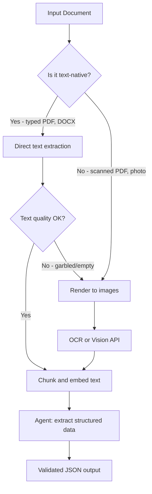

# 12.2 Document Processing Agents

Documents are everywhere in enterprise workflows: invoices, contracts, research papers, forms, reports. A document processing agent that can reliably extract structured data from any document — typed or scanned, clean or noisy — is one of the highest-value agents you can build.

## The Document Processing Pipeline

Every document processing task follows the same core pipeline, with a fork at step two based on whether the document is text-native or image-based:



The key insight is the fallback: always try direct text extraction first (fast and cheap), and only invoke the more expensive vision path when extraction fails or produces garbage.

## Text Extraction from PDFs

PyPDF2 is the standard Python library for text-native PDFs:

```python
import PyPDF2
from pathlib import Path

def extract_text_from_pdf(pdf_path: str) -> dict[int, str]:
    """
    Extract text from each page of a PDF.
    Returns a dict mapping page number (1-indexed) to text content.
    """
    pages = {}
    with open(pdf_path, "rb") as f:
        reader = PyPDF2.PdfReader(f)
        for i, page in enumerate(reader.pages, start=1):
            text = page.extract_text() or ""
            pages[i] = text.strip()
    return pages

def is_text_extraction_reliable(pages: dict[int, str]) -> bool:
    """
    Check whether extracted text looks like real content.
    Scanned PDFs often return empty strings or gibberish.
    """
    total_chars = sum(len(t) for t in pages.values())
    non_empty_pages = sum(1 for t in pages.values() if len(t) > 50)
    
    if total_chars < 100:
        return False  # Almost certainly a scanned doc
    if non_empty_pages < len(pages) * 0.5:
        return False  # More than half the pages have no text
    
    return True
```

## Rendering PDFs as Images (for Scanned Docs)

When direct extraction fails, `pdf2image` renders each page as a PIL image that can be sent to the vision API:

```python
from pdf2image import convert_from_path
import base64
import io

def render_pdf_pages(pdf_path: str, dpi: int = 200) -> list[str]:
    """
    Render each PDF page as a base64-encoded PNG string.
    DPI 200 is a good balance — readable text without huge file sizes.
    """
    images = convert_from_path(pdf_path, dpi=dpi)
    encoded_pages = []
    
    for img in images:
        # Convert PIL image to base64 PNG
        buffer = io.BytesIO()
        img.save(buffer, format="PNG")
        buffer.seek(0)
        encoded = base64.b64encode(buffer.read()).decode("utf-8")
        encoded_pages.append(encoded)
    
    return encoded_pages
```

> **Installing pdf2image:** This library requires Poppler to be installed separately. On macOS: `brew install poppler`. On Ubuntu: `apt install poppler-utils`. On Windows: download the Poppler binaries and add them to PATH.

## OCR with Tesseract

For documents where you need machine-readable text (not just vision API answers), Tesseract gives you explicit character-level extraction:

```python
import pytesseract
from PIL import Image
from pdf2image import convert_from_path

def ocr_pdf(pdf_path: str, lang: str = "eng") -> dict[int, str]:
    """
    Extract text from a scanned PDF using Tesseract OCR.
    Returns page number → extracted text.
    """
    images = convert_from_path(pdf_path, dpi=300)  # Higher DPI for OCR
    results = {}
    
    for i, img in enumerate(images, start=1):
        text = pytesseract.image_to_string(img, lang=lang)
        results[i] = text.strip()
    
    return results

def ocr_image_file(image_path: str, lang: str = "eng") -> str:
    """OCR a single image file."""
    img = Image.open(image_path)
    return pytesseract.image_to_string(img, lang=lang)
```

Tesseract works well for clean scans. For poor-quality scans (skewed, low-contrast, handwritten text), a cloud vision API like Google Cloud Vision or the LLM vision endpoint directly will outperform it significantly.

## The Intelligent Document Agent

Here's the full pipeline assembled into an agent that routes documents intelligently:

```python
import openai
import json
from dataclasses import dataclass
from typing import Any

client = openai.OpenAI()

@dataclass
class ExtractionResult:
    method: str          # "text", "ocr", or "vision"
    pages_processed: int
    raw_text: str
    structured_data: dict[str, Any]
    confidence: str      # "high", "medium", "low"

def extract_document(pdf_path: str, schema: dict) -> ExtractionResult:
    """
    Extract structured data from a PDF using the best available method.
    
    schema: JSON schema describing the fields to extract, e.g.
        {
            "invoice_number": "string",
            "date": "ISO date string",
            "vendor": "string",
            "line_items": [{"description": "string", "amount": "number"}],
            "total": "number"
        }
    """
    # Step 1: Try direct text extraction
    pages = extract_text_from_pdf(pdf_path)
    
    if is_text_extraction_reliable(pages):
        # Text-native PDF — use direct extraction
        full_text = "\n\n--- Page Break ---\n\n".join(
            f"[Page {n}]\n{text}" for n, text in pages.items()
        )
        return _extract_via_text(full_text, schema, method="text")
    
    # Step 2: Fallback to vision
    print(f"Text extraction unreliable for {pdf_path}, falling back to vision API")
    encoded_pages = render_pdf_pages(pdf_path)
    return _extract_via_vision(encoded_pages, schema)


def _extract_via_text(text: str, schema: dict, method: str) -> ExtractionResult:
    """Extract structured data from text using an LLM."""
    schema_str = json.dumps(schema, indent=2)
    
    response = client.chat.completions.create(
        model="gpt-4o",
        messages=[
            {
                "role": "system",
                "content": "You are a document extraction specialist. Extract the requested fields accurately. Return only valid JSON matching the schema."
            },
            {
                "role": "user",
                "content": f"""Extract the following fields from this document text.

Schema:
```json
{schema_str}
```

Document text:
{text[:8000]}

Return a JSON object with the extracted values. Use null for fields that cannot be found."""
            }
        ],
        response_format={"type": "json_object"},
        max_tokens=2048
    )
    
    extracted = json.loads(response.choices[0].message.content)
    return ExtractionResult(
        method=method,
        pages_processed=text.count("--- Page Break ---") + 1,
        raw_text=text,
        structured_data=extracted,
        confidence="high"
    )


def _extract_via_vision(encoded_pages: list[str], schema: dict) -> ExtractionResult:
    """Extract structured data by sending rendered pages to vision API."""
    schema_str = json.dumps(schema, indent=2)
    
    # Build multi-image content block
    content = [
        {
            "type": "text",
            "text": f"""Extract the following fields from this document. The document is shown as page images.

Schema:
```json
{schema_str}
```

Return a JSON object with the extracted values. Use null for any fields you cannot find or read clearly."""
        }
    ]
    
    # Attach each page (limit to first 10 pages to control cost)
    for page_data in encoded_pages[:10]:
        content.append({
            "type": "image_url",
            "image_url": {
                "url": f"data:image/png;base64,{page_data}",
                "detail": "high"
            }
        })
    
    response = client.chat.completions.create(
        model="gpt-4o",
        messages=[{"role": "user", "content": content}],
        response_format={"type": "json_object"},
        max_tokens=2048
    )
    
    extracted = json.loads(response.choices[0].message.content)
    return ExtractionResult(
        method="vision",
        pages_processed=len(encoded_pages),
        raw_text="",  # No raw text available for vision path
        structured_data=extracted,
        confidence="medium"  # Vision extraction is less reliable than text
    )
```

## Chunking for Long Documents

Documents longer than a few pages won't fit in the context window as raw text. Chunk them before extraction:

```python
def chunk_text(text: str, chunk_size: int = 3000, overlap: int = 200) -> list[str]:
    """Split text into overlapping chunks for long-document processing."""
    chunks = []
    start = 0
    while start < len(text):
        end = start + chunk_size
        chunks.append(text[start:end])
        start += chunk_size - overlap
    return chunks

def extract_from_long_document(pdf_path: str, schema: dict) -> dict:
    """
    Process a long document by extracting from each chunk
    and merging the results.
    """
    pages = extract_text_from_pdf(pdf_path)
    full_text = "\n".join(pages.values())
    chunks = chunk_text(full_text)
    
    all_extractions = []
    for i, chunk in enumerate(chunks):
        result = _extract_via_text(chunk, schema, method="text_chunked")
        all_extractions.append(result.structured_data)
    
    # Merge: for lists (line items), combine; for scalars, take first non-null
    return merge_extractions(all_extractions, schema)
```

## Practical Document Types

| Document Type | Best Approach | Notes |
|---|---|---|
| Typed PDF (report, contract) | Direct text extraction | Fast, cheap, high accuracy |
| Scanned invoice | Vision API | Cloud vision beats Tesseract for noisy scans |
| Handwritten form | Vision API | Tesseract cannot reliably read handwriting |
| Spreadsheet (.xlsx) | `openpyxl` for structured read | Preserve cell structure; don't extract as text |
| Word document (.docx) | `python-docx` | Preserves tables and formatting better than PDF conversion |
| Image (photo of document) | Vision API directly | Skip the PDF step entirely |

## Key Takeaways

- Always try direct text extraction first — it's faster and cheaper
- Use `is_text_extraction_reliable()` to detect scanned PDFs and trigger the vision fallback
- `pdf2image` + vision API handles virtually any document a human can read
- Tesseract is useful when you need explicit OCR text output; vision models are better for noisy or handwritten documents
- Long documents need chunking; keep chunk overlap to maintain context across boundaries
