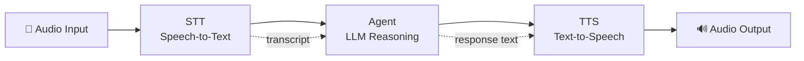

# 12.3 Audio and Voice Agents

Voice is the most natural human interface. A well-built voice agent feels like talking to a knowledgeable colleague — fast, responsive, and conversational. A poorly-built one feels like calling an automated phone system from 2003. This section covers the pipeline, the latency math, and the tricks that make the difference.

## The Voice Pipeline

Every voice agent is a three-stage pipeline:



The stages are independent, and each can be swapped out:

| Stage | Options | Latency |
|---|---|---|
| **STT** | OpenAI Whisper, Deepgram Nova, AssemblyAI | 150–400ms |
| **Agent** | GPT-4o, Claude, Gemini | 300–2000ms (TTFT) |
| **TTS** | OpenAI TTS, ElevenLabs, Azure Neural Voice | 100–300ms |

Total round-trip: **550ms to 2700ms** depending on choices and response length.

## Speech-to-Text with Whisper

OpenAI's Whisper model is the most widely used STT option — open source, supports 99 languages, and available via API:

```python
import openai
from pathlib import Path

client = openai.OpenAI()

def transcribe_audio(audio_path: str, language: str = "en") -> str:
    """
    Transcribe an audio file using OpenAI Whisper.
    Supports: mp3, mp4, mpeg, mpga, m4a, wav, webm
    """
    with open(audio_path, "rb") as audio_file:
        transcript = client.audio.transcriptions.create(
            model="whisper-1",
            file=audio_file,
            language=language,
            response_format="text"
        )
    return transcript

# With timestamps (useful for long recordings)
def transcribe_with_timestamps(audio_path: str) -> dict:
    with open(audio_path, "rb") as audio_file:
        transcript = client.audio.transcriptions.create(
            model="whisper-1",
            file=audio_file,
            response_format="verbose_json",
            timestamp_granularities=["word"]
        )
    return transcript.model_dump()
```

For real-time microphone input, capture audio in chunks and stream to the API:

```python
import pyaudio
import wave
import tempfile

def record_until_silence(
    silence_threshold: float = 0.01,
    silence_duration: float = 1.5,
    sample_rate: int = 16000
) -> str:
    """Record audio until 1.5 seconds of silence. Returns path to temp WAV file."""
    p = pyaudio.PyAudio()
    stream = p.open(
        format=pyaudio.paFloat32,
        channels=1,
        rate=sample_rate,
        input=True,
        frames_per_buffer=1024
    )
    
    frames = []
    silent_frames = 0
    required_silent_frames = int(sample_rate / 1024 * silence_duration)
    
    print("Listening...")
    while True:
        data = stream.read(1024)
        frames.append(data)
        
        # Check amplitude for silence detection
        import struct
        amplitude = max(abs(struct.unpack('f', data[i:i+4])[0])
                       for i in range(0, len(data), 4))
        
        if amplitude < silence_threshold:
            silent_frames += 1
        else:
            silent_frames = 0
        
        if silent_frames >= required_silent_frames and len(frames) > 10:
            break
    
    stream.stop_stream()
    stream.close()
    p.terminate()
    
    # Save to temp file
    tmp = tempfile.NamedTemporaryFile(suffix=".wav", delete=False)
    with wave.open(tmp.name, 'wb') as wf:
        wf.setnchannels(1)
        wf.setsampwidth(p.get_sample_size(pyaudio.paFloat32))
        wf.setframerate(sample_rate)
        wf.writeframes(b''.join(frames))
    
    return tmp.name
```

## Text-to-Speech

OpenAI's TTS API converts agent responses back to audio:

```python
import openai
from pathlib import Path

client = openai.OpenAI()

def speak(text: str, voice: str = "alloy", output_path: str = "response.mp3") -> str:
    """
    Convert text to speech using OpenAI TTS.
    Voices: alloy, echo, fable, onyx, nova, shimmer
    """
    response = client.audio.speech.create(
        model="tts-1",           # tts-1 for speed, tts-1-hd for quality
        voice=voice,
        input=text,
        response_format="mp3"
    )
    response.stream_to_file(output_path)
    return output_path

def speak_and_play(text: str, voice: str = "nova"):
    """Generate and immediately play the speech."""
    import subprocess
    audio_path = speak(text, voice=voice)
    # Play on macOS/Linux
    subprocess.run(["afplay", audio_path])   # macOS
    # subprocess.run(["aplay", audio_path])  # Linux
```

ElevenLabs offers higher-quality, more expressive voices for production deployments:

```python
from elevenlabs import ElevenLabs, VoiceSettings

el_client = ElevenLabs(api_key="your-key")

def speak_elevenlabs(text: str, voice_id: str = "Rachel") -> bytes:
    audio = el_client.generate(
        text=text,
        voice=voice_id,
        voice_settings=VoiceSettings(
            stability=0.5,
            similarity_boost=0.75,
            style=0.0,
            use_speaker_boost=True
        ),
        model="eleven_turbo_v2"  # Faster model for lower latency
    )
    return b"".join(audio)
```

## The Complete Voice Agent Loop

```python
import openai
import time

client = openai.OpenAI()

class VoiceAgent:
    def __init__(self, system_prompt: str, voice: str = "nova"):
        self.system_prompt = system_prompt
        self.voice = voice
        self.conversation_history = []
    
    def run(self):
        print("Voice agent ready. Speak to interact. (Ctrl+C to exit)")
        
        while True:
            try:
                # Step 1: Record user speech
                audio_path = record_until_silence()
                
                # Step 2: Transcribe (STT)
                t0 = time.time()
                user_text = transcribe_audio(audio_path)
                stt_ms = (time.time() - t0) * 1000
                print(f"You: {user_text} ({stt_ms:.0f}ms STT)")
                
                # Step 3: Agent reasoning
                self.conversation_history.append({
                    "role": "user", "content": user_text
                })
                
                t1 = time.time()
                response = client.chat.completions.create(
                    model="gpt-4o",
                    messages=[
                        {"role": "system", "content": self.system_prompt},
                        *self.conversation_history
                    ],
                    max_tokens=300  # Keep responses short for voice
                )
                agent_text = response.choices[0].message.content
                llm_ms = (time.time() - t1) * 1000
                print(f"Agent: {agent_text} ({llm_ms:.0f}ms LLM)")
                
                self.conversation_history.append({
                    "role": "assistant", "content": agent_text
                })
                
                # Step 4: TTS
                t2 = time.time()
                speak_and_play(agent_text, voice=self.voice)
                tts_ms = (time.time() - t2) * 1000
                print(f"(Total: {stt_ms + llm_ms + tts_ms:.0f}ms)")
                
            except KeyboardInterrupt:
                print("\nVoice agent stopped.")
                break
```

## The Latency Problem

Here's the brutal truth about voice latency:

```
Whisper STT:      ~200ms
GPT-4o (TTFT):    ~400ms
GPT-4o (full):    ~1200ms (for a 3-sentence response)
OpenAI TTS:       ~200ms
────────────────────────
Total (naive):    ~1600ms
```

1.6 seconds of silence after every utterance feels broken to users. The solution is **streaming TTS** — start generating audio as soon as the first sentence arrives, don't wait for the full response.

## Streaming TTS for Lower Perceived Latency

```python
import openai
import threading
import queue

client = openai.OpenAI()

def stream_speech_response(prompt: str, voice: str = "nova"):
    """
    Stream LLM response and start TTS as soon as the first sentence is complete.
    Perceived latency drops from ~1600ms to ~600ms.
    """
    sentence_buffer = ""
    audio_queue = queue.Queue()
    
    def tts_worker():
        """Background thread: convert sentences to audio and play them."""
        while True:
            sentence = audio_queue.get()
            if sentence is None:  # Sentinel value — done
                break
            audio_data = speak(sentence, voice=voice)
            play_audio(audio_data)
            audio_queue.task_done()
    
    # Start TTS worker thread
    worker = threading.Thread(target=tts_worker, daemon=True)
    worker.start()
    
    # Stream LLM response
    stream = client.chat.completions.create(
        model="gpt-4o",
        messages=[{"role": "user", "content": prompt}],
        stream=True,
        max_tokens=300
    )
    
    for chunk in stream:
        delta = chunk.choices[0].delta.content or ""
        sentence_buffer += delta
        
        # Check if we have a complete sentence
        for terminator in [".", "!", "?", "\n"]:
            if terminator in sentence_buffer:
                parts = sentence_buffer.split(terminator, 1)
                complete_sentence = parts[0] + terminator
                sentence_buffer = parts[1]
                
                if complete_sentence.strip():
                    audio_queue.put(complete_sentence.strip())
                break
    
    # Handle remaining text
    if sentence_buffer.strip():
        audio_queue.put(sentence_buffer.strip())
    
    # Signal worker to stop
    audio_queue.put(None)
    worker.join()
```

With streaming, the timeline looks like:

```
LLM streaming starts:     t=400ms
First sentence complete:  t=600ms  ← TTS starts here
TTS audio begins playing: t=800ms  ← User hears first words
LLM finishes full response: t=1200ms (but user is already listening)
```

Perceived latency drops from 1600ms to 800ms — a 50% improvement.

## OpenAI Realtime API

For the lowest possible latency, OpenAI's Realtime API handles the full STT→LLM→TTS pipeline in a single WebSocket connection with streaming audio in and out:

```python
import asyncio
import websockets
import json
import base64

async def realtime_voice_session():
    """Connect to OpenAI Realtime API for low-latency voice."""
    url = "wss://api.openai.com/v1/realtime?model=gpt-4o-realtime-preview"
    headers = {
        "Authorization": f"Bearer {openai.api_key}",
        "OpenAI-Beta": "realtime=v1"
    }
    
    async with websockets.connect(url, extra_headers=headers) as ws:
        # Configure session
        await ws.send(json.dumps({
            "type": "session.update",
            "session": {
                "modalities": ["text", "audio"],
                "instructions": "You are a helpful voice assistant. Be concise.",
                "voice": "nova",
                "input_audio_format": "pcm16",
                "output_audio_format": "pcm16",
                "turn_detection": {
                    "type": "server_vad",  # Server detects when user stops speaking
                    "threshold": 0.5
                }
            }
        }))
        
        # Stream audio in, receive audio out
        async for message in ws:
            event = json.loads(message)
            if event["type"] == "response.audio.delta":
                audio_chunk = base64.b64decode(event["delta"])
                play_audio_chunk(audio_chunk)  # Play as it arrives
```

The Realtime API removes the separate STT and TTS steps — the model handles everything end-to-end with ~300ms total latency.

## Key Takeaways

- The voice pipeline is STT → LLM → TTS, and each stage can be swapped independently
- Naive (non-streaming) voice latency is 1.5–2.5 seconds — unacceptable for conversation
- Streaming TTS that starts on the first sentence halves perceived latency
- OpenAI's Realtime API achieves ~300ms end-to-end at the cost of less control over each stage
- Keep voice responses short — max_tokens 200–300 for natural conversational turns
