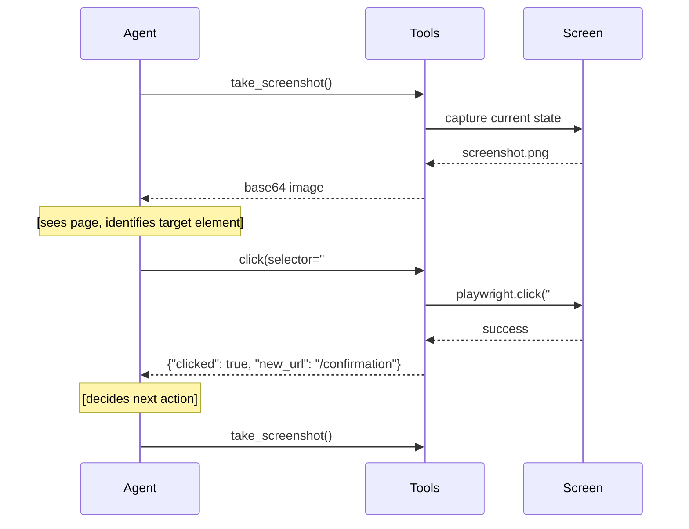

# 12.4 Multimodal Tool Calling

The most powerful multimodal agents don't just perceive — they act. This section covers how to combine vision with tool calling so that agents can see the current state of the world and decide what to do next. The canonical example is a web agent that takes a screenshot of a page and decides which element to click.

## The See-Act Loop

Standard tool-calling agents reason over text: the user says something, the model picks a tool, the tool returns text, the model picks another tool. Multimodal tool-calling agents reason over the *visual state* of their environment:



The agent never receives a raw DOM dump or scraped HTML — it sees what a human would see. This makes the agent robust to any page structure, even custom web components and canvas-rendered UIs that tools like Selenium struggle with.

## Building a Web Agent with Playwright

```python
import base64
import json
from playwright.sync_api import sync_playwright
import openai

client = openai.OpenAI()

# Tool definitions
BROWSER_TOOLS = [
    {
        "type": "function",
        "function": {
            "name": "take_screenshot",
            "description": "Take a screenshot of the current browser page. Use this to see the current state before deciding what to do next.",
            "parameters": {"type": "object", "properties": {}, "required": []}
        }
    },
    {
        "type": "function",
        "function": {
            "name": "click",
            "description": "Click an element on the page. Prefer CSS selectors or text-based selectors.",
            "parameters": {
                "type": "object",
                "properties": {
                    "selector": {
                        "type": "string",
                        "description": "CSS selector or text selector (e.g. 'text=Submit', '#login-btn', '.nav-item')"
                    }
                },
                "required": ["selector"]
            }
        }
    },
    {
        "type": "function",
        "function": {
            "name": "type_text",
            "description": "Type text into the currently focused input field.",
            "parameters": {
                "type": "object",
                "properties": {
                    "selector": {"type": "string", "description": "CSS selector for the input"},
                    "text": {"type": "string", "description": "Text to type"}
                },
                "required": ["selector", "text"]
            }
        }
    },
    {
        "type": "function",
        "function": {
            "name": "navigate",
            "description": "Navigate the browser to a URL.",
            "parameters": {
                "type": "object",
                "properties": {
                    "url": {"type": "string", "description": "The URL to navigate to"}
                },
                "required": ["url"]
            }
        }
    },
    {
        "type": "function",
        "function": {
            "name": "task_complete",
            "description": "Call this when the task is fully completed.",
            "parameters": {
                "type": "object",
                "properties": {
                    "result": {"type": "string", "description": "Description of what was accomplished"}
                },
                "required": ["result"]
            }
        }
    }
]


class WebAgent:
    def __init__(self, headless: bool = True):
        self.playwright = sync_playwright().start()
        self.browser = self.playwright.chromium.launch(headless=headless)
        self.page = self.browser.new_page(viewport={"width": 1280, "height": 800})
        self.messages = []
    
    def _take_screenshot(self) -> str:
        """Returns base64-encoded PNG of current page."""
        screenshot_bytes = self.page.screenshot(full_page=False)
        return base64.b64encode(screenshot_bytes).decode("utf-8")
    
    def _execute_tool(self, name: str, args: dict) -> str:
        """Execute a browser tool and return a text result."""
        try:
            if name == "take_screenshot":
                image_b64 = self._take_screenshot()
                # Return the image as part of the tool result
                return {"type": "screenshot", "image": image_b64}
            
            elif name == "click":
                self.page.click(args["selector"], timeout=5000)
                self.page.wait_for_load_state("networkidle", timeout=5000)
                return {"clicked": True, "current_url": self.page.url}
            
            elif name == "type_text":
                self.page.fill(args["selector"], args["text"])
                return {"typed": True}
            
            elif name == "navigate":
                self.page.goto(args["url"], wait_until="networkidle")
                return {"navigated": True, "current_url": self.page.url}
            
            elif name == "task_complete":
                return {"done": True, "result": args["result"]}
            
        except Exception as e:
            return {"error": str(e)}
    
    def run(self, task: str, max_steps: int = 15) -> str:
        """Run the web agent on a task."""
        system_prompt = """You are a web automation agent. You control a browser using the provided tools.

IMPORTANT RULES:
1. Always take a screenshot first to see the current state of the page
2. Prefer text-based selectors ('text=Login') over complex CSS selectors
3. After clicking anything, take another screenshot to verify the result
4. If a click doesn't work, try a different selector strategy
5. Call task_complete when you are done — don't keep going after the task is finished
6. Be conservative — don't click things you're not sure about"""

        self.messages = [
            {"role": "system", "content": system_prompt},
            {"role": "user", "content": f"Task: {task}"}
        ]
        
        for step in range(max_steps):
            response = client.chat.completions.create(
                model="gpt-4o",
                messages=self.messages,
                tools=BROWSER_TOOLS,
                tool_choice="auto",
                max_tokens=1024
            )
            
            message = response.choices[0].message
            self.messages.append(message.model_dump())
            
            # No tool call — agent is done or confused
            if not message.tool_calls:
                return message.content or "Task ended without completion signal."
            
            # Execute each tool call
            for tool_call in message.tool_calls:
                func_name = tool_call.function.name
                func_args = json.loads(tool_call.function.arguments)
                
                result = self._execute_tool(func_name, func_args)
                
                if func_name == "task_complete":
                    return result.get("result", "Task completed.")
                
                # For screenshot results, inject image into next message
                if isinstance(result, dict) and result.get("type") == "screenshot":
                    tool_result_content = [
                        {"type": "text", "text": "Here is the current screenshot:"},
                        {
                            "type": "image_url",
                            "image_url": {
                                "url": f"data:image/png;base64,{result['image']}",
                                "detail": "high"
                            }
                        }
                    ]
                else:
                    tool_result_content = json.dumps(result)
                
                self.messages.append({
                    "role": "tool",
                    "tool_call_id": tool_call.id,
                    "content": tool_result_content
                })
        
        return "Max steps reached without task completion."
    
    def close(self):
        self.browser.close()
        self.playwright.stop()


# Example usage
agent = WebAgent(headless=False)
try:
    result = agent.run(
        "Go to https://example.com, find the login button, and tell me the page title."
    )
    print(result)
finally:
    agent.close()
```

## The Vision + Tool Calling Reliability Problem

Mixing vision inputs with tool calls works but is less reliable than text-only tool calling. The model has more to process, and grounding decisions ("which element to click") is harder than "which function to call based on text."

Mitigations:

### 1. Keep Tool Schemas Simple

When combining vision with tools, each additional parameter is another thing the model might get wrong. Prefer:

```python
# Good — minimal schema, model just picks the visible text
{
    "name": "click",
    "parameters": {
        "selector": {"type": "string"}
    }
}

# Risky — too many parameters for a vision call
{
    "name": "click_element",
    "parameters": {
        "selector": {"type": "string"},
        "timeout_ms": {"type": "integer"},
        "force": {"type": "boolean"},
        "position_x": {"type": "number"},
        "position_y": {"type": "number"}
    }
}
```

### 2. Use High-Detail Screenshots Selectively

High-detail screenshots cost more tokens, which crowds out the model's reasoning capacity for tool calls. Use a two-pass approach: low-detail to understand the page structure, high-detail zoom-in when a specific element needs identification:

```python
def zoom_screenshot(page, selector: str) -> str:
    """Take a screenshot of just the element bounding box."""
    element = page.query_selector(selector)
    if element:
        bbox = element.bounding_box()
        screenshot = page.screenshot(clip=bbox)
        return base64.b64encode(screenshot).decode("utf-8")
    return None
```

### 3. Force Screenshot After Every Action

Always take a screenshot after each action to verify it worked before deciding the next step:

```python
# After every click/type, add a screenshot step
BROWSER_TOOLS_WITH_VERIFY = [
    *BROWSER_TOOLS,
    {
        "type": "function",
        "function": {
            "name": "click_and_verify",
            "description": "Click an element and automatically take a screenshot to confirm the result.",
            "parameters": {
                "type": "object",
                "properties": {
                    "selector": {"type": "string"}
                },
                "required": ["selector"]
            }
        }
    }
]
```

## Comparing Vision vs. DOM-Based Agents

| Approach | Robustness | Speed | Cost | Best For |
|---|---|---|---|---|
| Vision-based (screenshot) | High — works on any page | Slower (screenshot overhead) | Higher (image tokens) | Complex/custom UIs, canvas apps |
| DOM-based (HTML scraping) | Medium — breaks on dynamic JS | Faster | Lower | Standard HTML apps |
| Accessibility tree | Medium | Fast | Lower | Well-labeled apps |
| Hybrid (DOM + screenshot) | Highest | Medium | Medium | Production web agents |

The hybrid approach is most practical: use the DOM/accessibility tree for element discovery (cheap), fall back to screenshot when the DOM doesn't have what you need (expensive but reliable).

## Key Takeaways

- Vision + tool calling enables agents that navigate web UIs without scrapers or hardcoded selectors
- The see-act loop: screenshot → decide → act → screenshot → verify
- Keep tool schemas simple when using vision inputs — fewer parameters means fewer failures
- Always take a screenshot after each action to verify state before the next decision
- For production, combine DOM-based element discovery with vision fallback for reliability at lower cost
