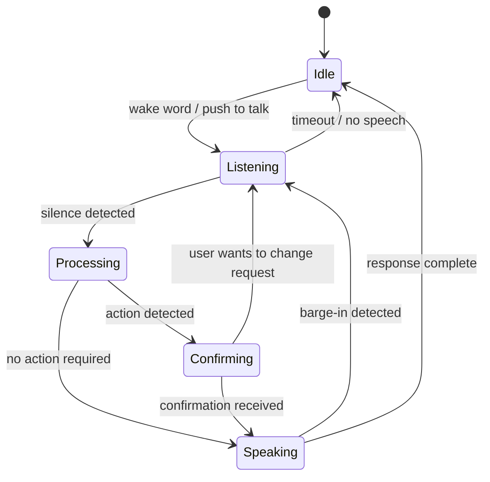

# 12.5 Voice Interface Design

Building a voice agent isn't just wiring up STT and TTS to your existing text agent. Voice is a fundamentally different communication medium with its own constraints, conventions, and failure modes. An agent that works brilliantly in text can be confusing, slow, and frustrating when spoken aloud.

## Why Voice Is Different

Text and voice fail in opposite ways:

| Text Agent | Voice Agent |
|---|---|
| Can use headers, bullets, code blocks | Must use spoken language only |
| Long responses are fine — user can scroll | Long responses force user to wait silently |
| Ambiguous output → user re-reads | Ambiguous output → user has to ask again |
| No latency concern on output | Every second of silence feels like a hang |
| Tables and formatting convey structure | Structure must come from sentence construction |

The model doesn't know it's being spoken unless you tell it. Without explicit guidance, it will write responses full of markdown, numbered lists, and code snippets that are completely incomprehensible when read aloud by a TTS engine.

## The Voice-First System Prompt

The most important thing you can do for voice quality is write a system prompt that explicitly encodes voice constraints:

```python
VOICE_SYSTEM_PROMPT = """You are a helpful voice assistant. You are speaking to the user — not writing to them.

CRITICAL RULES FOR VOICE:
1. Never use markdown formatting. No asterisks, no hashes, no backticks, no bullet points.
2. Never include code blocks or technical syntax. Describe code in plain English.
3. Keep every response under 60 words unless the user explicitly asks for detail.
4. Use conversational language: "Here's what I found:" not "## Results:".
5. Spell out numbers naturally: "about thirty percent" not "~30%".
6. Before taking any irreversible action, confirm with the user using a yes/no question.
7. If you don't understand something, say so directly: "I didn't catch that — could you say that again?"
8. End responses that require a follow-up with a clear question.

EXAMPLES:
❌ Wrong: "Here are the **3 key points**:\n- Point 1\n- Point 2\n- Point 3"
✅ Right: "There are three key things to know. First..."

❌ Wrong: "```python\nprint('hello')\n```"  
✅ Right: "In Python, you'd use the print function with your message in quotes."

❌ Wrong: "The temperature is 72°F (22.2°C)."
✅ Right: "It's seventy-two degrees Fahrenheit, which is about twenty-two Celsius."
"""
```

## The 30-Second Rule

A voice response longer than 30 seconds is a monologue. Users cannot easily interrupt, cannot re-read if they miss something, and will tune out. Thirty seconds is roughly 75 words at a comfortable speaking pace.

Build response length limits into your token budget:

```python
def voice_agent_response(user_text: str, conversation_history: list) -> str:
    """Generate a voice-appropriate response."""
    response = client.chat.completions.create(
        model="gpt-4o",
        messages=[
            {"role": "system", "content": VOICE_SYSTEM_PROMPT},
            *conversation_history,
            {"role": "user", "content": user_text}
        ],
        max_tokens=150,        # ~75 words — roughly 30 seconds of speech
        temperature=0.7
    )
    
    text = response.choices[0].message.content
    
    # Sanitize any remaining markdown the model snuck in
    text = sanitize_for_voice(text)
    
    return text


def sanitize_for_voice(text: str) -> str:
    """Remove markdown and formatting that TTS would read literally."""
    import re
    
    # Remove markdown headers
    text = re.sub(r'^#{1,6}\s+', '', text, flags=re.MULTILINE)
    # Remove bold/italic markers
    text = re.sub(r'\*{1,3}([^*]+)\*{1,3}', r'\1', text)
    # Remove inline code backticks
    text = re.sub(r'`([^`]+)`', r'\1', text)
    # Remove code blocks entirely
    text = re.sub(r'```[\s\S]*?```', '[code omitted]', text)
    # Convert markdown lists to prose
    text = re.sub(r'^\s*[-*]\s+', '', text, flags=re.MULTILINE)
    text = re.sub(r'^\s*\d+\.\s+', '', text, flags=re.MULTILINE)
    # Remove URLs
    text = re.sub(r'https?://\S+', 'a link', text)
    # Clean up excess whitespace
    text = re.sub(r'\n{2,}', '. ', text)
    text = re.sub(r'\s+', ' ', text).strip()
    
    return text
```

## Confirmation Before Action

Voice agents often take real-world actions: booking meetings, sending emails, making purchases. Because voice input is transcribed (and transcription can err), always read back what you understood and ask for confirmation before anything irreversible:

```python
ACTION_KEYWORDS = ["book", "send", "delete", "buy", "purchase", "cancel", "submit"]

def requires_confirmation(user_text: str) -> bool:
    """Detect if the user's request involves a significant action."""
    return any(kw in user_text.lower() for kw in ACTION_KEYWORDS)

def generate_confirmation(action_description: str) -> str:
    """Generate a spoken confirmation request."""
    return f"Just to confirm: {action_description}. Should I go ahead?"


# In the agent loop
if requires_confirmation(user_text):
    # First turn: understand the action, don't execute yet
    action_summary = extract_action_summary(user_text)
    return generate_confirmation(action_summary)
    # Second turn: listen for yes/no, then execute
```

Example confirmation exchange:

```
User: "Book a meeting with Sarah for Thursday at 2pm"
Agent: "Just to confirm: I'll create a 30-minute meeting with Sarah on Thursday at 2pm. Should I go ahead?"
User: "Yes"
Agent: "Done. The meeting with Sarah is booked for Thursday at 2 in the afternoon."
```

## Graceful Handling of Transcription Errors

Speech-to-text is not perfect. Background noise, accents, proper nouns, and fast speech all cause transcription errors. Your agent needs to handle ambiguity gracefully rather than hallucinating what the user said.

```python
CONFIDENCE_SYSTEM_PROMPT = """If you receive a message that seems garbled, incomplete, or doesn't make sense
in context, say so directly rather than guessing. Use phrases like:
- "I didn't quite catch that — could you repeat it?"
- "I'm not sure I understood — did you say [your best guess]?"
- "That came through a bit unclear. What would you like me to do?"

Never pretend you understood something you didn't."""

def is_likely_transcription_error(text: str) -> bool:
    """Heuristics to detect likely garbled transcriptions."""
    # Very short (user may have trailed off)
    if len(text.split()) < 2:
        return True
    # Contains common STT artifacts
    artifacts = ["um", "uh", "er", "hmm"]
    non_artifact_words = [w for w in text.lower().split() if w not in artifacts]
    if len(non_artifact_words) < 2:
        return True
    return False


# In the agent loop
if is_likely_transcription_error(user_text):
    return "I didn't catch that clearly. Could you say that again?"
```

## Handling Pauses and Barge-in

Users often start speaking before the agent finishes. A good voice agent supports **barge-in** — the ability to interrupt mid-response:

```python
import threading

class BargeinTTS:
    """TTS playback that can be interrupted."""
    
    def __init__(self):
        self._stop_event = threading.Event()
        self._playback_thread = None
    
    def speak(self, text: str):
        """Start speaking. Returns immediately; playback is non-blocking."""
        self._stop_event.clear()
        self._playback_thread = threading.Thread(
            target=self._play, args=(text,), daemon=True
        )
        self._playback_thread.start()
    
    def interrupt(self):
        """Stop playback immediately."""
        self._stop_event.set()
    
    def _play(self, text: str):
        sentences = split_into_sentences(text)
        for sentence in sentences:
            if self._stop_event.is_set():
                return  # Interrupted
            audio = speak(sentence)
            play_audio(audio)
```

## Voice Agent State Diagram



## Complete Voice-First Configuration

Putting it all together — the configuration checklist for a production voice agent:

```python
VOICE_AGENT_CONFIG = {
    # Model settings
    "model": "gpt-4o",
    "max_tokens": 150,           # ~30 seconds of speech
    "temperature": 0.7,
    
    # STT settings
    "stt_model": "whisper-1",
    "stt_language": "en",
    "silence_duration_sec": 1.2, # How long to wait for user to finish
    
    # TTS settings
    "tts_model": "tts-1",        # tts-1 for speed, tts-1-hd for quality
    "tts_voice": "nova",         # alloy, echo, fable, onyx, nova, shimmer
    "streaming_tts": True,       # Start TTS on first sentence, not full response
    
    # Behavior
    "confirmation_required": True,
    "max_conversation_turns": 20, # Reset context after 20 turns
    "sanitize_markdown": True,
    "barge_in_enabled": True,
    
    # System prompt
    "system_prompt": VOICE_SYSTEM_PROMPT
}
```

## Quick Reference: Voice Agent Do's and Don'ts

| Do | Don't |
|---|---|
| Keep responses under 75 words | Write markdown headers or bullets |
| Confirm before irreversible actions | Include URLs or technical syntax |
| Say "I didn't catch that" when uncertain | Pretend to understand garbled speech |
| Use natural spoken language | Use abbreviations (say "approximately" not "~") |
| Stream TTS for lower perceived latency | Wait for full response before starting TTS |
| End with a clear question when needed | Leave the user hanging mid-conversation |
| Test with actual speech, not typed input | Test only by typing into the voice agent |

## Key Takeaways

- Voice agents need their own system prompt that explicitly forbids markdown and enforces spoken language conventions
- The 30-second / 75-word rule keeps responses conversational and prevents silent waits
- Always confirm before irreversible actions — STT errors are real and costly
- Sanitize model output to remove any markdown that slips through
- Streaming TTS halves perceived latency — never wait for the full response
- Test voice agents with real speech input; text testing misses transcription failure modes
