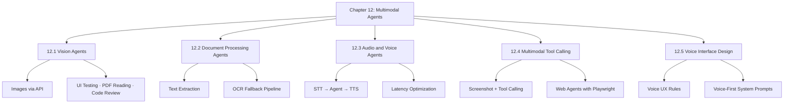

# Chapter 12: Multimodal and Voice Agents

Text is just one channel. The real world communicates through images, spoken words, recorded video, and scanned paper — and agents that can only handle text are blind and deaf to all of it. This chapter covers how to build agents that work across every modality: vision, audio, video, and documents.

## What Is a Multimodal Agent?

A **multimodal agent** is an agent that can process and reason across more than one type of input or output. The four primary modalities relevant to AI agents today are:

| Modality | Input Examples | Output Examples |
|---|---|---|
| **Text** | Prompts, messages, code | Responses, generated code, summaries |
| **Vision** | Screenshots, photos, scanned PDFs, charts | Descriptions, extracted data, bounding boxes |
| **Audio** | Spoken questions, recorded calls, podcasts | Transcriptions, spoken responses |
| **Video** | Screen recordings, surveillance footage | Frame-by-frame summaries, event detection |

Modern frontier models — GPT-4o, Claude 3.5+ series, Gemini 1.5 Pro — accept multiple modalities natively. You don't need separate pipelines for each; you send a mixed-content message and the model handles it.

## Why Multimodal Matters for Agents

Text-only agents hit a ceiling quickly in real-world deployments. Consider:

- **A code review agent** that only reads source files misses the fact that the UI is visually broken. Give it a screenshot and it can say "the login button is overlapping the nav bar on mobile."
- **A support agent** that requires typed input excludes users who prefer to speak, or who are using hands-free devices. Plug in speech-to-text and the same agent works for voice.
- **A document processing agent** that uses only text extraction fails on scanned invoices where the content is a rasterized image, not selectable text. Add vision and it reads anything a human can read.
- **A monitoring agent** that watches application logs misses visual anomalies in dashboards. Connect it to periodic screenshots and it catches UI regressions the logs never capture.

The pattern in every case is the same: the agent's reasoning capability stays the same, but its perception expands. More ways to perceive the world means more tasks it can do autonomously.

## Chapter Overview



## The Modality Stack

Think of multimodal agents as having a **perception layer** stacked on top of the same reasoning core you've already built:

```
┌──────────────────────────────────────────────┐
│           Agent Reasoning Core               │
│  (planning · tool calling · memory · loops)  │
└──────────────────┬───────────────────────────┘
                   │
       ┌───────────▼───────────┐
       │    Perception Layer   │
       ├───────────────────────┤
       │  Text  │ Vision │ Audio│
       └───────────────────────┘
```

You don't rewrite the agent when you add a new modality — you extend the perception layer. The same `run_agent()` function handles text, images, and audio because they all eventually become tokens in the same context window.

## What's Coming in This Chapter

- **12.1 Vision Agents** — how to send images to LLMs, practical applications including UI testing and document reading
- **12.2 Document Processing Agents** — handling PDFs (text and scanned), the OCR fallback pattern, structured extraction
- **12.3 Audio and Voice Agents** — the full voice pipeline from microphone to speaker, latency budgets and streaming tricks
- **12.4 Multimodal Tool Calling** — combining vision with actions; the web agent that sees and clicks
- **12.5 Voice Interface Design** — the UX rules for voice that are completely different from text; why markdown breaks voice agents
