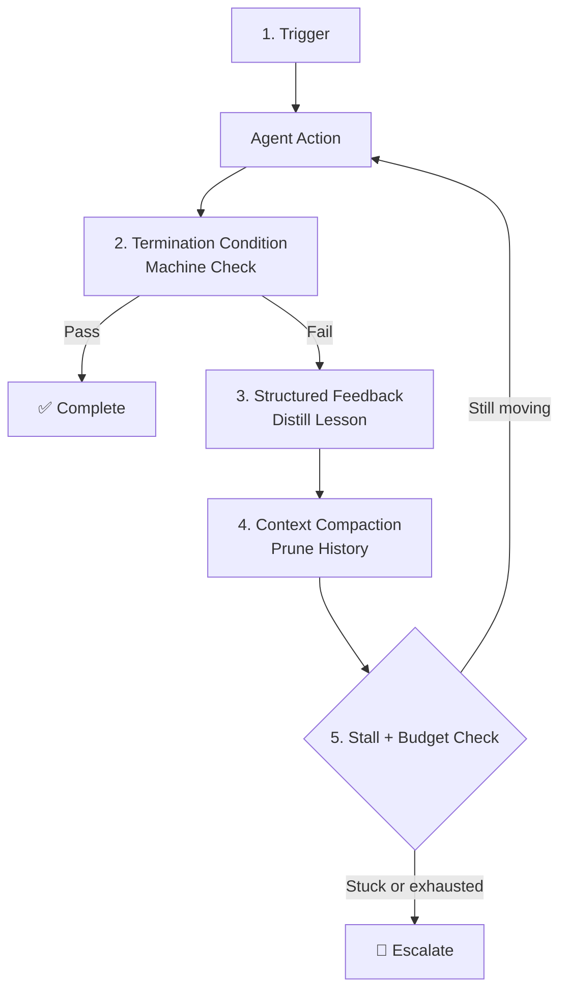

# 20.2 Anatomy of an Engineered Loop

Every self-running agent system needs five components. Skip any one of them and the loop either never terminates, burns through its budget making no progress, or silently produces wrong results without anyone noticing.



## Component 1: The Trigger

What starts the loop? This seems obvious, but it's worth being explicit because the trigger determines how the loop fits into your broader system.

Common trigger types:

| Trigger Type | Example | Notes |
|---|---|---|
| **Cron / scheduled** | "Every night at 2am, run the lint-and-fix loop" | Good for background improvement tasks |
| **CI/CD event** | "On PR open, run the test-and-fix loop" | Natural fit for code quality agents |
| **Ticket / issue** | "New Jira ticket assigned to AI → run the implementation loop" | Requires ticket-to-spec translation |
| **File change** | "New invoice uploaded → run the extraction loop" | Event-driven document processing |
| **API call** | "POST /run-agent {task: ...}" | Manual or downstream-service trigger |

The trigger also defines the **initial context** — what information the agent starts with. A CI trigger has access to the failing diff and the test output. A scheduled trigger may need to query for its own task list.

```python
from dataclasses import dataclass
from datetime import datetime

@dataclass
class LoopTrigger:
    task_id: str
    goal: str
    initial_context: dict
    triggered_by: str  # "ci", "cron", "ticket", "manual"
    triggered_at: datetime
    max_attempts: int = 6
    max_budget_usd: float = 2.00
```

## Component 2: The Termination Condition

The most important component, and the most commonly done wrong. The termination condition is the thing the machine checks to decide if the work is done.

It must be **binary** (pass/fail), **machine-executable** (no human required), and **authoritative** (if it passes, the work is genuinely done).

```python
from typing import Callable

# A termination condition is a function that returns (passed, evidence)
TerminationCondition = Callable[[], tuple[bool, str]]

def make_pytest_condition() -> TerminationCondition:
    """Tests pass with zero failures."""
    def check() -> tuple[bool, str]:
        import subprocess
        result = subprocess.run(
            ["python", "-m", "pytest", "--tb=short", "-q"],
            capture_output=True, text=True, timeout=300
        )
        passed = result.returncode == 0
        output = (result.stdout + result.stderr)[-2000:]
        return passed, output
    return check

def make_linter_condition(max_errors: int = 0) -> TerminationCondition:
    """Linter reports at most N errors."""
    def check() -> tuple[bool, str]:
        import subprocess
        result = subprocess.run(
            ["ruff", "check", "--select", "E,F", "."],
            capture_output=True, text=True
        )
        error_count = result.stdout.count("\n") if result.returncode != 0 else 0
        passed = error_count <= max_errors
        return passed, result.stdout[-1000:]
    return check

def make_composite_condition(*conditions: TerminationCondition) -> TerminationCondition:
    """All conditions must pass."""
    def check() -> tuple[bool, str]:
        all_evidence = []
        for condition in conditions:
            passed, evidence = condition()
            all_evidence.append(evidence)
            if not passed:
                return False, "\n".join(all_evidence)
        return True, "\n".join(all_evidence)
    return check

# Composing conditions
is_done = make_composite_condition(
    make_pytest_condition(),
    make_linter_condition(max_errors=0)
)
```

## Component 3: Structured Feedback

When the termination condition fails, the loop must feed the failure back to the agent. The naive approach — dump the raw error output directly into the context — works for the first attempt but degrades quality rapidly as the loop runs.

Raw failure output contains:
- Full stack traces (hundreds of lines, mostly noise)
- Warnings that aren't related to the actual failure
- Previous fix attempts in the code that contradict each other
- Timestamps and environment info the agent doesn't need

Structured feedback strips this down to what the agent actually needs: what failed, where, and what approaches have already been tried:

```python
def structure_failure_feedback(
    attempt: int,
    raw_output: str,
    previous_lessons: list[str]
) -> str:
    """
    Convert raw test/lint output into a structured lesson for the agent.
    """
    # Extract the key failure lines
    failure_lines = []
    for line in raw_output.splitlines():
        if any(kw in line for kw in ["FAILED", "ERROR", "Error:", "assert", "TypeError", "AttributeError"]):
            failure_lines.append(line.strip())
    
    # Cap to the most important failures
    key_failures = failure_lines[:5]
    
    lesson = f"Attempt {attempt} failed."
    if key_failures:
        lesson += " Key errors:\n" + "\n".join(f"  - {f}" for f in key_failures)
    else:
        lesson += f" Output: {raw_output[:200]}"
    
    # Add reminder of what's been tried
    if previous_lessons:
        lesson += f"\n\nPrevious attempts summary ({len(previous_lessons)} total):"
        for prev in previous_lessons[-3:]:  # Only last 3, not all history
            lesson += f"\n  • {prev[:100]}"
    
    return lesson
```

## Component 4: Context Compaction

Each retry carries the risk of context pollution. By attempt 4, the raw context contains three sets of failed code edits, three stack traces, and the model's own (wrong) reasoning about each failure. This noise actively harms quality — the model may repeat the same wrong approach because it's buried in its own context.

Compaction converts history into a clean, forward-looking brief:

```python
def compact_loop_context(
    goal: str,
    attempt: int,
    lessons: list[str],
    current_evidence: str
) -> str:
    """Build a clean context for the next attempt from distilled lessons."""
    
    context_parts = [
        f"GOAL: {goal}",
        f"",
        f"ATTEMPT {attempt + 1} OF {MAX_ATTEMPTS}",
        f"",
        f"WHAT HAS BEEN TRIED AND FAILED:"
    ]
    
    if lessons:
        for i, lesson in enumerate(lessons, 1):
            context_parts.append(f"  {i}. {lesson}")
    else:
        context_parts.append("  (This is the first attempt)")
    
    context_parts.extend([
        f"",
        f"CURRENT STATE:",
        current_evidence[:500],
        f"",
        f"Make a fresh approach that avoids all the failed patterns above."
    ])
    
    return "\n".join(context_parts)
```

## Component 5: Escalation Logic

The loop must know when to stop trying. Two triggers for escalation:

**Trigger A: Budget exhausted** — max attempts reached or cost limit hit. The agent is making progress but ran out of runway. Escalation message: "Made X attempts, reached attempt limit. Last state: [summary]. Human intervention needed."

**Trigger B: Stall detected** — the failure fingerprint hasn't changed in N attempts. The agent is alive and billing but making zero progress. Escalation message: "Same failure repeated 3 times (fingerprint: abc123). Likely stuck. Human intervention needed."

```python
def escalate(
    goal: str,
    lessons: list[str],
    reason: str,
    last_evidence: str
) -> dict:
    """Package escalation information for human review."""
    return {
        "status": "escalated",
        "reason": reason,
        "goal": goal,
        "attempts_made": len(lessons),
        "lessons_summary": lessons,
        "last_evidence": last_evidence[:500],
        "suggested_actions": _suggest_human_actions(reason, lessons)
    }

def _suggest_human_actions(reason: str, lessons: list[str]) -> list[str]:
    """Generate actionable suggestions for the human reviewer."""
    suggestions = []
    
    if "Same failure" in reason:
        suggestions.append("The agent appears stuck. Review the specific error it keeps hitting.")
        suggestions.append("The termination condition may be too strict — review whether it's correct.")
    
    if "Max attempts" in reason:
        suggestions.append("Task may need to be broken into smaller subtasks.")
        suggestions.append("Consider whether the goal is underspecified.")
    
    # Look for patterns in lessons
    if any("import" in l.lower() for l in lessons):
        suggestions.append("Multiple import errors — check dependency installation.")
    
    if any("permission" in l.lower() for l in lessons):
        suggestions.append("Permission errors detected — check file/directory access.")
    
    return suggestions
```

## Putting It Together: The Loop Skeleton

```python
MAX_ATTEMPTS = 6

def run_engineered_loop(trigger: LoopTrigger) -> dict:
    """
    The skeleton of any engineered loop.
    Swap in your own agent_act, verify, and fingerprint functions.
    """
    lessons: list[str] = []
    last_fingerprint = None
    stall_count = 0
    
    for attempt in range(1, trigger.max_attempts + 1):
        # Build clean context from distilled history
        context = compact_loop_context(
            goal=trigger.goal,
            attempt=attempt,
            lessons=lessons,
            current_evidence=get_current_state()
        )
        
        # Agent acts — it sees goal + lessons, not raw history
        agent_act(trigger.goal, context=context)
        
        # Machine checks the termination condition
        done, evidence = is_done()
        
        if done:
            return {
                "status": "success",
                "attempts": attempt,
                "trigger": trigger.task_id
            }
        
        # Detect stalls before burning more budget
        fp = failure_fingerprint(evidence)
        if fp == last_fingerprint:
            stall_count += 1
        else:
            stall_count = 0
        last_fingerprint = fp
        
        if stall_count >= 2:  # Same fingerprint 3 times in a row
            return escalate(
                trigger.goal,
                lessons,
                reason=f"Same failure 3x in a row (fingerprint: {fp})",
                last_evidence=evidence
            )
        
        # Compact the failure into a structured lesson
        lesson = structure_failure_feedback(attempt, evidence, lessons)
        lessons.append(f"Attempt {attempt}: {evidence[:150]}")
    
    return escalate(
        trigger.goal,
        lessons,
        reason=f"Max attempts ({trigger.max_attempts}) exhausted",
        last_evidence=evidence
    )
```

## A Concrete Example: The Atlas Pipeline


*Fig: The full Atlas pipeline: from GitHub issue to published pull request, the loop runs through planning, coding, testing, and verification automatically.*

## Component Summary

| Component | Purpose | Anti-pattern |
|---|---|---|
| **Trigger** | Define start condition and initial context | Starting without a clear goal or context |
| **Termination condition** | Machine-checkable definition of "done" | "Improve the code" — not checkable |
| **Structured feedback** | Distill failures into actionable lessons | Dumping raw error traces into context |
| **Context compaction** | Keep context clean across attempts | Accumulating full history from all attempts |
| **Escalation logic** | Know when to stop and hand off | Running to max attempts on every stall |
