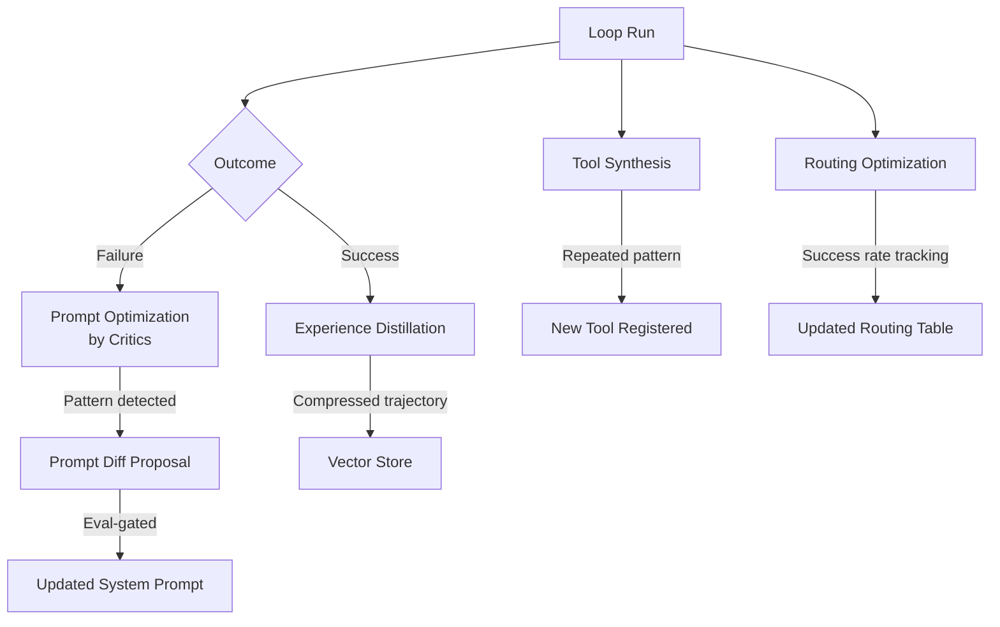

# 20.7 Self-Improving Loops


*Fig: The self-improving multi-agent loop: failures feed back into prompt optimization, tool synthesis, and routing improvement.*

A standard fix loop is reactive: it runs, fails, retries, and either succeeds or escalates. A self-improving loop does something more ambitious — it uses the outcomes of past runs to get better at future ones. The harness accumulates operational intelligence and applies it automatically.

This is not speculative future technology. All four mechanisms described in this section can be implemented today with standard tools. The challenge is doing it safely — every self-modification must be logged, versioned, and evaluated before it affects production.


*Fig: Two primary self-improvement strategies: weight optimization (fine-tuning) vs prompt/scaffold optimization (loop engineering). The book focuses on the latter.*

## The Four Mechanisms



## Mechanism 1: Prompt Optimization by Critics

When runs fail, a critic model scans the failure logs for patterns and proposes system-prompt changes.

```python
import openai
import json
from datetime import datetime

client = openai.OpenAI()

CRITIC_SYSTEM_PROMPT = """You are a prompt optimization critic. You analyze failure logs from AI agent runs
and identify patterns that suggest the system prompt needs updating.

Your job: find systematic errors — things the agent does wrong repeatedly across multiple runs —
and propose specific, minimal system-prompt additions that would prevent them.

Rules:
1. Only propose changes that would clearly prevent the observed pattern
2. Each change must be a concrete instruction, not vague guidance
3. Flag if the failures look like task variation (not fixable by prompt) vs. systematic agent behavior
4. Return JSON: {"pattern": str, "proposed_addition": str, "confidence": "high|medium|low"}"""


def analyze_failures_for_prompt_improvements(
    failure_logs: list[dict],
    current_system_prompt: str
) -> list[dict]:
    """
    Have a critic model scan failure logs and propose system prompt improvements.
    """
    logs_text = json.dumps(failure_logs[-20:], indent=2)  # Last 20 runs
    
    response = client.chat.completions.create(
        model="gpt-4o",
        messages=[
            {"role": "system", "content": CRITIC_SYSTEM_PROMPT},
            {
                "role": "user",
                "content": f"""Current system prompt:
```
{current_system_prompt}
```

Recent failure logs:
```json
{logs_text[:6000]}
```

Identify any systematic patterns and propose improvements."""
            }
        ],
        response_format={"type": "json_object"},
        max_tokens=1024
    )
    
    result = json.loads(response.choices[0].message.content)
    proposals = result.get("proposals", [result]) if isinstance(result, dict) else result
    return proposals


def apply_prompt_improvement(
    current_prompt: str,
    proposal: dict,
    eval_function  # Must pass eval before merging
) -> str | None:
    """
    Apply a proposed prompt change only if it passes evaluation.
    Returns updated prompt if eval passes, None if it fails.
    """
    if proposal.get("confidence") != "high":
        print(f"Skipping low-confidence proposal: {proposal['pattern']}")
        return None
    
    # Apply the proposed addition
    updated_prompt = current_prompt + "\n\n" + proposal["proposed_addition"]
    
    # Gate on evaluation
    eval_passed, eval_result = eval_function(updated_prompt)
    
    if eval_passed:
        # Log the change for audit
        log_prompt_change(
            original=current_prompt,
            updated=updated_prompt,
            reason=proposal["pattern"],
            proposal=proposal["proposed_addition"],
            eval_result=eval_result
        )
        return updated_prompt
    else:
        print(f"Proposal failed eval: {eval_result}")
        return None


def log_prompt_change(original: str, updated: str, reason: str, 
                      proposal: str, eval_result: str):
    """Every self-modification is logged, versioned, and available for audit."""
    record = {
        "timestamp": datetime.utcnow().isoformat(),
        "type": "prompt_update",
        "reason": reason,
        "proposal": proposal,
        "diff_summary": f"Added {len(updated) - len(original)} chars",
        "eval_result": eval_result
    }
    
    with open("harness_changes.jsonl", "a") as f:
        f.write(json.dumps(record) + "\n")
```

## Mechanism 2: Tool Synthesis

When the agent repeatedly performs the same multi-step action across runs, the harness synthesizes a new tool that does it atomically.

```python
from collections import Counter
import ast

def detect_repeated_patterns(run_logs: list[dict], min_occurrences: int = 5) -> list[dict]:
    """
    Find action sequences that appear in at least min_occurrences runs.
    These are candidates for tool synthesis.
    """
    # Extract action sequences from logs
    sequences = []
    for run in run_logs:
        actions = [tc["name"] for tc in run.get("tool_calls", [])]
        # Look for repeated subsequences of length 2-4
        for length in range(2, 5):
            for i in range(len(actions) - length + 1):
                seq = tuple(actions[i:i+length])
                sequences.append(seq)
    
    # Count occurrences
    counter = Counter(sequences)
    
    return [
        {"sequence": list(seq), "count": count}
        for seq, count in counter.most_common(10)
        if count >= min_occurrences
    ]


def synthesize_tool(action_sequence: list[str], example_calls: list[dict]) -> dict:
    """
    Ask the LLM to write a Python function that wraps a repeated action sequence.
    """
    response = client.chat.completions.create(
        model="gpt-4o",
        messages=[
            {
                "role": "user",
                "content": f"""Write a Python function that atomically performs this sequence of actions:
{action_sequence}

Example calls that use this sequence:
{json.dumps(example_calls[:3], indent=2)}

The function should:
1. Take the minimal parameters needed
2. Call the existing tool functions in sequence
3. Return a summary result
4. Include a docstring describing what it does

Return just the Python function code."""
            }
        ],
        max_tokens=1024
    )
    
    code = response.choices[0].message.content
    func_name = extract_function_name(code)
    
    return {
        "name": func_name,
        "code": code,
        "replaces_sequence": action_sequence,
        "synthesized_at": datetime.utcnow().isoformat()
    }


def register_synthesized_tool(tool_def: dict, tool_registry: dict) -> bool:
    """
    Add a synthesized tool to the registry after passing a safety check.
    """
    # Safety: parse the code to confirm it's valid Python
    try:
        ast.parse(tool_def["code"])
    except SyntaxError as e:
        print(f"Synthesized tool has syntax error: {e}")
        return False
    
    tool_registry[tool_def["name"]] = tool_def
    
    log_prompt_change(
        original="",
        updated=tool_def["code"],
        reason=f"Auto-synthesized from repeated sequence: {tool_def['replaces_sequence']}",
        proposal=tool_def["name"],
        eval_result="syntax-valid"
    )
    
    return True
```

## Mechanism 3: Experience Distillation

Successful runs are compressed into worked examples and stored in a vector database. Future similar tasks start from these examples, effectively "inheriting" the solutions to problems that have been solved before.

```python
from openai import OpenAI

client = OpenAI()

def distill_successful_run(run_log: dict) -> dict:
    """
    Compress a successful run into a reusable worked example.
    """
    response = client.chat.completions.create(
        model="gpt-4o-mini",
        messages=[
            {
                "role": "user",
                "content": f"""Compress this successful agent run into a worked example for future reference.

Run details:
Goal: {run_log['goal']}
Attempts needed: {run_log['attempts']}
Lessons learned (from failed attempts): {json.dumps(run_log.get('lessons', []))}
Final solution approach: {run_log.get('final_approach', 'not recorded')}

Write a compact worked example (3-6 sentences) that captures:
1. What type of task this was
2. What approaches failed and why
3. What approach ultimately worked
4. Any key insight that made the difference

This will be retrieved by future agents facing similar tasks."""
            }
        ],
        max_tokens=300
    )
    
    summary = response.choices[0].message.content
    
    return {
        "goal": run_log["goal"],
        "summary": summary,
        "attempts": run_log["attempts"],
        "task_type": classify_task_type(run_log["goal"]),
        "timestamp": datetime.utcnow().isoformat()
    }


def retrieve_relevant_experience(goal: str, vector_store, top_k: int = 3) -> list[str]:
    """
    Retrieve worked examples similar to the current task.
    """
    # Embed the goal
    embedding = client.embeddings.create(
        model="text-embedding-3-small",
        input=goal
    ).data[0].embedding
    
    # Query vector store
    results = vector_store.query(embedding, top_k=top_k)
    
    return [r["summary"] for r in results if r["similarity"] > 0.75]


def build_context_with_experience(goal: str, vector_store) -> str:
    """
    Build agent context that includes relevant past experience.
    """
    experiences = retrieve_relevant_experience(goal, vector_store)
    
    context = f"TASK: {goal}\n\n"
    
    if experiences:
        context += "RELEVANT PAST EXPERIENCE:\n"
        for i, exp in enumerate(experiences, 1):
            context += f"  {i}. {exp}\n"
        context += "\nBuild on this experience. Start from where previous solutions left off.\n"
    
    return context
```

## Mechanism 4: Routing Optimization

Track success rates per model per task type. Over time, route tasks to the model that succeeds most often for that category.

```python
import sqlite3
from collections import defaultdict

class RoutingOptimizer:
    """
    Track model performance per task type and route accordingly.
    """
    
    def __init__(self, db_path: str = "routing_metrics.db"):
        self.db_path = db_path
        self._init_db()
    
    def _init_db(self):
        with sqlite3.connect(self.db_path) as conn:
            conn.execute("""
                CREATE TABLE IF NOT EXISTS run_outcomes (
                    id INTEGER PRIMARY KEY,
                    task_type TEXT,
                    model TEXT,
                    succeeded INTEGER,
                    attempts INTEGER,
                    timestamp TEXT
                )
            """)
    
    def record_outcome(self, task_type: str, model: str, succeeded: bool, attempts: int):
        """Record the outcome of a run."""
        with sqlite3.connect(self.db_path) as conn:
            conn.execute(
                "INSERT INTO run_outcomes (task_type, model, succeeded, attempts, timestamp) VALUES (?, ?, ?, ?, ?)",
                (task_type, model, int(succeeded), attempts, datetime.utcnow().isoformat())
            )
    
    def get_best_model(
        self,
        task_type: str,
        available_models: list[str],
        min_sample_size: int = 10
    ) -> str:
        """
        Return the model with the highest success rate for this task type.
        Falls back to the first available model if insufficient data.
        """
        with sqlite3.connect(self.db_path) as conn:
            rows = conn.execute("""
                SELECT model, 
                       SUM(succeeded) as wins,
                       COUNT(*) as total,
                       AVG(attempts) as avg_attempts
                FROM run_outcomes
                WHERE task_type = ? AND model IN ({})
                GROUP BY model
                HAVING total >= ?
                ORDER BY (wins * 1.0 / total) DESC, avg_attempts ASC
            """.format(",".join("?" * len(available_models))),
                [task_type] + available_models + [min_sample_size]
            ).fetchall()
        
        if not rows:
            return available_models[0]  # Not enough data yet — use default
        
        best_model = rows[0][0]
        best_rate = rows[0][1] / rows[0][2]
        print(f"Routing '{task_type}' to {best_model} (success rate: {best_rate:.1%})")
        return best_model
    
    def routing_report(self) -> str:
        """Generate a human-readable routing performance report."""
        with sqlite3.connect(self.db_path) as conn:
            rows = conn.execute("""
                SELECT task_type, model, 
                       SUM(succeeded) as wins,
                       COUNT(*) as total
                FROM run_outcomes
                GROUP BY task_type, model
                ORDER BY task_type, (wins * 1.0 / total) DESC
            """).fetchall()
        
        report_lines = ["Routing Performance Report", "=" * 40]
        current_task = None
        for task_type, model, wins, total in rows:
            if task_type != current_task:
                report_lines.append(f"\n{task_type}:")
                current_task = task_type
            rate = wins / total
            report_lines.append(f"  {model}: {rate:.1%} ({wins}/{total})")
        
        return "\n".join(report_lines)
```

## The Safety Contract

Every self-modification mechanism must respect these rules:

> "Every self-modification is logged, versioned, and eval-gated. A harness that rewrites its own prompts must show the diff when audited."

Concretely:

1. **Logged**: every change is appended to `harness_changes.jsonl` with timestamp, reason, and diff
2. **Versioned**: the current prompt/tool/routing table is stored in version control; changes create new versions, not overwrites  
3. **Eval-gated**: no change goes live without passing a fixed evaluation suite
4. **Reversible**: any change can be rolled back in one command

```python
class SelfImprovingHarness:
    VERSION_FILE = "harness_version.json"
    
    def load_current_version(self) -> dict:
        with open(self.VERSION_FILE) as f:
            return json.load(f)
    
    def commit_change(self, change: dict, eval_passed: bool):
        """Only commit if eval passes. Always log."""
        current = self.load_current_version()
        
        log_entry = {
            "timestamp": datetime.utcnow().isoformat(),
            "change_type": change["type"],
            "description": change["description"],
            "eval_passed": eval_passed,
            "version_before": current["version"]
        }
        
        with open("harness_changes.jsonl", "a") as f:
            f.write(json.dumps(log_entry) + "\n")
        
        if not eval_passed:
            return  # Never apply a change that didn't pass eval
        
        # Apply and version bump
        new_version = {
            **current,
            "version": current["version"] + 1,
            "last_updated": datetime.utcnow().isoformat(),
            **change.get("updates", {})
        }
        
        # Keep a backup of the previous version
        with open(f"harness_v{current['version']}.json", "w") as f:
            json.dump(current, f, indent=2)
        
        with open(self.VERSION_FILE, "w") as f:
            json.dump(new_version, f, indent=2)
```

## Key Takeaways

- Self-improving loops are practical today — all four mechanisms use standard LLM calls and storage
- **Prompt optimization by critics**: scan failure logs for patterns, propose minimal prompt additions, gate on eval before applying
- **Tool synthesis**: detect repeated action sequences, write atomic wrapper functions, register after safety check
- **Experience distillation**: compress successful runs into worked examples, store in vector DB, retrieve for similar future tasks
- **Routing optimization**: track success rates per model per task type, route future tasks to the winning model
- The non-negotiable safety contract: every self-modification is logged, versioned, and eval-gated — no exceptions
