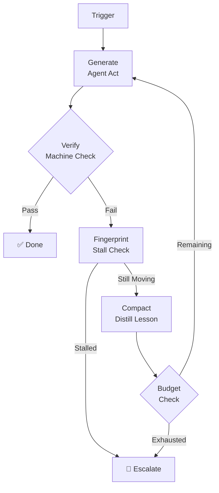

# Chapter 20: Loop Engineering

There is a third discipline in AI development that most teams discover only after they've been burned by the first two.

**Prompt engineering** taught us to write better instructions. **Context engineering** taught us to curate better inputs. **Loop engineering** is the discipline of building systems that run, verify, and improve themselves — without requiring a human to read every output.

## The Core Problem

Every agent you've built so far has a silent dependency: you. The agent runs, produces output, and then waits. Waits for you to read it. Waits for you to decide if it's correct. Waits for you to fix the prompt, retry the call, and check again.

This works when agents run a few times a day. It breaks catastrophically when agents run hundreds of times, or when the work takes 20 minutes per attempt, or when your team ships five agents simultaneously.

Your eyeballs are the bottleneck. The way out is not reading faster. It's encoding your judgment into machinery that scales.

## What Loop Engineering Is

Loop engineering is the practice of building the verification, feedback, and escalation logic that surrounds an agent — so the system grades its own work and only asks a human for help when it's genuinely stuck.

A loop-engineered system has:

1. **A machine-checkable termination condition** — not "improve the code" but "all 214 tests pass and ruff reports zero errors"
2. **Structured feedback** — not the raw error trace, but a distilled lesson that helps the agent do better next time
3. **Stall detection** — the ability to recognize when it's making the same mistake repeatedly and stop burning budget
4. **Escalation logic** — a clear rule for when to give up and call a human

## What This Chapter Covers

- **20.1 The Three Disciplines** — how AI development evolved from prompt engineering to loop engineering and why each level unlocks a new capability ceiling
- **20.2 Anatomy of an Engineered Loop** — the five required components of a self-running system
- **20.3 The Self-Correcting Fix Loop** — a complete implementation with verification, fingerprinting, and escalation
- **20.4 Machine-Checkable Termination** — the most important principle in loop engineering; how to write termination conditions that a machine can actually evaluate
- **20.5 Failure Fingerprinting** — how to detect stalls before they burn your budget
- **20.6 Context Compaction** — keeping the loop context clean across many attempts
- **20.7 Self-Improving Loops** — the four mechanisms by which a harness improves itself over time

## Who This Chapter Is For

You've already built agents that work. Now you want them to work *reliably*, at *scale*, without you watching every run. This chapter is for engineers who are moving from "impressive demos" to production systems that run in CI/CD pipelines, process backlogs overnight, and handle thousands of tasks per day.

If you've ever found yourself re-running an agent because the first attempt failed and you had to manually decide whether to retry — this chapter is for you.
