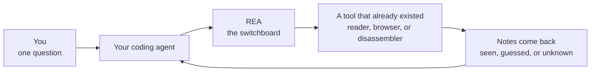
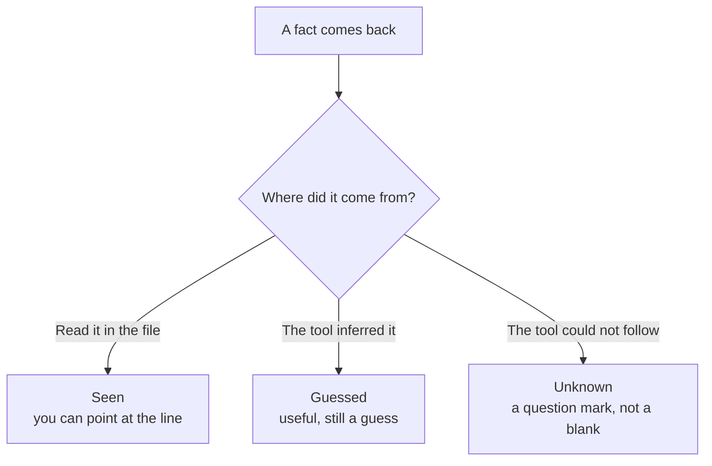
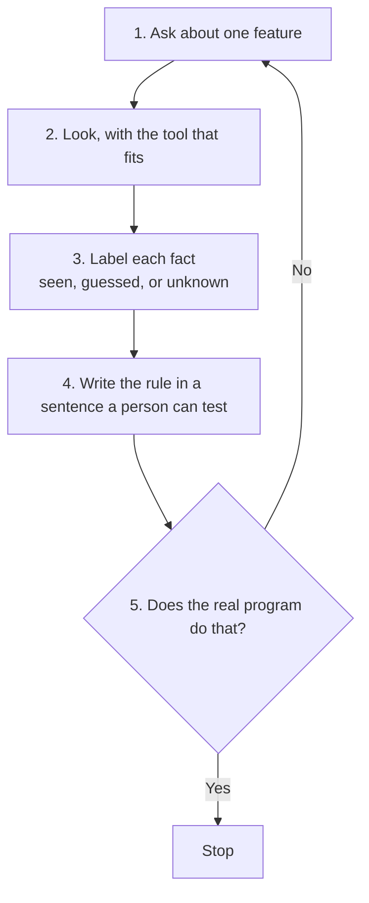
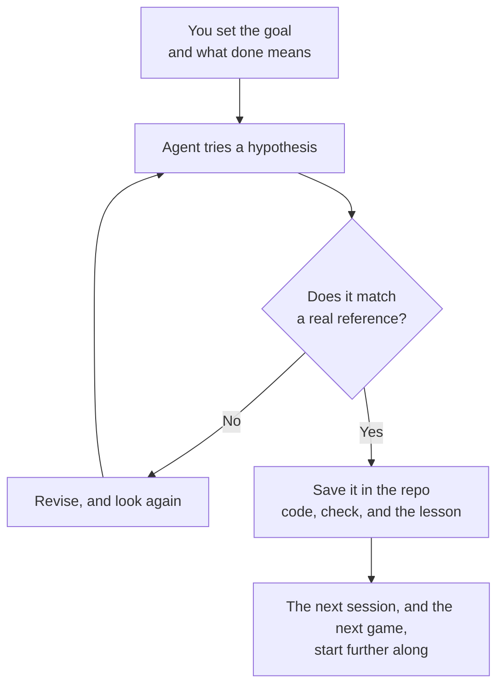
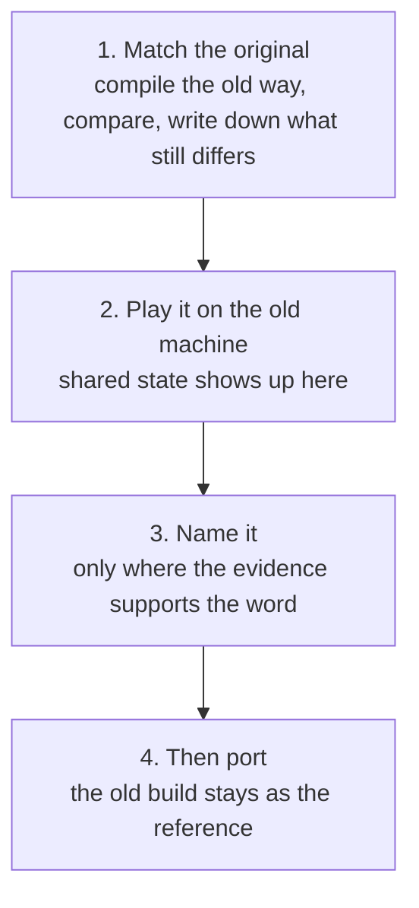
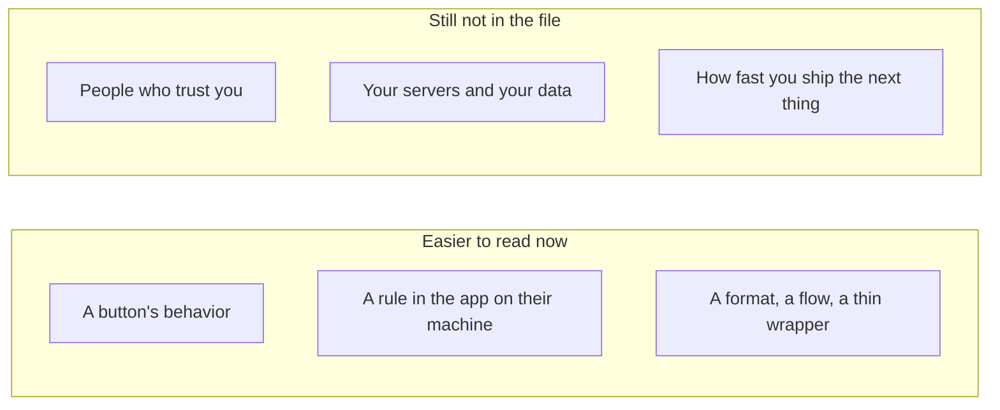

# 27. Reverse Engineer Anything

You have used a program that does something clever, and you have wanted to know *how*.

Not the marketing sentence. The actual rule. Why does the dinosaur in Chrome speed up? Why does `200 + 10%` on the Windows calculator come out as 220, not 210? Why does a notes app update itself without you downloading a new installer?

That curiosity has a name: **reverse engineering**. You start from the finished thing and work backward until you can explain the behavior. People have done it for decades with radios, game cartridges, and file formats. What changed in October 2026 is who can start. A coding agent can now open the old tools for you, look, and come back with an answer. A project called [REA](https://github.com/morluto/rea) — Reverse Engineer Anything — is the thing that made that loop famous.

This note is the plain version. You do not need to know the names of disassemblers. You need to know what the loop is, what an honest answer looks like, and where it still fails.

## Start with something you already understand

Take a toaster.

You do not have the factory drawings. You do have the toaster. You can watch what it does: bread goes in, a lever goes down, a timer runs, the bread pops up. If you are careful you can open it and see the heating wire, the spring, the little switch the lever hits.

That is reverse engineering. You are not inventing a toaster. You are explaining one that already exists.

Software is the same idea, with one annoying difference. A toaster's parts are visible once you take the cover off. A program is often shipped as a finished box: the company compiled the human-readable code into instructions only the computer is meant to run. "Opening the cover" means using a tool that turns those instructions back into something a person can read. The tool is old. The skill used to be rare. An agent can now hold the screwdriver.

Three public write-ups sit behind this chapter, and this chapter is not a copy of any of them. [Rana Adeel Tahir](https://ranaadeeltahir.com/blog/how-to-reverse-engineer-anything/) installed REA and used it on an app already on his own computer. [Firstlaunch](https://www.onfirstlaunch.com/blog/reverse-engineer-anything-rea-explained) asked what the sudden fame changes for someone shipping software. [N0zoM1z0](https://rea.tools/blog/touhou-reconstruction/) used the same habit on whole games, for weeks, and caught his own test lying.

## What people thought they were looking at

In the first week of October 2026, REA went from a quiet repository to the top of GitHub. Demo videos showed an agent taking a small feature apart and describing the rule. Star counts shot up: on the order of 145,000 by 12 October, and past 200,000 a couple of days later, depending on who checked. Releases shipped almost daily.

Stars measure looking. They do not measure being right.

The clips people shared were small, well-understood features. Careful side-by-side tests were thinner, and at least one early comparison found that a capable agent, *without* REA, got close on the easy cases. Sometimes it was faster. That does not make the project fake. It means the new part is narrower than the trailer.

The new part is this: you no longer have to be the person who knows which tool to open. You have to be the person who can read the answer and notice when it is bluffing.

## What REA actually is

REA is not a mind that understands programs. It is not a new way of taking a program apart. It is a **switchboard**.

You already talk to a coding agent: Claude, Codex, Cursor, or whatever you use. That agent is good at reading and writing, and bad at opening the specialized tools that inspect a finished program. REA sits between them. The agent asks REA a question. REA starts the right existing tool, waits, and hands the notes back.

You can also skip the agent and type the same steps yourself. Both doors run the same workflow. If the agent did something, you can do it again by hand and compare. An investigation you cannot repeat is just a chat log.

The file you hand it decides the tool. You do not need the product names to get the idea:

| What you have | What happens | What you need installed |
| --- | --- | --- |
| A website, or an app written in JavaScript | REA reads the files, or looks at the page in a browser | Usually just Node, or a normal Chrome-family browser |
| A phone app | REA unpacks the package the way Android developers already do | The usual Android reading tools |
| A normal desktop program, compiled | REA opens it in a disassembler you already own | That disassembler. REA does not include one |
| A saved recording of network traffic | REA reads the recording | Node |

A disassembler is the "open the toaster" tool for compiled programs. It turns machine instructions back into a rough listing a person can scroll. There are a few well-known ones. Some are free, some are paid, and REA does not bundle them. If you do not have one, REA should say "I cannot look," not quietly borrow a copy.

One rule is worth remembering. For a compiled program, REA picks **one** of those tools and stays with it. If that tool cannot answer, REA says so. It does not quietly ask a second tool and staple the two answers together. Mixed notes are how a confident wrong story gets built.

Those tools run as their own programs, with a time limit. If one hangs, it gets killed. Your agent does not hang with it.

## The notes are the actual product

Here is the part that matters more than the switchboard.

Every look comes back as a bundle of notes tied to the exact file that was read. A hash of those bytes is part of the notes, so you cannot accidentally explain version 1.2 with scribbles you took on version 1.1.

Each fact wears one of three labels.

**Seen.** It is in the file. You can point at the line. "This file imports the crypto library."

**Guessed.** The tool derived a relationship. It did not read a sentence that said so. "This file probably loads that one." Useful, and still a guess.

**Unknown.** The tool can see that *something* is loaded, but the path is only decided while the program is running. The notes keep a question mark. They do not delete the arrow and pretend nothing was there.

Why the labels exist: a language model hates a hole. Hand it a pile of raw disassembly and it will finish your sentences. Hand it notes that already say seen, guessed, or unknown, and it has somewhere to put "I don't know yet."

That is the whole trick. Bookkeeping.

The notes get huge. A small app can turn into megabytes of labelled graph, and one published analysis of a notes app produced a file hundreds of megabytes big. You do not paste that into a chat. You save it, then ask a smaller question: a summary, one file, a walk that starts from a name you care about, or a diff between two versions. The expensive read happens once. The thinking happens on the notes.

A phrase from the project is worth keeping. **Missing coverage is unknown, not absence.** "We did not get that far" is a different sentence from "nothing is there."

## A session is one question, then a check

You do not point REA at an app and receive its source code. You ask about one feature. Something comes back with the labels attached. If you want to trust it, you check the rule against the real world: a log, a screen, a second run. If the check fails, you ask a better question.

Going back is the success path. A confident paragraph that nobody checked is a story with better fonts.

### Two rules small enough to hold in your head

Asked how Chrome's offline dinosaur speeds up, the inspection found a rule in the running game's script. Start at 6. Add a tiny amount on each update. Stop at 13. You can watch the dinosaur and see whether that matches.

Asked about the percent key on the Windows calculator, it found that after a plus sign, percent means "a share of the first number." So `200 + 10%` is 200 plus 10% of 200, which is 220. Not 210. Not "10% as a separate idea." You can type it and see.

In both cases the useful output is a sentence a person can test, with the evidence beside it. A wrong guess about a compiled program can wear the same confident tone. The check is the point.

### A notes app that updates itself

Adeel asked a homelier question of an app he already had installed, read from copies of the files, without publishing any keys. The shape of the answer is the part worth keeping.

The program you install is a short loader. The app you actually use is a second package. A newer copy of that package can already be sitting in the app's own data folder, downloaded by the app itself. Before the new package is allowed to look finished, the loader checks a signature against a certificate that was baked in when you installed it. A half-written download never gets to pretend it is a real update. The app's own log then matches the story: download, verify, save, and the next launch loads the new package.

That is a design you can admire without owning a disassembler.

- Keep the installed shell small. Ship the app as a package the shell can swap.
- Trust a signature you baked in, not a hash that arrived in the same document as the download link. Anyone who can swap the link can swap the hash.
- Check the bytes in memory, write a temporary file, then rename it. A crash halfway through should not look like a successful update.
- Leave a way out for the day the new package needs a newer shell than the one people have, and fall back to the copy you shipped if the new one will not load.
- Log every step in plain text. The log is how you find out whether the code you read is the code that ran.

Notice what the tool did **not** do. The most important handoff in that loader — "load whatever package path we just decided" — stayed unknown, because the path is chosen only while the program runs. The notes were right to shrug. A person went and read a few hundred lines. On a huge minified file, the tool ran out of memory and honestly reported that it had not seen the interface talk to the rest of the app. Reading that as "the interface never talks" would have been the mistake.

Unknown means go look. It does not mean case closed.

Most of REA only *reads* files. A separate set of tools will click through a page, or watch a program you named while it runs. Those use your permissions. Their notes are kept apart from the "I only read the file" notes, so a thing you saw happen cannot be laundered into "it was sitting in the file the whole time."

Reading a file is looking. Running a program is running it. Treat an unknown program the way you would treat an unknown file you were about to double-click.

## When the project is a whole game

The clips were one feature. [N0zoM1z0's essay](https://rea.tools/blog/touhou-reconstruction/), from 10 October 2026, is the other scale: reconstruct old Touhou games so the behavior can be understood, and later carried into a version that runs on a modern computer, or into a mod.

Before August 2026 that work was manual. You sat with one function until you could explain it. You tested the explanation against the game. The map lived in your head. Getting further meant more of your hours.

What changed was permission. You set the goal, and you set the rule for accepting a result. The agent picks the next experiment. If a comparison fails, it can go look at the function that called this one. It can write a tiny diagnostic and let that result choose the next try. Your attention moves to the direction of the project, and to whether the checks are actually checking what you think they are.

Four jobs, and they are not the same person.

- **You** name the goal and what "accepted" means.
- **The agent** proposes a guess and runs the experiment.
- **The check** compares the result with something real. One kind asks "do these instructions match the original?" Another asks "when I play this path, does the game end up in the state I expected?" A mismatch is a place to look.
- **The repository** is the memory. A chat ends before a large reconstruction does. If the reason for the last change lives only in the transcript, the next session starts from scratch. Put the code, the evidence, the check, and the lesson in git.

### The test that passed, and was wrong

The first game in that write-up, *Imperishable Night*, continued a public reconstruction by a group called GensokyoClub. Their history was kept. The author's own continuation starts on 13 August 2026. About eleven days later there was a playable Linux version. A web version followed. A 64-bit Linux release was recorded on 30 August. Those are his checkpoints, lined up with public git history on 10 October. They are not a stopwatch we ran.

The calendar is the least interesting part. Two functions can each match on their own and still keep *separate copies* of a value the game meant to share. You only see that when something runs. So the check moved to the center of the work.

Then the check itself was wrong, in a way a green tick hides.

In September, a bug reported from a Switch port led back to how the game scoops up items. The reconstructed code compared the player's power with `0.0`. The original game used `128.0`, which is "you are at full power."

Think about that for a second. Power in this game does not go negative. Comparing it with zero is almost the same as saying "yes, always." So above the collection line, items could fly toward the player even when the player was not at full power. The rest of the condition was fine. One number was the whole bug.

And the function had already passed an "exact match" test.

Here is why, in toaster terms. Imagine you check that two machines have the same wiring diagram, but you never check the number printed on the resistor. A rebuild can put that number at a different address in memory. The comparison tool was smart enough to ignore the address difference. It was not smart enough to read the number stored there. The wiring matched. The resistor said 0 when it should have said 128.

The fix on 2 September corrected the number and taught the comparison to actually read it. A wider pass over 1,548 of these floating-point references found twelve more bad ones, inside five functions that had already been accepted. The test now includes numbers it is *supposed* to reject. Anything that had slipped through the weaker test had to be opened again.

That is the lesson, and it is larger than one game. When you cannot personally read every line an agent writes, your confidence sits on the checker. A blind spot in a shared checker spreads across hundreds of functions before you notice. Fixing the game included fixing the test, and then testing the test.

### The next game should not start from zero

The second game, *Shoot the Bullet*, opened on 29 August with zero confirmed functions. The game was new. The way of starting was not. About twelve days later there was a playable Windows build. Along the way, nearly every identified function had source, and nearly all of those had passed an exact comparison.

The number worth keeping is not twelve. It is that a lesson from the first game had become a check the next session could run without living through the original mistake: build the whole program early, because isolated matches hide shared state, and when you compare a reference, also compare the data behind it.

A lesson in your head helps while you are in the room. A lesson that is a command in the repo helps after you have gone.

The third game, *Lotus Land Story*, is the rude version of the same claim. It is an old PC-98 game: a different kind of computer, four programs that have to cooperate, hardware the Windows titles did not have. Other people had already gathered notes on that machine. As of 10 October 2026 the old-computer version runs. The author had played complete routes through their endings and checked saves. A modern 64-bit port was still underway, with the old version kept as the reference for how the port ought to behave.

The machine changed. The habit did not. Follow one question to a result, and let the result pick the next experiment.

### Matching the bytes is not the same as understanding them

An exact match tells you the reconstructed code behaves like the original instructions. It does not tell you what a field *means*.

"The value at offset 1C" is a true sentence and a useless one, if you are trying to move the game to a modern computer. A modern port needs to know which object owns that value. So there is a slower pass: watch how the game writes the field, and what it does with it, and only then give it a name. If you are not sure it means "invulnerability time," a dull name is kinder to the next reader than a confident guess. Leave the reasoning next to the code, so they can see where the word came from.

The order that fell out of doing this more than once:

The playable old build is a second check. The first asks "do the instructions still match?" The second asks "does the game still behave?" They catch different mistakes. Changing a type can change the instructions. Changing who owns a value can split one piece of state into two. Either failure should be visible before you keep going.

The first game had playable modern ports *before* some of the later audits on the original machine, and that hid defects. The later workflow puts the old build first, so you have something to play before anyone starts a port.

### Credit, and a disagreement that gets to stay a disagreement

GensokyoClub's public notes, as that essay checked them on 10 October 2026, say further work on their reconstruction stays private until it is finished. They turn away contributions that are mostly model output. The maintainers describe what it costs to watch a difficult volunteer project become the foundation for someone else's much faster continuation. That foundation is what made the first game's continuation possible. The history was kept on purpose, and the continuation is marked as a continuation.

The disagreement is about how the work should proceed, and how a contribution gets judged. In the older craft, understanding a function and rewriting it were the same person's job. You trusted that person, because the reasoning happened while they worked and often never left their head. An agent can now use code and build tools a project already published, and go after the next function on its own. Someone still has to set the standard and notice when the output is wrong. Communities get to decide how much of that shift they want.

The choice in the essay is to keep going in the open, with the inherited work credited, so a later person can see *why* an implementation was accepted even if an agent typed most of it.

We are early. Agents can outrun checks that were built for one person and one function. When a shared tool is wrong, you fix the tool and you reopen everything it had blessed. The question the essay leaves is the useful one. What access, what feedback, and what saved knowledge would let an agent work on this reliably? If you cannot answer that, the speed is a story.

## Where it still needs you

A few limits show up the moment someone uses this on a real app.

The notes are heavy, because everything is labelled. That is the price of the honesty. Ask for the summary. Do not drag the raw file into the chat and hope.

Reading files has a ceiling. If a program decides a name only while it is running, a static read cannot follow it. Sometimes the next step is reading the code yourself. Sometimes it is watching the program run, which you have to ask for on purpose. The tool's job is to show you the gap, not to narrate over it.

Compiled programs still need a disassembler, and the disassembler still needs a person who notices a bad reading. REA moves quickly enough that the advice file from the latest branch can describe a command your installed version does not have yet. If you want a run you can repeat next month, pin a version.

And somebody still has to read the result. REA does the boring parts well: pick a tool, run it inside a fence, say what it knows. The judgment stays with you.

## If you are the one shipping

Tools like this make one kind of advantage cheaper to copy. A feature a person can see and click. A rule that lives in the app on their computer. A file format. A clever flow. A thin product that is mostly a prompt in front of someone else's model.

None of that was a strong moat. It is getting weaker.

What is still hard to copy is everything that is not in the file you shipped them: why you are building it, the people who already trust you, the channels you earned, what you learn from real use, and how fast you ship the next thing. Your servers, your data, and your users are not in that file.

Putting secrets and business rules on the server was good advice before this repository existed. It is the same advice now, with a shorter clock. Scrambling the client code slows a curious person down more than it slows an agent with a weekend.

## Use it the way the project asks

The code is open source. The project's own line is: lawful research, education, making things work together, preservation, and software you own or are allowed to examine. Plenty of terms of service forbid this even then. If you are unsure, that is a lawyer's question, not a README's. Figuring out how a feature works is not the same act as copying someone's product to sell as your own, and the first does not excuse the second.

A few practical courtesies fall out of how the tool is built.

It runs on your machine. The results still go to your agent's model provider, under that provider's rules. Think about that before you open anything you would not paste into a chat.

Install it from the place people can actually point at: the repository [morluto/rea](https://github.com/morluto/rea), the package `rea-agents`. Lookalike downloads showed up in the same week as the stars. The project has said it did not ship a mystery Windows zip.

Paid disassemblers stay paid. If you do not have a license, you do not have that tool.

## What to remember

Reverse engineering did not become easy. Starting became easy.

You are explaining a finished thing, the way you would explain a toaster after taking the cover off. Ask about one feature. Read the labels. Believe the question marks. Check the sentence against something that is not the model's paragraph: a log, a screen, a second run.

Then check the checker. A test that only looks at the wiring can bless a machine whose resistor still says the wrong number.

If you are building the thing rather than reading it, assume a stranger can now read the part you shipped to their computer. Put the part that matters where that stranger cannot open it.

The tool list and the install notes live in the [repository](https://github.com/morluto/rea). More case studies are on [rea.tools](https://rea.tools). This note is in conversation with Adeel's [how to reverse engineer anything](https://ranaadeeltahir.com/blog/how-to-reverse-engineer-anything/), Firstlaunch's [what the viral repo does](https://www.onfirstlaunch.com/blog/reverse-engineer-anything-rea-explained), and N0zoM1z0's [Touhou reconstruction](https://rea.tools/blog/touhou-reconstruction/).
